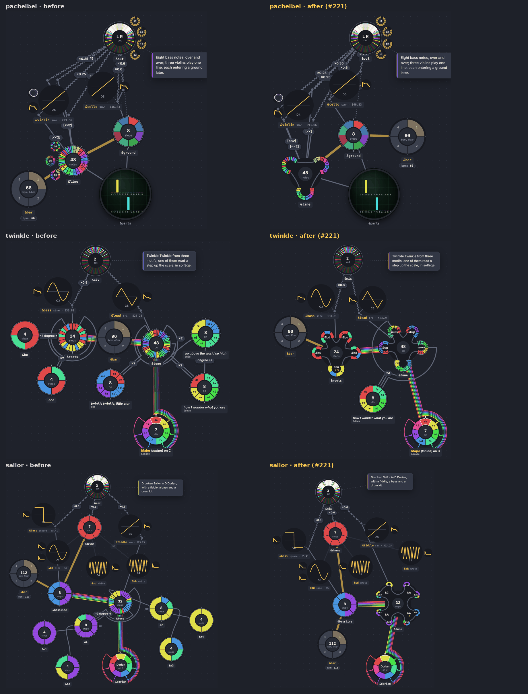

# 014 · A splice is a bulb on its braid's track; a cell spliced once has no node of its own

**Date:** 2026-10-08 · **Status:** accepted (owner, #221)

## Context

A braid that splices other cells (`&line &(…) &(…) &(…)`, `&tune &up &down &mid!2`) was drawn as one flat ring, its refs unrolled all the way down, and each spliced cell as a wheel of its own elsewhere in the graph (`&(…)` as a petal). The same notes were drawn twice, the structure the code states (which part is which motif, which repeats, which is nested) wasn't drawn at all, and a piece of motifs filled the graph with small wheels, each wired once to its player. Over the library, 102 of 941 nodes were cells spliced into one braid and read nowhere else.

## Decision

- **The wheel is a track.** A braid's ring and its splices are one smooth closed curve, its steps along it in time. A spliced unit bends out of the ring into a **bulb** and back: its ends join the neighbouring steps, its own steps go round it. A splice inside a splice is a bulb on its bulb: one rule at any depth. The way out to a bulb and back (its stem) takes no time; a repeat (`&x!2`) goes round its bulb that many times.
- **The cursor bends**: from the hub through each bulb's stem and hub to the step playing now, at the cell's pace.
- **A cell spliced into one braid only, and read nowhere else, is drawn there** and has no node of its own; its edges (its `over=`, what it reads) are drawn from the braid, as a petal's are. `&(…)` spliced into a braid is one.
- **A cell read elsewhere too is a net-ref:** a bulb drawn with its own notes in their colours, outlined dotted; its edge comes in through the reader's loom to the outside of each bulb that shows it. A cell that is one splice and nothing else (`&mid &down`) is one bulb, showing what it splices.
- Picks (`&x[i]`) are taps, not splices: they stay as they are ([decision 012](012-picks-are-taps.md)).

*Before and after, from `node tools/gallery.mjs golden 3 pachelbel twinkle sailor`.*

## Why

The owner's proposal: the code says which notes come from which motif, and the drawing should too, on the wheel that plays them. A bulb is a picture of a splice that keeps the invariant every wheel has (the hand meets each step at its time), so the same mechanism covers a tape, a resonator's tines, a braid's taps and nets: a track, read by a head. A once-used cell is part of its player, not a separate thing to wire up.

## Consequences

- No sound changes: only the graph is drawn differently (`GraphModel.bulbs`, `layout/track.ts`).
- The library's layout improves: 100 fewer nodes, crossings 34.8 → 25.2, overlap 12.7 → 0 (`src/layout/quality.baseline.json`).
- ~~A cell drawn as a bulb can't be tapped open from the graph on its own.~~ Amended with [016](016-arranging-at-the-input.md) (the owner, on the taps' wheel): a bulb is the cell it splices, tapped it opens that cell's sheet, held it switches it off (dimmed); a tap of a meter's bus is a bulb on its table, its sub-net leaving from there (`GraphEdge.bulb`, `bulbAt`).
