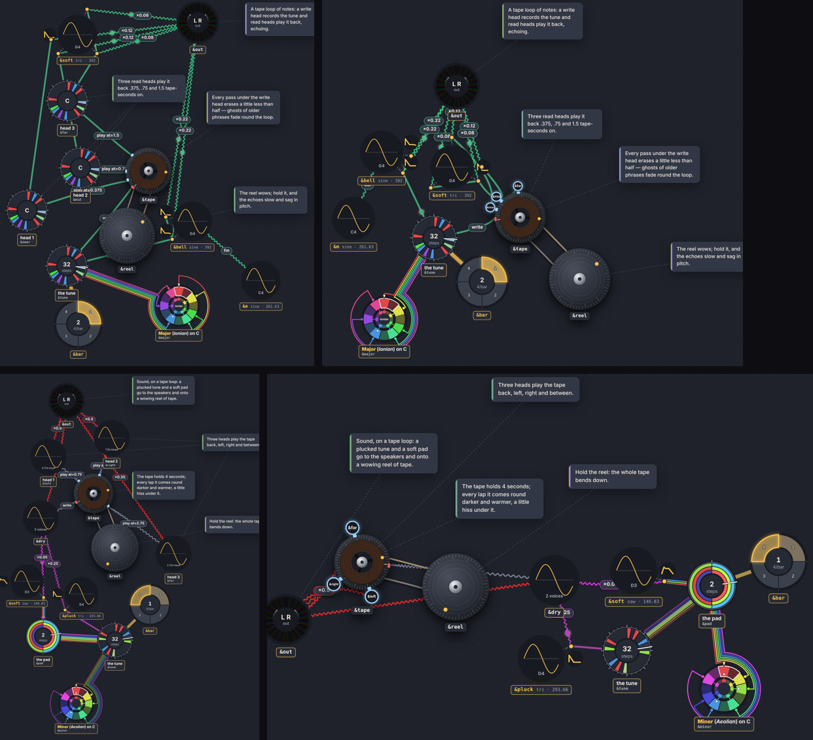

# 021 · A tape's read heads are bulbs on it: one rule for every sub-wheel

**Date:** 2026-10-10 · **Status:** accepted (owner: the request, and the layout baseline it records)

## Context

A tape (`&tape step=&reel write=&tune length=6`) was drawn as a turntable with its heads marked on its rim, and each read head (`&near play=&tape at=.375`) as a wheel of its own elsewhere, wired back to its mark with a `play at=…` edge. The layout turned the tape so each mark faced its head's wheel, and pulled the head's wheel round towards it (`src/layout/tape.ts`, `aims.ts`). Every head in the library takes nothing but its tape: it is a place on the tape, as a splice is a stretch of its braid ([014](014-splices-are-bulbs.md)) and a tap is a slot of its table ([016](https://github.com/yggi/cells/blob/main/docs/decisions/016-arranging-at-the-input.md)). A gate's only voice became a bulb on the gate the same way (#234). Four rules, written one at a time.

## Decision

**A cell that is only part of another is drawn on it, as a bulb, not as a node of its own.** The rules are one table in the code, `src/layout/subwheels.ts`, tried in order. Where it sits is the host's own coordinate for it, written in the code:

| bulb | on | when | where (from the code) | turns with |
|---|---|---|---|---|
| a splice | a braid | read by its braid only, once, no pick or delay | its time on the track | the braid's rim (`shift=`) |
| a tap | its table | a name in a stepped table of names | its place in the table, fanned over the top | nothing: the fan stays |
| ~~a voice~~ | ~~a gate~~ | (dropped: a gate's voices are not part of it, they keep their nodes and their sound is wired into the gate; a kit's are, below) | | |
| a voice | a kit (a table of voices) | played by the kit only | its piece of a drum kit, by its name (`layout/kit.ts`: `drumPlaces`) | nothing |
| **a read head** | **its tape** | **takes nothing but the tape; `at=` in seconds** | **`at=` of `length=`, clockwise from the write head** | **the layout's turn of the tape, not the reel** |

- The edge from the host to the bulb is the host's drawing, not an edge. A bulb's other edges: a splice's are drawn from its braid (it has no place of its own off the track); a tap's and a read head's **leave from the bulb**, where it is on its host.
- Any bulb is its cell: tapped, it opens its sheet; held, it switches it off (dimmed).
- **A tape turns two ways, and the heads follow only one.** The reel runs under its heads (the rim, the recording and the reel's hand turn); the heads stay put, so their bulbs do too. The layout turns the whole wheel to face its heads at what they play into (`fitTurn`: it still keeps their spacing): the bulbs turn with it, and so do the edges leaving them (the drawing through the head's handle, the layout by turning `GraphEdge.bulbAt`, which the graph gives unturned).
- A head stays a node, its mark and `play` edge as before, when it takes more than its tape (`level=&lfo`), reads at a clock (`at=&bar`, whose place the drawing doesn't know), is what the tape records (`&tape write=&a`, `&a play=&tape`: a loop, whose write edge is drawn), or has no room: clockwise from the write head, a head whose bulb at the smallest size would touch the write head or a bulb before it (two heads at one `at=`, a stereo pair; `at=0` or a whole `length=` round, on the write head) keeps its node, so each head can be tapped.

*Before (left) and after, from `node tools/gallery.mjs golden 3 echotape soundtape`.*

## Why

The owner's request: a tape's heads sit on it as sub-wheels. A head is where the tape is read, not a separate thing to wire up, and its delay is already its place round the wheel. Written as one rule, the next host (a resonator's exciters, already pads round its wheel) is a row of the table, not a fifth special case.

Measured over the library's six tape pieces, three seeds (`tools/probe/tape-heads.test.ts`, `tape-aims.test.ts`; [the note](../notes/tape-heads.md)): all 15 heads qualify; 15 fewer wheels; crossings 53.3 → 53.1, weighed by what they cross 117.2 → 118.7; no overlap.

## Consequences

- The tape no longer faces its heads' cells (they have none) but what its heads play into. Several heads into one hub (`&out`, one mix) can't all face it at their fixed spacing: the layout's aim term, which measures that, rose 44.6 → 260.7 and isn't comparable across the change. What the eye sees is an edge from a bulb across its own tape: 3 of 60 over the six pieces and three seeds, as before; the tape test allows one a piece.
- Saved `.cells` pieces are not affected: only the drawing changes.
- A note `about=` a head is drawn to its tape (`about=(&near &mid &far)` is one note to `&tape`): the head has no node to point at.
- The `play` edges and their `at=` labels are gone from the graph; the head's place is its delay (its sheet and the code still say it). How sub-wheels and their edges are labelled, and names that don't fit: [#274](https://github.com/yggi/cell-studio/issues/274).
