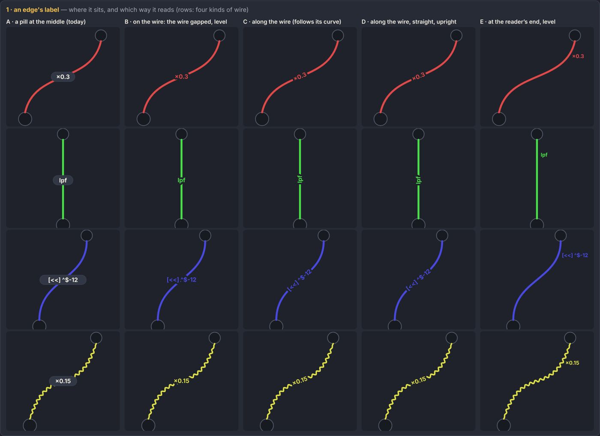
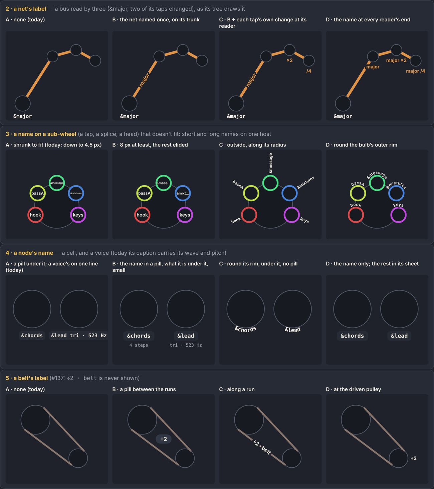

# 034 · Labels sit on what they name: an edge's on its wire, a net's once, a name too long for its bulb round its rim

**Date:** 2026-10-13 · **Status:** accepted (owner, on #137: 1 as recommended, 2 C with tap sockets, 3 D, 4 B with a rim option, 5 C) · Issues: #137, #274

## Context

The graph labelled each thing its own way ([the pass](../notes/edge-styles.md)): an edge's transform was a pill
floating at its spline's middle, often off its wire or under a wheel (`×0.3` beside its sound wire, `×0.5` under
`&loop`'s name); nothing named a net, a meter's net or a belt; a name on a sub-wheel (a tap, a splice, a tape's read
head) was shrunk to fit, down to 4.5 px, or clipped (`&messag`); a voice's caption (`&pad saw · 261.63`) was unlike
every other node's name. The options were mocked side by side (`node tools/gallery.mjs labels`):

## Decision

1. **An edge's label is on its wire** (option D, B where steep): along it, upright, the wire gapped under it by a halo
   of the background; level where the wire is steeper than 60° (a vertical label is hard to read); slid along the
   wire to the first place clear of every wheel and its name (`wire.ts: wireLabel`). No pill.
2. **A net is named once, on its trunk** (option C), by its owner's name; each tap's own change (`×2`, `/4`) sits on
   the wire near its reader, just before a **tap socket**: a ring on the reader's rim where the net comes in. The net
   itself runs on under the reader to the next, as before.
3. **A name too long for its bulb goes round the bulb's outer rim** (option D): inside while it fits at 7 px or more,
   else on an arc over the bulb at a readable size (`glyph.ts: rimArc`); the same for a tape's read heads.
4. **A node's name is a pill under it, what it is under that, small** (option B): a voice's `tri · 261.63 Hz` under its
   name, as a cell's label has its `&name`. A small wheel (96 px or less) with another close under it names itself
   round its rim instead, where its pill would land on that one.
5. **A belt's label runs along its pulling run** (option C), by the edge rule.

Edges are a step bolder with it (`--edge-w` 5).

## Consequences

- The edge sheet's bare tiles put a sound wire's label above its voice (the wire leaves its top and loops down to a
  card drawn under it); in a graph the card is above.
- A meter's net still has no label: its traces carry no transform, and its meter's ring names it.
- Labels are placed by the wheels' positions each time they move; a label never covers a wheel unless no place along
  its wire is clear, then it takes the roomiest.
