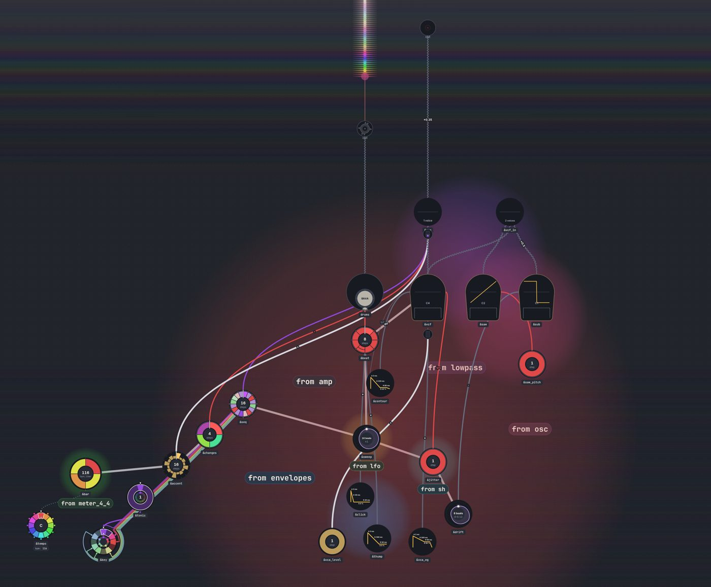
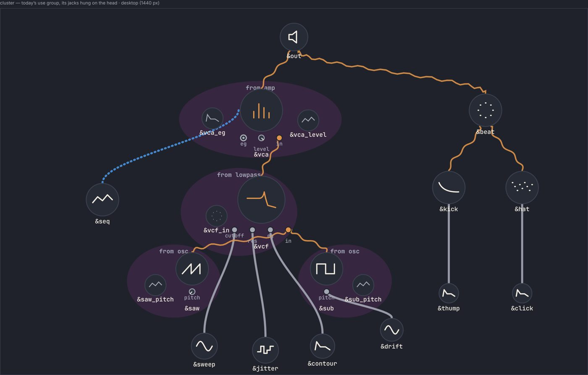
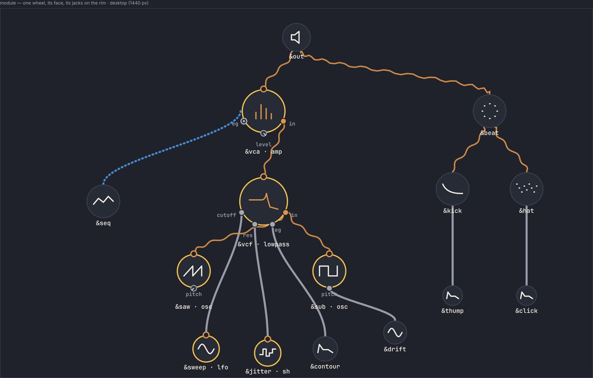
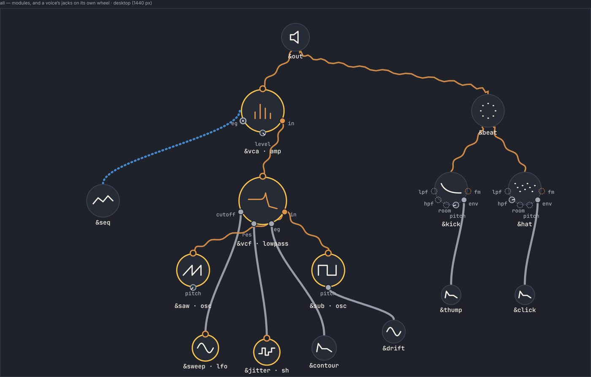
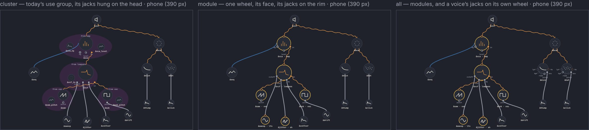
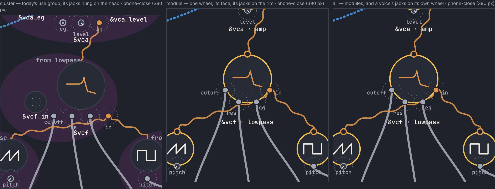
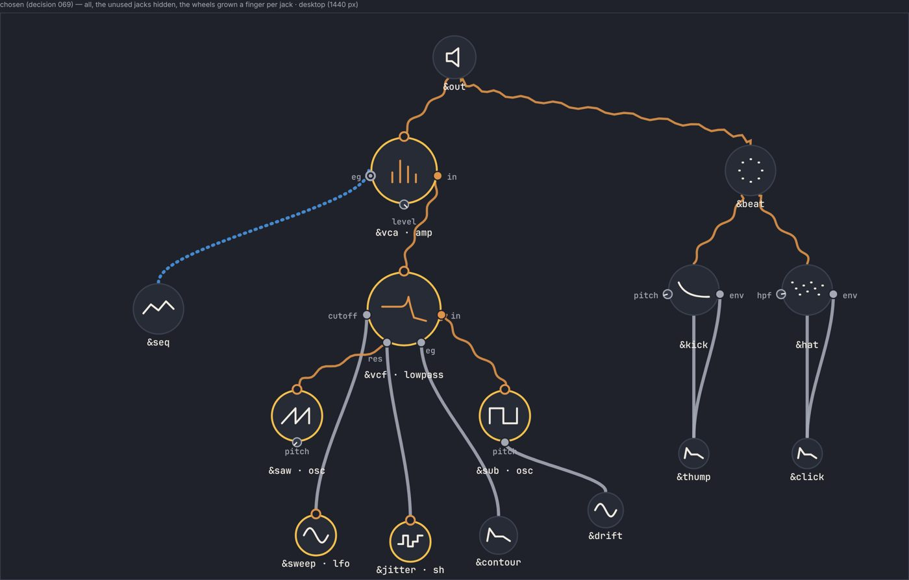

# A module drawn as one wheel with its jacks: the mock-up

Date: 2026-11-05 · Status: done: the owner chose `all` with the unused jacks hidden, and the wheels grown ([decision 069](../decisions/069-module-wheels.md)) · Issue: [#554](https://github.com/yggi/cell-studio/issues/554) (modular rung 7 of yggi/cells [docs/notes/modular.md](https://github.com/yggi/cells/blob/main/docs/notes/modular.md)); next, [#555](https://github.com/yggi/cell-studio/issues/555) (dragged cables) · Pictures: `node tools/gallery.mjs modules` (the options) and `golden 3 patchbay` (today), both with yggi/cells v0.17.0 installed unsaved (the pin is v0.16.0, which has neither Patchbay nor the modules)

The question: how a module (a `from` line on a fragment with a signature, yggi/cells decision 065; the modules, decision 067 §3) and a voice's patch points are drawn, before anything is built. The piece is Patchbay, yggi/cells' reference patch. The jacks are the ones cells' `jacksOf` (`@yggi/cells/engine/patch`) gives for it. The options are drawn as a schematic in the app's theme, laid out by hand, not by the app's layout (`tools/gallery/modules/Sheet.svelte`).

## Today

Patchbay is 28 nodes and 37 edges. Each module is a use's cluster ([decision 038](../decisions/038-use-groups.md)), washed and named by its line ("from lowpass", "from amp", "from osc"). Four of its nodes are a module's private cells, defaults and inputs the piece never wrote: `&vcf_in`, `&vca_eg`, `&vca_level`, `&saw_pitch`. A cable into a module is a plain wire into one of those cells or into the head, and it doesn't say which jack it fills.

## The options

**cluster** (the issue's 2): today's cluster, with the jacks hung on the head as a row of tabs.

**module** (1): a module is one wheel. Its face is the head's own glyph (a filter's curve, an amp's meter, an LFO's wave, an S&H's steps), with an accent rim. Its jacks are on the rim: inputs over the lower half, the output on top. The private cells are gone.

**all** (3): as `module`, and a voice's jacks on its own wheel too (Patchbay's kick and hat: `lpf`, `hpf`, `room`, `pitch`, `env`, `fm`).

A jack drawn **filled** holds a cable; **◉** holds a value set on the line (`&vca`'s inline envelope); a **knob** has no cable, its pointer at its default; **dashed** has no value written, so a cable can't go in yet (cells' `patch` refuses it). Sound is a wavy wire, CV a solid one, and the notes a dotted bus, as the graph's palette has them.

On a phone, the whole patch fitted to 390 px:

On a phone at 1:1 round the filter, each jack's 44 px finger target dashed:

## What the pictures show

1. **`module` takes four nodes out of 28** (the private cells) and draws every cable into the jack it fills. The patch reads as a patch: oscillators into a filter into an amp into the card, with the modulation coming up from below.
2. **`cluster` keeps the noise it has today and adds tabs to it.** The private cells sit in the wash beside the head; the tabs, the head's name and the wash's name compete for one strip under the head.
3. **Six jacks crowd a voice's wheel.** At 40 px the kick's and hat's labels run together, and their targets on a phone are about 24 px apart, half a finger. Four of the six are unset (dashed): they are places a cable can't go until a value is written.
4. **Four jacks on the filter's 58 px wheel put their 44 px targets edge to edge on a phone.** Spread over the lower half (from 0.15π to 0.85π), they are 44 px apart, the least that works. A wheel with n jacks needs a radius of about 44 (n − 1) / (0.9 π) to keep its targets a finger apart along the arc of the lower half: 47 px for four, 78 px for six. (Corrected in #560: a fingertip measures the straight line, so decision 069 keeps the chord 44 px, a radius of 22 / sin(0.45 π / (n − 1)): 48 px for four, 79 px for six, 22 px for two, where the arc rule gave 16.)
5. **The order of a module's jacks against where its sources sit makes crossings.** The signature's order (cutoff, res, eg) is the rim's order, and the layout would have to place the sources under their jacks. Hand-placed here.
6. **The notes have no jack.** They are the product's (a gate meter's) and stay so: a cable is a parameter, a melody isn't one.

## Recommendation

**`all`, with the unset jacks hidden at rest.**
- A module is one wheel, its private cells folded into it (as a use's unread cells already fold into its name, decision 038).
- A voice shows the jacks that hold a cable or a value.
- While a cable is dragged (#555), every jack of the band it can take shows, set or not, lit. An unset one says it needs a value first (cells' `PatchError`).

That gives the kick two jacks at rest (`pitch`, its value written, and `env`) instead of six, and keeps a wheel's rim at four jacks or fewer in Patchbay. A wheel grows to fit its jacks a finger apart on a phone, by point 4's rule.

What would change it: a piece whose voices hold five or more jacks at rest. Then the jacks go on a ring outside the rim, not on it.

## The choice

The owner (on #556): "1) all with unused hidden 2) grow the wheels": [decision 069](../decisions/069-module-wheels.md). Drawn as the fourth column, `chosen`:

In Patchbay no wheel needs to grow (the filter's four jacks need 48 px, and it is 58), and the kick and the hat show two jacks each.

## What was open

- The option: `cluster`, `module`, `all`, or `all` with the unset jacks hidden (the recommendation).
- The finger rule (point 4) as the wheel's size, or a ring outside the rim.

Nothing is built beyond the mock-up's sheet (`tools/gallery/modules/`). The answer becomes a decision here, and #555 builds on it.
