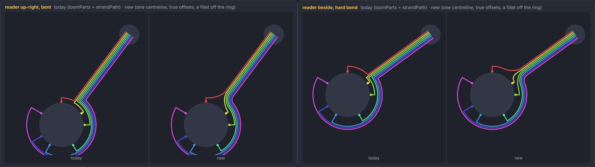
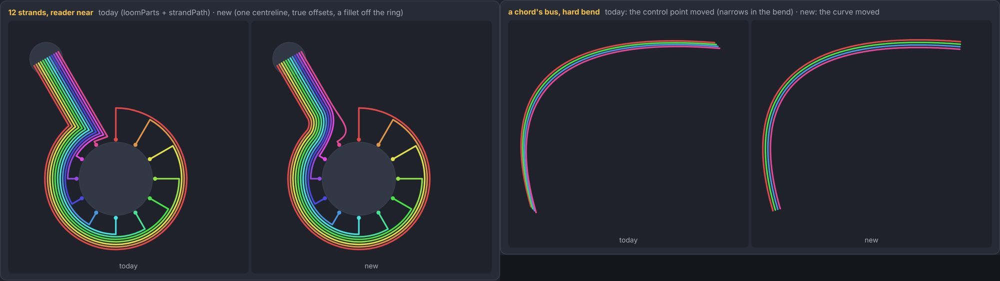
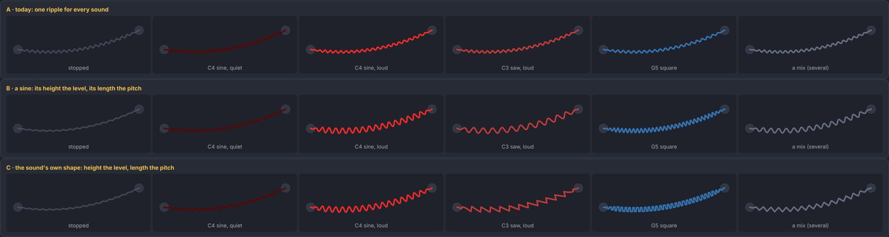
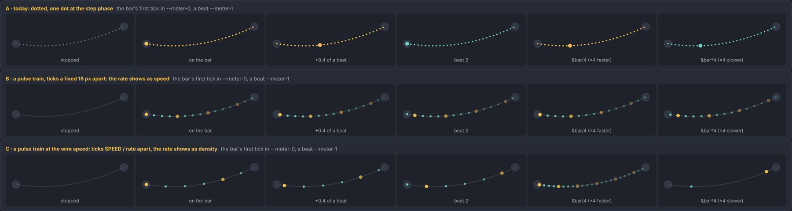
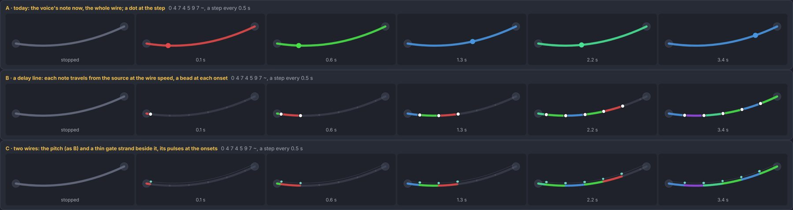
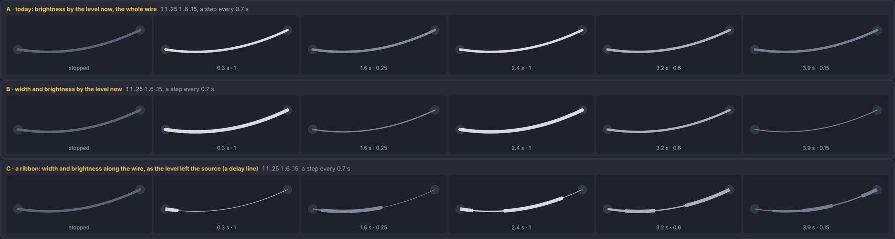

# Edge styles: what an edge shows, and the bus's geometry

**2026-10-10 · open: surveyed, planned and decided (owner, 2026-10-10: D1 C travelling, D2 C, D3 B, D4 C, D5 a constant, D6 still); steps 1–4 built · #137, #238, #183, #150; on top of [nets.md](nets.md)**

The owner's ask: edges and net segments by colour and style, the bus's geometry, one mechanism and one place for the rules. Meter nets are good as they are. The colour bus needs a constant width through bends and a clean join between the loom and the bus. The other edges: what they show should follow what their source pushes, one style per band, and the payload should drive it while playing (a wave's height and length by the sound, pulse trains on clocks). Some edges are unstyled.

Pictures: `node tools/gallery.mjs edges` (every kind today), `golden 3 chords pop` (the real graph), and the new subject `node tools/gallery.mjs edge-mockups` (`tools/gallery/edgemocks/`: the options below, plain SVG on the theme; the geometry prototypes are in `proto.ts`). No open PR touches the edges: #268 adds the tower axis to `Graph.svelte`, #240 changes the layout, #267 and #269 are MIDI and the tutorial.

## What is drawn today

37 kinds on the edge sheet, by band:

| band | kinds | stopped | live | gap |
|---|---|---|---|---|
| none | `about`, `is`, `base` | a faint hairline (`about`); dashes (`is`, `base=`: definitions) | `is` takes its voice's colour; the others never live | none: structure |
| sync | `step`, `step·cycle`, `step·loop`, a belt, the meter's net | dotted (`0.5 8`) | the tick's colour, one dot at the step's phase | the dot says where in a step, not the clock: a ×4 clock looks like a ÷4 one |
| cv · pointer | `braid` (refs, picks, `[<<]`, `^n`), `over`, `map` | solid; a bus as strands | the note under the source's playhead | a bus narrows in bends and kinks off its loom (below) |
| cv · value | `voice`, `pitch`, `level`, `lpf` `hpf` `lpq`, `write`/`play` of notes, `trigger` `velocity` `gate` | solid | one colour along the whole wire: the voice's note, or the level's brightness | the payload's shape never shows; `trigger=` is white (below) |
| audio | `mix`, `mix·gain`, `fm`, `excite`, `couple` | one ripple | the fundamental's hue | one ripple for every sound: amplitude 2.5 px and period 11 px, whatever it carries |

### Under-styled or mis-banded: what can be inferred

- **The sound through a selector is CV** ([#238](https://github.com/yggi/cell-studio/issues/238)): `&keysPart → &parts → &song → &out` in 10 pieces is drawn as plain lines. Inferable: a wire whose source sounds (a mix, a table of mixes, a selector reading one) is audio, decided once in `engine/graph.ts`.
- **`trigger=` (the gate, #264) is white.** It is a melody into a gate, but `carried()` takes the colour from the target's note (`INTO_VOICE`: `voice = target`), and a gate is not a voice. Inferable: `trigger=` is the `voice` port (pitch and gate), coloured by what its source plays. `velocity=` and `gate=` are levels and are drawn as levels already.
- **Edges colour by the target, not the source.** A melody's wire takes the voice's heard note, after the transform, so `&roots − 24` shows the note two octaves down along the whole wire, before and after its label. The rule the owner asks for, *the edge follows what its source pushes*, puts the source's value on the wire and the transform at the label.
- **Levels** (`level`, `lpf`, `hpf`, `lpq`, `velocity`, `gate`) show only the level now, as brightness.
- **A melody into its voice is a 2-wire bus** (gate and pitch: nets.md §3), drawn as one wire with a dot.
- **A belt has no label** (#137): `÷2 · belt` is never shown.

Genuinely open (not inferable): whether a **pointer** (a ref, `over=`) moves at all, since decision 3 calls it an indirection and the reader's wheel already shows its content; how fast things travel (D5).

### Where the rules live today

Six places: `edges.css` (stroke by band and by state, `transition` set twice: #137); `PulseEdge.svelte` (seven path builders, the colour in five branches, `GAP`, `STRANDS`, the pulse radii, the sheath); `MeterEdge.svelte` (its own flash and `color-mix`); `BeltEdge.svelte` (its own colour mix 45/55/25: #183); `flowedges.ts` (`carried()`: which voice colours an edge); `geometry.ts` (`strandPath`, `loomParts`, `ripplePath`, `radialPath`) with `STRAND_GAP` in `looms.ts`.

## 1 · The bus's geometry (no choice needed)

Two faults, both in how strands are offset:

- **Width.** `strandPath` and `loomParts`' run move a strand by moving the spline's control point along one fixed normal (the chord's, or the exit's). In a bend the normal turns, so the bundle narrows (a chord's bus on a hard bend, right). Where it meets the reader the curve no longer runs along the exit's direction, so the strands close up there too (*Chords*: `&minor → &chords`). Fix: one centreline per bus, sampled; each strand is its true offset (`offset()` in `proto.ts`). The width is then the same along the whole length.
- **The join.** A strand comes round its track and turns off it at a right angle onto the run (`L` after the arc), each at its own distance out, so the bundle leaves the loom in steps. Fix: every run starts at one distance out (the bundle leaves square), and each strand turns through a fillet tangent to its track and to its run. An inner track's fillet is longer and gentler, an outer one's tighter, so they nest like a harness bending round a corner.

**Built** (`src/layout/wire.ts`: `bundlePaths`, `loomParts`; tested for width and crossings in `wire.test.ts`), with two findings on the way:

- **The fillets are short (1.5 gaps), and the bundle doesn't leave square.** A strand's track goes by how near it is to the exit, and its place across the bundle by its order on the bus, so the two don't nest like a ribbon. A long fillet on an inner track sweeps through the outer tracks that are still coming round, and the test's crossings went from 0 to 2. Any fillet that stays under about two gaps is safe: it rounds the corner and keeps the topology.
- **A flat bus ends under its wheels.** On a hard bend the true normal at an end swings the bundle's end out past a small node. First fix: over the last 20 px a strand's place turned back to the chord's; the review of #272 found that this lets strands meet there (17–61 % of hard-bent chords, by how hard). So a bus whose wheels' sizes are known is cut inside each rim, by more than half its width, and stays true to its ends; the settling is left only for an end of no known size (the edge sheet's bare nodes).

The same centreline serves the hop (a bus out of a reader's hub), a pick's strands, a ref written several times and the tines. The run now leaves the loom along its straight lead (a cubic, no corner at its end).

## 2 · One mechanism: the wire is a delay line

While playing, what is *s* px along a wire is what its source pushed *s* / SPEED seconds ago, at **one visual speed for every edge** (mocked at 90 px/s). The head of the wire is now. This is not latency: nothing is heard later. Each band then draws the same idea its own way:

| band | what travels | drawn | stopped |
|---|---|---|---|
| audio | the sound | a wave: its shape the voice's, its height the level, its length the pitch (λ = SPEED-like, compressed: an octave up ×1/√2, 5 … 28 px) | a flat, faint wave |
| sync | ticks | a pulse train: a tick every SPEED / rate px, the bar's first in `--meter-0`, a beat `--meter-1` | dotted, as today |
| cv · pitch | notes | runs in each note's colour, a bead at each onset (the gate) | neutral |
| cv · level | a level | a ribbon, its width and brightness the level as it left | neutral |

So the edge's state is the source's (what it pushes, before the transform on the tap), one style per band, and the payload drives it. A net's taps share their owner's signal, so it is computed once per source per frame, not per edge. Meter nets stay as they are: they draw the same sync signal, flashing on the tick.

### The choices (owner, decided 2026-10-10)

Decided: **D1 C, travelling · D2 C · D3 B · D4 C · D5 a constant speed · D6 pointers stay still.** The options as they were put:

**D1 · Sound.** A today · B a sine, its height the level, its length the pitch · C the sound's own shape (sine, triangle, saw, square), height and length the same. A fourth, D, is C travelling along the flow at the wire's speed (four frames on the mock-up sheet).

*Recommended: C, travelling (D).* A mix of several sounds is neutral, as now. It falls back to C still if the profile says moving waves cost too much.

**D2 · Clocks.** A today · B a pulse train with ticks a fixed 18 px apart, the rate shown as speed · C a pulse train at the wire's speed, ticks SPEED / rate apart, the rate shown as density.

*Recommended: C.* It moves at the same speed as the notes the clock steps, so a clock and its melody travel together, and `&bar/4` reads as four times as dense. The catch is that a slow clock shows one tick on a short wire; the dotted rest line stays under it.

**D3 · A melody into its voice.** A today: the voice's note on the whole wire, a dot at the step · B a delay line, notes as runs of colour with a bead at each onset · C two wires, the pitch as in B and a thin gate strand beside it.

*Recommended: B.* One wire carries both halves: the colour is the pitch, the beads are the gate. C is the literal 2-wire bus, and it costs a second strand on the most common edge (69 examples).

**D4 · Levels.** A today: brightness now · B width and brightness now · C a ribbon along the wire.

*Recommended: C.* An envelope or a duck shows its shape travelling. B is the cheap fallback.

**D5 · The speed.** One constant in px/s (mocked at 90), or relative to the tempo (a beat = n px, so pieces at different tempi look alike). *Recommended: a constant:* simpler, and a fast piece looks fast.

**D6 · Pointers** (refs, `over=`). Still lines, coloured by what they point at now (as today), or a delay line as in D3. *Recommended: still.* They are indirections (decision 3), and the reader's wheel shows what is read.

## 3 · Where it lives (one place for the rules)

- `src/layout/wire.ts` (pure, tested): the centreline (a spline, or a loom's exit then a curve), `offset`, the bus's strands, the loom's fillets, a wave along a curve, the places of pulses and runs. It replaces `strandPath`, `loomParts`' run and `ripplePath` at their call sites. Its test checks the width: adjacent strands keep their gap within ±0.3 px along the whole length, on bends.
- `src/layout/signal.ts` (pure): what a cell pushes at time *t*, by band: its note (the plan's events), its level, its ticks (rate, phase, level), its sound (pitch and shape). It is read back over the wire's length (*t* − *s* / SPEED). Loudness is the only input from audio (`LiveSource.waveform`'s RMS, passed in).
- `src/ui/edgeStyle.ts` with tokens in `theme.ts` / `app.css`: one table by band and state (widths, dashes, rest opacity, pulse sizes, the wave's range). `edges.css` reads its tokens; the magic numbers of #137 and #183 move here.
- `PulseEdge` becomes a dispatcher over per-band drawers that share the centreline (bus, wave, pulse train, runs, ribbon); `MeterEdge` and `BeltEdge` read the same sync signal; `carried()` names the source, not the target's voice.
- Cost: one signal per source per frame; pulse trains and runs by dash offsets on a fixed path where they can be (no path rebuilt); waves quantised (height and length in buckets), so a path is rebuilt only when its bucket changes. Measured with the `profile` skill before and after, on Bach 847 (#36) and Pop.

## A pass over every kind (2026-10-13, #398)

The edge sheet, 39 kinds × 7 states, read for kinds left unstyled or half-developed. Built:

- **Structure** (band `none`): only `is` had a style. `about` is a faint hairline (`--edge-w-about`, `--edge-about`: dots are a clock's), `base=` dashed as `is` (a definition, a copy).
- **At rest, a value**: a reference (`braid`, `^`, `×n`, `[<<]`) wears the note its source's wheel shows at the cursor (D6: coloured by what it points at), as a melody does since #393; a level its value as width and brightness (D4's ribbon, still), live too where no ribbon travels (a slow LFO with no clock, Cellscape II's `hpf=`: read from its curve, `valuesOf`).
- **A groove over a kit of several drums** is one wire of hits (#393's rule), not a bus of the kit's members in grey.
- **The pill's lanes** flash on their clock's beat while their section is chosen, the bypass always (`beatFlash`, shared with a meter's net).

The sheet itself (`tools/gallery/edges/`): kinds split where `over=` reads something drawn otherwise (`over·kit`, `over·taps`); a column for the tower layout (its sigmoid); a row for the selector's pill (`PillCell`: the layout's own `tapLoom`/`pillOf`, at rest, on the beat with all or one section chosen, off it); and a live tile whose source has no playhead at that moment is marked *silent* — what it shows there is a fallback the app never draws (an edge is live only while its source sounds), the cause of what looked like refs and chord strands losing their colour live.

1. **The bus's geometry** (§1): `wire.ts` and its test, the loom's fillets, the chord bus, the hop, the reader's end. No choice needed. Verified with the `edges` and `zoom` sheets before and after, and the golden graph's crossings unchanged.
2. **Bands right. Built.** Since decision 016 the parts play straight into the sound card, so #238's chain (part → table of parts → selector → card) no longer exists. What still carried sound on a CV wire, over the 75 examples, was always a reference: a mix spliced into the sound card (*Canon*, *Pertonos*) or a scope (*Hypercell*, *Test Tones*), a read head into a scope, and a voice in a pattern of voices (7 pieces). Now a `braid` wire is audio when its source sounds, and on up: a cell sounds if it sounds itself (`sounds()`, the rule tapes already used) or if anything its braid splices in does, so a pattern of voices spliced into another carries sound too (*IDM*'s `&pat → &break`, *Brothers*' `&break → &tracker`: found in review, #273). Its colour is the first voice it splices in. A wave follows any path now (`rippled`, `wire.ts`: lines, arcs, curves), so a reference keeps its locked end. `trigger=` is a pitch port. Left as it is: `flowRanks`' own notion of what sounds (`start.ts`). Reading the band there would move voices into patterns in the layout, a change of its own.
3. **Rules in one place. Built.** The CSS numbers (widths, dashes, each state's opacity, the meter's backbone, a belt's colour mix) are `--edge-*` and `--belt-*` tokens in `app.css`; the ones drawn in code are `EDGE` in `theme.ts` (#137's tokens, #183's magic numbers; #137's duplicate transition was gone already). Which colour a live edge takes is one tested rule, `liveColour` (`src/ui/edgeStyle.ts`), and it reads the source first: a melody's wire is the note its source's wheel shows, and sound into a voice (FM, `excite=`, `couple=`) is its source's. Checked by the edge sheet against main: of 41 tiles only the nine whose colour rule changed differ by a pixel (`voice` and its delays, `trigger`, `write`, `midi`, `fm`, `excite`). Found in review: sound into a voice whose source sounds no note of its own (a modulator never played) takes the note of the voice it feeds; and a sound edge's colour had read `ctx.sound.note()`, which isn't reactive, so it kept what it caught as it went live (often no note yet: every live sound edge in *FM* and *Sympathy* was neutral on main). It reads the frame now. Not done here: splitting `PulseEdge` into per-band drawers. With no new drawer yet it would only move code; step 4 brings the drawers (the wave, the pulse train, the runs, the ribbon) and splits it then.
4. **The payload. Built** (§2, as chosen: D1 C travelling, D2 C, D3 B, D4 C, D5 a constant 90 px/s, D6 still). `layout/signal.ts` (pure, tested) lists the steps a cell sent, read from its clock's own time map (`q`, `stepAt`: exact through swing, agogic bars and a moving tempo), and lays them on a wire; `ui/payload.ts` says which payload an edge carries and reads what a source sends at a step (an oscillator's units as levels, its wheel showing a curve); `ui/EdgePayload.svelte` draws it over the edge's own line, which stays under it, faint. Found on the way:
   - **Cost is in the DOM, not the maths.** The first build cost 5–9 points of main-thread time at ×1; the new functions themselves were under 1 % of it. A fast melody puts dozens of runs on a wire, an element each; drawn instead as one path per colour (and one for every bead, one per tick level), at 30 frames a second, with the payload kept mounted while playing (a note's start only shows it) and the wave's paths cached by height, length and phase, it costs about 2–3 points at ×1 over main (three alternating runs: the Prelude 31.6 → 33.9 %, Baustelle II 30.3 → 33.0 %). At ×4 every heavy piece is saturated with or without it (~90 %); long tasks rise (the Prelude 58 → 106 in 15 s).
   - **An oscillator's wheel has no segments.** `&swell map=lin loop=…` draws a curve: its levels are read from its units.
   - **Held back** (review): with reduced motion (motion made in code, which app.css's rule can't reach) and while the page is behind. The ticker's load scale over 1.2 turns it off until the page has kept up for 5 s, twice as long each time it falls behind again up to a minute (`payloadGate.ts`, tested), so a payload that is itself the load doesn't flicker. Its edge is drawn as before step 4 then. A voice's loudness is read 8 times a second and shared by the edges that carry it (a waveform is a fresh 8 KB buffer); a wave is no shorter than 9 px, about three frames' travel, so a high note's wave doesn't seem to run backwards.
   - **The splitting of PulseEdge** planned for step 3 is the payload component: PulseEdge keeps the geometry and decides; EdgePayload draws what travels.
5. Leftovers: the belt's label (#137).
