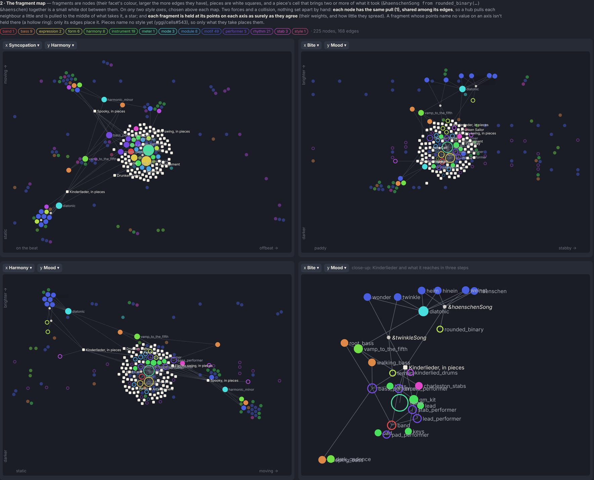

# Fragments in Cell studio: the plan and its mock-ups

Date: 2026-11-09 · Status: open: the plan the owner asked for, every question ruled (2026-11-09); the epic is [#621](https://github.com/yggi/cell-studio/issues/621), its rungs filed in both trackers (below) · Issues: it subsumes [#449](https://github.com/yggi/cell-studio/issues/449), [#586](https://github.com/yggi/cell-studio/issues/586), [#587](https://github.com/yggi/cell-studio/issues/587), [#610](https://github.com/yggi/cell-studio/issues/610), and the library half of [#585](https://github.com/yggi/cell-studio/issues/585); it needs [yggi/cells#543](https://github.com/yggi/cells/issues/543) and meets [yggi/cells#436](https://github.com/yggi/cells/issues/436), [#541](https://github.com/yggi/cells/issues/541) and [#540](https://github.com/yggi/cells/issues/540) · Pictures: `node tools/gallery.mjs fragments` (`tools/gallery/fragments/`), taken with yggi/cells at [PR 624](https://github.com/yggi/cells/pull/624)'s head (f3617df) installed unsaved, for its axes; the sheet reads whatever `AXES` the installed cells has

The owner's ask: Cell studio shows and handles fragments, the seed library first: a library cell for them, an explorable map (fragments as nodes, pieces as leaves, placed by style), `from` references followed in the code view, a selection turned into a fragment, and a fragment opened and heard reasonably by itself. An epic across both repositories, with a clean seam: no old shims kept.

## What there is (both repositories at their `main`, 2026-11-09)

- **cells has most of it**, unexposed: 120 seed files in 14 facets (folder = facet), each with an association of style points; `useOn` and `fitsAs` (insert a fragment, does it fit); a host that makes a fragment play alone, private inside `coreFragment` (#590); the learned layer, which already holds filed fragments as files (decision 048).
- **Cell studio uses almost none of it:** `resolveSeed` (compile, worker, Shorten, cables, modules) and the facet filter for modules. No fragment document, no preview, no links, no completion; the editor is a textarea over a painted copy, and the selection can't be read back.
- **The references:** 68 of 85 examples take from fragments; only 10 edges run between fragments; 80 of the 120 are taken by no example (most are Jambot's motifs and drum bars).

## The seam: who owns what

- **cells** says what a fragment is and computes everything about it: its catalogue entry (facet, signature, holes, what it takes, association, prose), a text's `from` references, where a given cell came from, the audition host, extraction, insertion (`useOn`), a piece's style, and a resolver over the seed library and a person's layer.
- **Cell studio** shows and drives it: the library's fragments cell and the map (a pure layout in `layout/`), the fragment document and its tabs, links and completion in the code view, playback, and where a person's fragments are kept.
- **No axis is named in Cell studio.** The axes are being reworked (yggi/cells PR 624: `sync harm bite mood`, after `sync harm artic energy` and `sync harm drive bright`); every picker, layout and label reads `AXES`, so the next rework changes only the pictures.

Wrinkles at the seam, each removed by a rung below:

| where | wrinkle | goes in |
|---|---|---|
| cells | 14 one-line facet modules (`BASS_FRAGMENTS` …), all exported | C1 |
| cells | `heard.ts` finds a fragment's parts by conventional names (`&groove`, `&bassline`), against decision 075; the host inside `corefragment.ts` does it by what each head compiles to | C3 |
| cells | `Used`, `uses`, `hasUse`, `USE_DEPTH`, "a `use` line", after `use` retired (#588) | C2 |
| cells | provenance stops at the piece's `from` line (`through`); nested takes (`&hh` from `gm_kit` through `drums_performer`) are lost | C2 |
| cells | `readPiece` and `readFragment`: two readers of what decision 047 calls one kind of file | C5 |
| cells | `docs/MEMORY.md` lists its decisions twice | C1 |
| Cell studio | `withUsedLine` (#610), an app-side text splice | S1 |
| Cell studio | `Piece.#used`: "past the code's last line" taken to mean "from a fragment" | S1 |
| Cell studio | `useTag`: a use faked as a tag `use "id"` to borrow tag clusters | S1 |
| Cell studio | `INSTRUMENT_MODULES` and `GENRES` written by hand | S1, S4 |
| Cell studio | "use" in docs and comments; `docs/MEMORY.md` names the pin twice (v0.21.0, v0.16.0) | S1 |

## Ruled (the owner, 2026-11-09)

1. **"The cells defaults" are the seed library**: cells' own fragments, read-only here and versioned with its releases, beside a person's own, which the app keeps and edits.
2. **The breaking renames** (`Used` and its kin, the facet exports) go in one minor release of cells, with Jambot's pin move.
3. **Several fragments per document**, as proposed (C5).
4. **Extraction's signature** as recommended; the alternatives are kept for a need (below).
5. **The axes stay abstract**: the machinery is generic over `AXES`.
6. **Hubs are not set apart by a threshold.** No "taken by 10 %" and no list of defaults: what the map does with `meter` must follow from one rule applied to every node, so no case like `vibrato` (9 pieces of 85, just over a tenth) flips at a boundary.
7. **A document's parts (C5)**, each point as proposed:
   - **Which lines a part is:** its signature's heads and every line they read (a collection's closure), wherever they sit; lines no part reaches are the piece's own, played when the file opens and never given; two signatures naming one head are an error.
   - **Its main parameter** may have a line in a document, the line the file plays with as a piece; taken, the parameter stays required (`&twinkle from kinderlied &key`), so a part never keeps the document's key unasked. Decision 065 amended for documents only.
   - **Addressed** by its head in a text, `kinderlied › twinkle` in the catalogue; **a hash per part**, so a lockfile records each head and the piece's own lines move none.
   - **Its association** keyed by its head in the frontmatter (`parts: { twinkle: { association: […] } }`) now, and in its text once #436 is ruled; #436 is pushed.
   - **Kinderlieder moves in, breaking:** the six motif files become its parts, their ids respelled in one change (Migrate rewrites `&twinkle from twinkle &key` as `&twinkle from kinderlied &key`), with no forwarding release.
8. **Certainty per axis** comes with #436: an association written in the text, a point's axis with decision 079's reach (`bite=.55 ± .1`); one spelling, the language's. Until then the map measures it: the points' spread, and an axis a point doesn't name. A reach's meaning: the effective reach is √(spread² + reach²), the certainty 1 less it over the axis's half range, a missing axis a reach of the whole axis (certainty 0); no constant but the axis's range. Queries don't read it in this epic (a reach as a window in a query's distance is a question of its own, [yggi/cells#644](https://github.com/yggi/cells/issues/644)).
9. **The map's balance is a control:** one slider, style ↔ structure (the anchors' strength against the springs', their ratio the only real choice: scaling both changes only how fast it settles), its default the knee a probe over the library finds (how far fragments sit from their style, weighted by certainty, against how long the edges are). Changing it or an axis re-runs the layout from where the nodes are, so they glide (the library grows its layout so already).
10. **Normalise's and Migrate's cruft** for retired forms goes, as a cells issue of its own.

## The map: two forces and a collision

- **The graph.** Nodes: each seed fragment, each example, and each **meeting point**: a piece's `from` line whose arguments bring two or more cells the piece took together (`&haenschenSong from rounded_binary(answer=&hinein, close=&heim, bridge=&weinet) &haenschen`). Edges: a line to what each argument came through (`&hinein from hinein &key`: hinein to diatonic); a meeting point to its fragment; a piece to what none of its lines passes on; a fragment to those it takes. 225 nodes, 168 edges over the library at f3617df. "Two or more" is not a tuned number: one argument is an edge, and a meeting needs two.
- **Every node has the same total pull, shared among its edges** (the owner's rule). A spring between a and b pulls a toward b by b's share, 1/deg(b), and b toward a by 1/deg(a). So a hub pulls each neighbour a little and is pulled to the middle of what takes it: `meter`, taken by 52 pieces, is a star at the centre under every projection, as are `envelopes`; `diatonic` sits among the motifs that pass its `&key`.
- **Each fragment is held at its points, per axis, as surely as they agree.** Its place on an axis is the weighted mean of the points that name it; its certainty is the points' weight (a share of its points) times 1 less their weighted spread over the axis's half range. A point that names no value on an axis says nothing there (a hollow ring on the map): PR 624 gives meters, rhythms, forms, modules and performers no mood, so on mood only their edges place them, never a centre stand-in.
- **Pieces name no style yet** (yggi/cells#543), so only what they take places them. Most take only the hubs, so they gather as a disc round `meter`: honest, and the measure of what #543 brings.
- **The two strengths**, a spring's and an anchor's, are one scale (0.2 each per tick at certainty 1, `data.ts`): a choice of the mock-up, to measure with the `probe` skill before S4 fixes it.

### What the pictures show

- **The microstructure appears** where the text has it: `&haenschenSong` pulls `haenschen`, `hinein`, `heim`, `weinet` and `rounded_binary` together; `&twinkleSong` pulls `twinkle`, `wonder` and `ternary` (the close-up).
- **It can't show `hinein` above `weinet` on mood:** the seed gives all six Kinderlied motifs Kinderlied's point (sync .1, harm .12, mood .95), apart only in bite (.4 to .7). A fragment's point is the style it was written for, not a reading of its own notes. That reading is yggi/cells#541's (a style reader with a confidence per axis); its readings would give each motif a point of its own, and the map would show the difference by itself.
- **`vibrato` sits at the centre of style space** (.5 .5 .5, weight .25), a centre stand-in yggi/cells#540 means to remove.
- **9 of 85 examples** would be placed by their non-hub fragments under the first mock-up's rule; under this one all are placed, most by the hubs alone.

### Certainty in the syntax

There is no certainty per axis today. What there is: a weight per point (`association[].weight`, decision 041), a point that leaves an axis out (PR 624), a query's `axisWeights`, a style cell's reach per axis (`bite=.55 ± .25`, decision 079), and #541's `confidence` per axis for a reading. Ruled (8): it comes with #436, in 079's spelling.

## The other mock-ups

- **The library** ([fragments-library.jpg](fragments-library.jpg)): the seed library as one more cell beside the wheel, as the tutorial and the MIDI collections are; its discs the facets, a person's own fragments its inner ring. A tap opens the map.
- **A document of fragments** ([fragments-document.jpg](fragments-document.jpg)): Kinderlieder as one file, each tune a fragment it gives by its own signature line (`&twinkle from &key`), then the piece. Opened, it plays the piece; its parts tab lists what it gives; another piece takes one by its head, `&twinkle from kinderlied &key`.
- **Heard alone** ([fragments-preview.jpg](fragments-preview.jpg)): cells' audition host gives a fragment what it lacks; the view draws it by facet (a drum grid, a roll, chords, a form's sections, keys, knobs, a meter's ticks, the band's roles), and what the host stood in for as dashed chips, each changeable. What a fragment reads of the style (`lead` reads `&style[bite]`) becomes sliders.
- **The code view** ([fragments-code.jpg](fragments-code.jpg)): each `from` id a link (⌘/Ctrl-click opens it; ◂ back), its gutter dot its facet; hovering an id shows the fragment, hovering a given name its chain (`&hh`: from `gm_kit` line 8, through `drums_performer`, through line 1).
- **A selection turned into a fragment** ([fragments-extract.jpg](fragments-extract.jpg)): the proposed signature (heads: what the rest reads; main: the one name it reads and doesn't define; the rest private), a check that the piece plays the same (S1), whether the library holds it already, then filed as the person's own.

## The rungs

Each a pull request with its bounds; cells' first, released together as one minor version, then Cell studio's at that pin.

**cells**

- **C1 · ([yggi/cells#638](https://github.com/yggi/cells/issues/638)) A catalogue and references.** `catalogue(layer?)`: an entry per fragment (id, facets, path, signature, holes, what it takes, association, source, prose), replacing the 14 facet modules and their exports; `references(text)`: a text's `from` lines read without resolving (the id and its span, the names, the arguments); `resolverOf(layer)`: the seed and a person's filed fragments. Bounds: 120 of 120 seed files in it once; every repository query in the tests returns what it did.
- **C2 · ([yggi/cells#639](https://github.com/yggi/cells/issues/639)) Provenance and taking a cell into the piece.** The rename around `from`; each given name's origin as a chain of `{ id, line }`, outermost first; an edit that writes a given cell's line into the piece, right for a head a `from` line names and for a collection's cell. Bound: #610's two cases (clock's `&bar`, electroswing's `&drumsOut`) play the same events after the edit, over 3 s.
- **C3 · ([yggi/cells#640](https://github.com/yggi/cells/issues/640)) Audition.** `audition(idOrText, { resolve, host? })`: a playable text, which lines are the host's, and why where it can't play; lifted out of `coreFragment`, which then uses it; `heard.ts` retires; a style the fragment reads is a host parameter. Bound: every seed file auditions with 0 errors and at least 1 event in 4 bars, the exceptions named in its test.
- **C4 · ([yggi/cells#641](https://github.com/yggi/cells/issues/641)) Extraction.** `extract(text, lines, { id, resolve })`: the fragment file and the piece with its `from` line, the piece S1-equal before and after, and `sameText` against the library. Bound: over every example, each run of consecutive `from`-free lines that defines a cell another line reads extracts and plays the same (choose the run's length and name it).
- **C5 · ([yggi/cells#642](https://github.com/yggi/cells/issues/642)) Documents of fragments** (decision 082, the next number in either list; ruled, 7). A file may hold several signatures; a part is a signature's heads and their closure; a document's main parameter may have its line, the piece's; a part is addressed by its head and hashed alone; its association keyed by its head. A piece and a fragment become one kind of file, read by one reader. Kinderlieder first, its six motifs moved in and respelled, breaking. Bounds: Kinderlieder and Twinkle play the same events before and after; decomposition and recognition find the six parts through the catalogue (their tests unchanged but for the ids).
- **C6 · Associations in the text, with a reach per axis:** #436, pushed (ruled, 8); a document's parts move their association into their text with it. Bound: #436's own (every query in the tests returns what it did, 0 event snapshots moved).
- **C7 · ([yggi/cells#643](https://github.com/yggi/cells/issues/643)) Normalise and Migrate without the retired forms' cruft:** an issue of its own (ruled, 10).
- **Needed, filed already:** #543 (every example names its style: frontmatter, its option (a)), and #541 (a style reader, which gives a fragment a point read from its notes).

**Cell studio**

- **S1 · ([#622](https://github.com/yggi/cell-studio/issues/622)) The pin and the seam.** Move to the release; `withUsedLine`, `#used`, `useTag` and `INSTRUMENT_MODULES` replaced by cells' C1/C2; "use" gone from the docs. Closes #610; #597 and #521 re-measured.
- **S2 · ([#623](https://github.com/yggi/cell-studio/issues/623)) A fragment is a document.** `Open` gains `fragment` (seed: read-only, "save a copy as mine"; mine: editable) and a back stack; a document of fragments has a parts tab; Play plays the audition, its view by facet. Bound: every seed fragment opens and plays (the smoke test's set, choose it and name it).
- **S3 · ([#624](https://github.com/yggi/cell-studio/issues/624)) The code view.** `from` ids as links, hovering an id or a given name, the facet's dot; completion after `from` (#587) from C1's catalogue. Bound: typing latency not up (the `profile` skill, before and after).
- **S4 · ([#625](https://github.com/yggi/cell-studio/issues/625)) The fragments cell and the map.** The map's layout as one pure module in `layout/` (springs that share a node's pull, anchors by certainty, a collision; any two of `AXES`; the style ↔ structure slider, a re-run from where the nodes are on any change: ruled, 9), which the library's wheel uses too when pieces name their style (#585's second rung; the `GENRES` rim retires). Bounds: a `probe` over the library before it is built (the slider's default at the knee, named; crossings; the hubs' places); deterministic (a fixed start, no `Math.random`); 0 axis names written in Cell studio (a test); the contact sheet before and after.
- **S5 · ([#626](https://github.com/yggi/cell-studio/issues/626)) A selection turned into a fragment.** The editor's selection read back; C4's dialog; filed into the person's layer (IndexedDB), compiled through `resolverOf(layer)`. Bound: a fragment filed, the page reloaded, the piece plays the same.
- **Later:** #455 (a fragment's frontmatter and association edited; a store beyond the browser).

Order: C1 → C2 → (C3, C4, C5, C6) → the release (C7 any time) → S1 → (S2, S3) → S4 → S5. #543 before S4's library half.

## Kept in mind (the alternatives to extraction's signature, if a need comes)

- No holes at all: a collection, taken by its names (the sound lines).
- Several holes: the main parameter the one read through `over=`, the rest optional.
- Self-contained: every hole optional, the piece's lines copied in as their defaults; it plays alone, but duplicates them.
- No private names: every name the selection defines a head; simpler, but a second copy collides.
- The facet prefilled by recognition, the style point by the open piece's (decision 048's filing), once #543 is in.

## Open

Nothing for the owner; each rung's own choices are named in its PR (the probe's knee, the smoke set, C4's run length).
