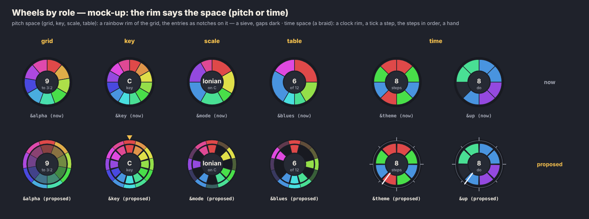

# Nets: what an edge is

**2026-10-07 · open: decided in part (below), steps 1–2 and 5 built, 3 begun, belts counted, ends locked, buses gathered · #9, #10, #27, on top of PR #136 (the gallery)**

The golden graph (`node tools/gallery.mjs golden`, PR #136) puts every kind of wheel and edge into one picture, so the flaws of the edge model show up together. This note collects what it shows, proposes one model under all of them, and splits the work into small steps. The owner's input that started it: **nets and buses** (an edge carrying `[0,4,7]` is a 3-wire bus); **edges by the signal they carry** (sync, CV, audio); **a palette that maps values to colours**; **named networks with in and out**, which unify tape heads and the meter's net, where today's edge syntax is the anonymous shorthand (like `&( )` cells).

*A mock-up for discussion, drawn by hand, not by the app.*

## Decided (owner, 2026-10-07)

1. **Every arrow follows the flow.**
2. **A product is an unnamed junction node**, shorthand for a node that could be written out with a name (as `&leadA [&walk * &lead * .3]` already is), the same way `&( … )` is shorthand for a named cell.
3. **Refs and `over=` are pointers**: indirections, reference values. `over=` is still drawn as a wide bus, because the bus is how the notes go from the scale's wheel to the theme's.
4. **Three fundamental bands** (sync, CV, audio). Visual variations come from `show=`.
5. **Syntax: the new operators come later** (after the drawing). The owner's sketch is `&<foo` (from net `foo`) and `&>foo` (to net `foo`), as in `&foo step=&<meter`. Worked through below.
6. **The canon may change:** go for the clean form, and rewrite the examples rather than keep a spelling for their sake.
7. **`show=` is decoupled between the node and the net:** a cell's `show=` says how its wheel is drawn, and its net's (the taps') drawing gets its own say.
8. **A net's style is set by its owner**: the cell whose net it is, once for all its taps, not each place it is read.
9. **How it is said:** an attribute of its own on the owner, or a decorator on the reference to the net (a tap written with its style). Not `show=`.
10. **Belts count, twice.** A belt is drawn over the wheels, two runs: every edge or wheel it crosses counts once per run.
11. **The sun dissolves into two mechanisms** (worked through below): a source of absolute time, a sync net like a meter's; and `show=brightness`, a way to draw any mode wheel.
12. **Angular locking:** a braid's edge meets its segment, generalizing a tape's heads.
13. **A step between two turntables is a belt** (built: `GraphEdge.belt`, `rigid` without `belt=`, as the tape on its capstan).
14. **A table's strands leave at their entries and gather into a bus towards the reader** (built: `busStrandPath`).
15. **Meter rings retired** (built): the net says which meter steps a cell.
16. **Placed-last for meters can be retired.** Tried, not done: see step 9.
17. **A tape and a chorus line up** (the owner likes it): a chorus is a tape with short, wandering heads, as a canon is one with long ones. A net with delayed taps covers all three.
18. **The wheels need distinguishing by role**, not only by their hub text: proposal under "The wheels".

## What the golden graph shows

Measured over the 52 examples and the golden piece (`buildGraph` compared with the `&name` tokens written on each line):

- **Edge direction is half pull, half flow.** `over`, `step`, `ref`, `couple` and `about` point from the cell that writes the name to the cell named (the reader to what it reads). `mix`, `fm`, `lpf`, `excite`, `write` and `play` point the other way, along the signal. You can't tell from an arrow which way sound or time goes.
- **The graph draws edges no line writes, and leaves out names that are written.** `[&theme * &flute]` on `&out`'s line is drawn as `&theme → &flute → &out`. That is 223 `out` edges no line writes, and 218 written names (`&theme` on `&out`'s line) with no edge. The product is folded into the voice, so a voice turns into a hub. In the golden graph `&lead` has five melodies in and three mixes out, and the picture can't say which melody goes to which mix.
- **`out` means 13 things.** It is melody into voice, envelope (`×`), level (`×`), vibrato (`+`), `lpf`, `hpf`, `lpq`, `fm`, `excite`, `couple`, `write` and `play`. The `pick` field holds a port name, a shift (`[<<]`) or a transposition (`^7`). The `label` field holds an operator, a gain or a rate (`÷2 · belt`). Port, transform and multiplicity are mixed into two strings (`src/engine/graph.ts`). The edge sheet's 30 kinds are these strings, not 30 concepts.
- **The meter's net is the only edge that is already a net, and the layout makes it, not the engine.** `ForceLayout.meterNet()` builds a spanning tree over the cells a meter steps. It works, so it should be the general case rather than the exception.
- **A written name with no edge.** `&sun sun=&cycle` draws no edge, so the sun floats off.
- **Colour belongs to the kind, not to what the edge carries.** A step edge is accent-tinted, `excite` magenta, a belt brown, a meter's net yellow, and a live edge takes its note's colour. Kind colours and value colours compete.
- **Lines through wheels.** Belts and the meter's net run under two turntables (PR #136's follow-ups).

## The model, proposed

### 1. An edge is a name written on a line

`&a` written on `&b`'s line is one edge, `a → b`, always in the direction of flow: from what is read to the cell that reads it. The **port** is where the name is written: `step=`, `over=`, `lpf=`, `write=`, the braid, a slot of a mix. That gives one rule for direction. It also makes code and graph a bijection: every `&name` token is an edge, every edge is a token, and selecting one selects the other.

### 2. A product is a junction

`&theme * &lead` is an unnamed cell, the same as `&( … )`. It is drawn as a small junction: the melody goes in, the voice is its definition (a dotted "is a"), and its sound goes out to the mix. The 223 edges no line writes disappear, and the 218 missing names get their edges. Voices stop being hubs (mock-up D).

### 3. Three bands

A wire carries one of three things. The **port** decides which, not the cell: `&bar`'s ticks drive `&theme` (`step=&bar`), and the same `&bar`'s values can be read as a melody somewhere else. In modular terms a cell has up to three outputs (gate, CV, audio), and a port reads one of them.

| band | carries | ports (today's `kind` / `pick`) | transforms on the tap | drawn |
|---|---|---|---|---|
| **sync** | ticks: gate, trigger, clock | `step=`, `loop=&x`, `cycle(&x)`, `at=&bar`, `delaytime=&bar/2`; the gate half of melody → voice | `×n` `÷n` `⟳` `belt=` | thin, dotted, pulses travelling |
| **CV** | values: pitch, level, envelope, table, `lpf` | `over=`, braid refs, `+` (vibrato), `×` (level, envelope), `lpf=` `hpf=` `lpq=` `index=`, `write=` of notes; the pitch half of melody → voice | `+n` `^n` `×g` `[<<n]` `[a:b]` | solid, coloured by its value now |
| **audio** | sound | entries of a mix, the sound card, `fm=`, `excite=`, `couple=`, `write=` of sound, a sound tape's `play=` | `×gain`, `at=` | thick, rippling at its pitch |

Most of this is already written down. `engine/attributes.ts` marks `moves` (a CV port) and `clock` (a sync port), and decision 006's sorts map onto the bands: pitch and volume are CV, signal is audio. A **wave** is the one case where the rate moves a cell across a band: an audio-rate wave summed into a pitch is FM. `about=` is not a signal. It stays a layer of its own (notes), drawn as now.

Melody → voice carries two bands at once: gate and pitch, the way MIDI to CV does. It is a 2-wire bus.

### 4. Width: buses

A wire is as wide as the number of values the source holds at once:

- a chord `[0,4,7]` is 3 wires
- a table read through `over=` is its length (`&mode`: 7)
- a selector's `[0,1]` picks 2 wires of a table of parts
- the sound card is 2 (L R)

100 cells in the examples write chords, 2 to 8 wide. A bus is drawn as parallel strands, each coloured by its own value. That is the braid in the edge.

### 5. A tap is (net, transform), and a cell is a net

Every cell is a **net**. What writes to it is its *in*: a meter's motor or rate, a tape's `write=`, a mix's entries, a melody's own braid. Every place its name is written is a *tap*, an *out*, with a transform. The labels of today's edges are those transforms. Four things that look different turn out to have the same shape (mock-up C):

| net | in | taps | transform |
|---|---|---|---|
| a tape | `write=&tune` | `play=&tape` heads | `at=.375` (a delay) |
| a canon | its braid | `&john`, `&john[<<1]`, `&john[<<2]` | `[<<n]` (a delay, in steps) |
| a meter | motor, bpm | `step=&bar`, `step=&bar/2 belt=30`, `step=cycle(&bar)` | `×n` `÷n` `⟳`, a spring |
| a mix | `[a, b, c]` (summed) | each place the mix is played | `×gain` |

So **the existing syntax is the anonymous form of a named net**: `step=&bar/2` means "tap the net `&bar`, divide by 2". No new syntax is needed to get the model and the graph right. It is needed only where one thing has two spellings or can't be said. The first such pair: **`&john[<<1]` and `play=&john at=…` are the same tap** (a delay, in steps and in seconds). A canon is a tape with three heads. Whether one becomes the other is a #10 question (orthogonality, item 2), below.

### 6. One palette: value → colour

One function, `palette(band, value)`. Kinds get no colour of their own. The band sets the stroke (dotted, solid, rippling), the width sets the strands, the value sets the colour:

- **CV pitch:** the pitch-class rainbow already in use (`noteColour`, grid-aware, [tuning.md](../language/tuning.md)), muted by octave.
- **CV level** (envelope, gain, `lpf`): lightness on one neutral hue.
- **sync:** the meter's levels, which already exist as tokens (`--meter-0` downbeat … `--meter-3`), flashing on the tick.
- **audio:** the hue of its fundamental, as bright as it is loud (`scopeBand` already does this for the scope).

That removes six kind colours (the step tint, excite magenta, belt brown, meter yellow, the about grey, the live accent) and leaves one rule.

## Syntax: `&x`, `&<x`, `&>x`

The owner's sketch, read together with decision 3 (refs and `over=` are pointers): **a name can mean the cell or what is on its net.**

| written | means | today | new power |
|---|---|---|---|
| `&x` | the cell itself, a pointer: splice it, index it, play it as a voice | every `&name` | none |
| `&<x` | a tap: what `x` actually played, on one timeline | `play=&tape`, `step=&bar` | a head on any cell, not only a tape |
| `&>x` | a send: this cell's output also goes into `x` | `write=&tune` (written on the other line) | aux sends: many cells feed one net without it listing them |

- **The tape, written both ways.** Today, the pull form: `&tape step=&reel write=&tune length=6` and `&near play=&tape at=.375`. The push form: `&tune … &>tape` and `&near &<tape at=.375`. Both spell the same edge. Only the token's line differs, so the graph doesn't change.
- **An aux send:** `&lead s=saw … &>verb*.3` with `&verb room=.9`. Today `&verb` would have to list every input itself (`&verb [&lead*.3, &bass*.1]`). With `&>`, the inputs name the net instead, and `&>verb*.3` is a mix entry written on its source's line.
- **Where `&<` differs from `&`.** A port that can only take a signal needs no arrow. `step=` can only follow a running clock, so `step=&bar` is already `step=&<bar` and stays the shorthand. The arrow matters where both readings fit: a braid or a mix. There, `&john[<<1]` is a **copy**, the braid replayed a step later. `&<john[<<1]` (or `at=`) would be a **tap**, what `&john` played a step ago. They differ once something happens only once: a `free()` moved by hand, a belt slipping, a turntable held, a restart. A canon from copies keeps the score. A canon from a tap echoes the performance.
- **Parsing:** `&<` and `&>` are free. Nothing else follows `&` with `<` or `>` (picks are bracketed, `&t[<<n]`), and a mix has no comparisons.

**Recommendation.** Add no syntax until steps 2 to 5 are drawn. The model and graph need none, since every existing form is the shorthand. Then add `&>` first, because it is the only one that says something new (a send). Add `&<` only if the copy/tap difference turns out to be heard in a real piece. Each one gets a decision record (#10, item 2: one edge, two lines to write it on).

## The sun, dissolved (decision 11)

Today one cell does two jobs: `&cycle law=fiveto12 anchor=11.55 step=84bpm` computes notes from a time of day, and `&sun sun=&cycle` draws that day as a 24-hour dial whose rim shows the twelve modes by brightness. Split:

- **A source of absolute time.** A cell that is the clock of the world, as a meter is the clock of a bar: its net is sync, and it is tapped by unit: seconds, minutes, hours, the day of the week, the week in the month and in the year, the day in the year, the month. Its own attributes: where it starts (`anchor=`, today on the law) and how fast time runs (1 the real one; faster to hear a day in a minute). A law reads it instead of keeping its own anchor. The tap's unit is part of the reference, so the open question is the spelling: a pick (`&now[hour]`), a rate like a meter's (`step=&now/hour`), or a decorator once `&<` exists.
- **`show=brightness`**: a way to draw a mode wheel (or any table read as modes), its segments shaded by how bright their mode is (Lydian 1 … Locrian 0, today the sun's `blockColour`). The sun's dial becomes: the time source drawn as a 24-hour face, beside a mode wheel with `show=brightness`.

Nothing is built yet. *5 to 12* is the only example, and it would be rewritten (decision 6: the clean form, not the old spelling).

## How it unlocks #9 and #10

- **#9, PR 3 (`Graph.svelte`, a pure tested `flowedges.ts`).** Once an edge is `(net, port, band, transform, width)`, `pulseData`'s special cases (`play`, `write`, `out`, `mix`, `step`) become one lookup, and `flowedge.ts` becomes a pure function worth testing. #132 (`voices.sync` and `routing.ts` disagreeing about where sound goes) gets one source: both read the same nets.
- **#10, item 2 (orthogonality).** Taps give each set of equal spellings one canonical form: one delay (`[<<n]` and `at=`), one rate transform (`step=&x*n/m`, `cycle(&x)`, `loop=`), one gain.
- **#10, item 6 (naming).** "Units fixed by kind" *is* the band: a sync port takes a clock, a CV port takes semitones or a 0–1 level, an audio port takes sound. "Any parameter may be a cell" means any port takes a tap of its band. Which parameters can move stops being arbitrary: the CV ports.
- **#27 (layout).** Direction, junctions and nets are what the forces read. The meter's net moves from the layout into the engine, and the layout only places it.

## Steps, one at a time

Each step is its own PR, each visible in the golden graph and the edge sheet (before and after), and each keeps saved pieces and sound unchanged until step 6.

0. **Land #136** (the gallery). It is the yardstick.
1. **The model, no visual change. Built.** Every `GraphEdge` is also a wire: `port`, `band`, `pointer`, `width`, and `from` → `to` along the flow (`src/engine/graph.ts`, tested in `graph.test.ts`). Over the examples:

   | port | band | edges |
   |---|---|---|
   | `braid` (a ref) | CV, pointer | 251 |
   | `about` | none | 246 |
   | `step` | sync | 231 |
   | `mix` | audio | 230 |
   | `voice` (melody → voice) | CV | 192 |
   | `over` | CV, pointer | 113 |
   | `lpf` `hpf` `lpq`, `level`, `pitch` | CV | 39 |
   | `fm`, `excite`, `couple` | audio | 14 |
   | `write`, `play` | CV on a tape of notes (4), audio on a tape of sound (14) | 18 |

   Widths: `over` buses are 4 to 25 wide, and 95 and 96 for the two chord tables of the Prelude. Chords on `voice` and `braid` edges are 2 to 8. No example puts an audio-rate wave into a pitch sum, so audio on `pitch` (FM) is seen only in the unit test. Still to do: `transform` (today's `pick` and `label` taken apart), and stereo as 2 wires on the sound card.
2. **One direction. Built.** The flow edge is drawn `from` → `to` (`src/ui/flowedge.ts`), so a pulse always runs along the signal: the step edge's reversed pulse is gone. `sun=&cycle` is an edge, and the sun sits by its law. That costs crossings: the golden graph's bound goes from 4 to 6 (the sun now sits among the belts), and *5 to 12* goes from 0 to 1. Not done: the layout still turns each kind round by hand (`flowRanks`, the consumers in `physics.ts`). Each of those turns already reads along the flow, but `layered.ts` remaps `source` and `target` without `from` and `to`, so it is a refactor for later (#27), with no change in the picture.
3. **Bands and palette.** Begun: in `PulseEdge` and `edges.css`, sync is dotted in the meter's colour, audio is a wave (`ripplePath`), and CV is solid. The step edge's accent tint and the `over` edge's dashes are gone. Still to come: a live edge without a voice keeps the accent yellow, a belt is brown, `excite` takes its voice's colour, and the palette as one function.
4. **Junctions.** Products become small anonymous nodes, and voices become definitions. This is the biggest layout change: watch the golden graph's crossings and the library's overlap count ([limits.md](../limits.md)).
5. **Buses.** Built for tables and chords: an `over=` edge is a bus, a strand per entry in the colours its wheel gives them (at most 12), and while it plays the entries looked up now are lit, the others dim. A CV edge carrying chords (melody → voice, a ref) is a strand per note: stopped, neutral; playing, the notes under the playhead of the cell it comes from, in the colours of that wheel's rings (the rest dim). A kit's strands are grey: its entries are voices. The golden graph's facets now include the band and the bus (`facets.ts`), so its `&theme` has two chords. Still to come: stereo, and the owner's style for its net (decision 8).
6. **Named nets.** The meter's net comes from the engine. Tape heads and a canon get one drawing. Then the language question, `[<<n]` and `play= at=`, goes to a decision record.
7. **Belts counted. Built.** `drawnCrossings` (`quality.ts`) takes a belt as drawn: its two runs, over the wheels, each counted against every edge and every wheel but its own two. The layout keeps belts short (a stiff, short spring) and places a meter with a belt where the belt crosses least (`placeMeters`: its length, with every crossing ×4 per run, beside the net's cost). The golden graph went 6 → 26 when belts were first counted, and is back at 6 with the placement. The library went 74 → 86, and is now 75: *Tape Machine* is tighter with the same crossings, and *Automaton* has one more.
8. **Angular locking. Built** for refs and tables. A ref's edge meets the wheel of the cell it is spliced into at the segment where it sits, once per time it is written (`&tune &up &up`: two strokes, at 3 and 9 o'clock). A table's strands leave its wheel from their own entries. The ends arrive along the radius from outside (`radialPath`), as a tape's head meets its reel, because edges are drawn under the wheels. The layout still bends edges between centres, so a locked end can swing round its wheel; to come: the layout knowing the ends.

   **Locking and a moving shift** (owner, 2026-10-07). Two kinds of wheel behave differently:
   - **A table's wheel is drawn in pitch space.** Turning it (`shift=`, a stepped table, a hand) keeps every segment where it is, with the same hue; only which degree sits there changes (`cellView`'s `index`). So a locked strand never moves: the scale turns under it, the way tape moves under a fixed head. Only its meaning moves, which entry is looked up there. That was a bug: the edges read the static shifts while the wheels draw the live ones (`CellGlyph`: `ctx.live?.shifts ?? ctx.shifts`, redrawn on `ctx.turned`), so a turning table lit the wrong strands. Fixed: the edges use the wheel's rule.
   - **A braid's wheel is drawn in time.** A shift turns its units round the rim, so a ref locked to its segment moves with it. Today that happens with `shift=` in the code or a hand turning a wheel (stopped), when the end should follow, like a string tied to a turning wheel. While playing, the live shifts turn stepped tables, which are in pitch space. A braid of refs that turns while it plays would have its ends travel round the rim each turn. Open: let them ride, or unlock them (centre to centre) while the shift moves.

9. **Meters laid out with the rest: tried, not done.** Placed-last (`placeMeters`) searches a grid for the spot where the meter's net and belts cross least. Replacing it with springs that aren't drawn (ground links), so a meter settles among its cells, costs crossings at every strength tried: the library goes from 75 to 89 at best (`GROUND_PULL` .15) and to 95–140 elsewhere, and the golden graph never gets back to its bound. Kept for now. What would retire it cleanly: a force that does what the search does (pushing a meter off drawn edges, towards where its net is shortest), or a net that routes round the drawing.

## The wheels (decision 18)

*A mock-up, drawn by hand.* Today a grid, a key, a scale, a table and a melody are all a full ring of rainbow wedges; only the hub's text tells them apart (`node tools/gallery.mjs wheels --fast`). The finding about shifts gives the line to draw: a grid's, key's, scale's or table's wheel is laid out in **pitch** (a position is a pitch class, fixed; turning it moves the degrees), a melody's in **time** (a position is a step). Let the rim say which:

- **Pitch:** the rim is the grid, a thin rainbow of all its steps. A table's entries are notches on it, one step wide, with the pitch classes it leaves out dark, so a scale reads as a sieve of the circle and a pentatonic shows its holes. A grid is the rim and a dim full ring. A key is the grid with its tonic marked (a pointer at the top).
- **Time:** the rim is a clock, a tick a step (a beat longer), with the steps in order and the hand.

Levels (gold), meters, curves, LFOs and the matrix are already apart. This would also sit well with the buses: a table's strands leave notches, a melody's chord strands leave a segment under the hand.

## Open questions

1. **The canon's clean form** (decision 6): a canon is one net, `&john`, with three taps at a delay. As copies today, `&john[<<1]`. Once `&<` exists, as taps of what was played. Which of the two the Frère Jacques example shows is to be decided when `&<` comes.
2. **The net's style** (decision 9): which styles (strands or one line, a pulse or still, coloured or neutral), and the spelling of the attribute and of the decorator.
3. **The time source** (decision 11): its name and attributes, and how a tap names its unit.
