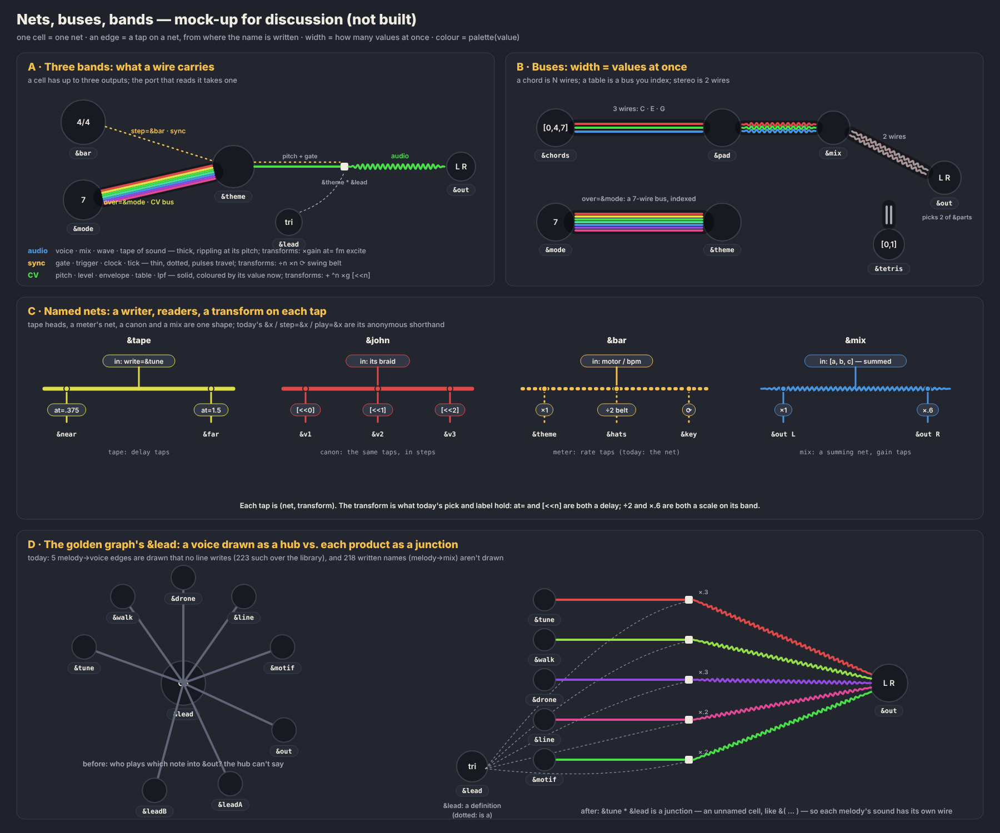

# Nets: what an edge is

**2026-10-07 · open, brainstorm (nothing built) · #9, #10, #27, on top of PR #136 (the gallery)**

The golden graph (`node tools/gallery.mjs golden`, PR #136) puts every kind of wheel and edge into one picture, so the flaws of the edge model show up together. This note collects what it shows, proposes one model under all of them, and splits the work into small steps. The owner's input that started it: **nets and buses** (an edge carrying `[0,4,7]` is a 3-wire bus); **edges by the signal they carry** (sync, CV, audio); **a palette that maps values to colours**; **named networks with in and out**, which unify tape heads and the meter's net, where today's edge syntax is the anonymous shorthand (like `&( )` cells).

*A mock-up for discussion, drawn by hand, not by the app.*

## What the golden graph shows

Measured over the 52 examples and the golden piece (`buildGraph` compared with the `&name` tokens written on each line):

- **Edge direction is half pull, half flow.** `over`, `step`, `ref`, `couple` and `about` point from the cell that writes the name to the cell named (the reader to what it reads). `mix`, `fm`, `lpf`, `excite`, `write` and `play` point the other way, along the signal. You can't tell from an arrow which way sound or time goes.
- **The graph draws edges no line writes, and leaves out names that are written.** `[&theme * &flute]` on `&out`'s line is drawn as `&theme → &flute → &out`. That is 223 `out` edges no line writes, and 218 written names (`&theme` on `&out`'s line) with no edge. The product is folded into the voice, so a voice turns into a hub. In the golden graph `&lead` has five melodies in and three mixes out, and the picture can't say which melody goes to which mix.
- **`out` means 13 things.** It is melody into voice, envelope (`×`), level (`×`), vibrato (`+`), `lpf`, `hpf`, `lpq`, `fm`, `excite`, `couple`, `write` and `play`. The `pick` field holds a port name, a shift (`[<<]`) or a transposition (`^7`). The `label` field holds an operator, a gain or a rate (`÷2 · belt`). Port, transform and multiplicity are mixed into two strings (`src/engine/graph.ts`). The edge sheet's 30 kinds are these strings, not 30 concepts.
- **The meter's net is the only edge that is already a net, and the layout makes it, not the engine.** `ForceLayout.meterNet()` builds a spanning tree over the cells a meter steps. It works, so it should be the general case rather than the exception.
- **A written name with no edge.** `&sun sun=&cycle` draws no edge, so the sun floats off.
- **Colour belongs to the kind, not to what the edge carries.** A step edge is accent-tinted, `excite` magenta, a belt brown, a meter's net yellow, and a live edge takes its note's colour. Kind colours and value colours compete.
- **Lines through wheels.** Belts and the meter's net run under two turntables (PR #136's follow-ups).

## The model, proposed

### 1. An edge is a name written on a line

`&a` written on `&b`'s line is one edge, `a → b`, always in the direction of flow: from what is read to the cell that reads it. The **port** is where the name is written: `step=`, `over=`, `lpf=`, `write=`, the braid, a slot of a mix. That gives one rule for direction. It also makes code and graph a bijection: every `&name` token is an edge, every edge is a token, and selecting one selects the other.

### 2. A product is a junction

`&theme * &lead` is an unnamed cell, the same as `&( … )`. It is drawn as a small junction: the melody goes in, the voice is its definition (a dotted "is a"), and its sound goes out to the mix. The 223 edges no line writes disappear, and the 218 missing names get their edges. Voices stop being hubs (mock-up D).

### 3. Three bands

A wire carries one of three things. The **port** decides which, not the cell: `&bar`'s ticks drive `&theme` (`step=&bar`), and the same `&bar`'s values can be read as a melody somewhere else. In modular terms a cell has up to three outputs (gate, CV, audio), and a port reads one of them.

| band | carries | ports (today's `kind` / `pick`) | transforms on the tap | drawn |
|---|---|---|---|---|
| **sync** | ticks: gate, trigger, clock | `step=`, `loop=&x`, `cycle(&x)`, `at=&bar`, `delaytime=&bar/2`; the gate half of melody → voice | `×n` `÷n` `⟳` `belt=` | thin, dotted, pulses travelling |
| **CV** | values: pitch, level, envelope, table, `lpf` | `over=`, braid refs, `+` (vibrato), `×` (level, envelope), `lpf=` `hpf=` `lpq=` `index=`, `write=` of notes; the pitch half of melody → voice | `+n` `^n` `×g` `[<<n]` `[a:b]` | solid, coloured by its value now |
| **audio** | sound | entries of a mix, the sound card, `fm=`, `excite=`, `couple=`, `write=` of sound, a sound tape's `play=` | `×gain`, `at=` | thick, rippling at its pitch |

Most of this is already written down. `engine/attributes.ts` marks `moves` (a CV port) and `clock` (a sync port), and decision 006's sorts map onto the bands: pitch and volume are CV, signal is audio. A **wave** is the one case where the rate moves a cell across a band: an audio-rate wave summed into a pitch is FM. `about=` is not a signal. It stays a layer of its own (notes), drawn as now.

Melody → voice carries two bands at once: gate and pitch, the way MIDI to CV does. It is a 2-wire bus.

### 4. Width: buses

A wire is as wide as the number of values the source holds at once:

- a chord `[0,4,7]` is 3 wires
- a table read through `over=` is its length (`&mode`: 7)
- a selector's `[0,1]` picks 2 wires of a table of parts
- the sound card is 2 (L R)

100 cells in the examples write chords, 2 to 8 wide. A bus is drawn as parallel strands, each coloured by its own value. That is the braid in the edge.

### 5. A tap is (net, transform), and a cell is a net

Every cell is a **net**. What writes to it is its *in*: a meter's motor or rate, a tape's `write=`, a mix's entries, a melody's own braid. Every place its name is written is a *tap*, an *out*, with a transform. The labels of today's edges are those transforms. Four things that look different turn out to have the same shape (mock-up C):

| net | in | taps | transform |
|---|---|---|---|
| a tape | `write=&tune` | `play=&tape` heads | `at=.375` (a delay) |
| a canon | its braid | `&john`, `&john[<<1]`, `&john[<<2]` | `[<<n]` (a delay, in steps) |
| a meter | motor, bpm | `step=&bar`, `step=&bar/2 belt=30`, `step=cycle(&bar)` | `×n` `÷n` `⟳`, a spring |
| a mix | `[a, b, c]` (summed) | each place the mix is played | `×gain` |

So **the existing syntax is the anonymous form of a named net**: `step=&bar/2` means "tap the net `&bar`, divide by 2". No new syntax is needed to get the model and the graph right. It is needed only where one thing has two spellings or can't be said. The first such pair: **`&john[<<1]` and `play=&john at=…` are the same tap** (a delay, in steps and in seconds). A canon is a tape with three heads. Whether one becomes the other is a #10 question (orthogonality, item 2), below.

### 6. One palette: value → colour

One function, `palette(band, value)`. Kinds get no colour of their own. The band sets the stroke (dotted, solid, rippling), the width sets the strands, the value sets the colour:

- **CV pitch:** the pitch-class rainbow already in use (`noteColour`, grid-aware, [tuning.md](../language/tuning.md)), muted by octave.
- **CV level** (envelope, gain, `lpf`): lightness on one neutral hue.
- **sync:** the meter's levels, which already exist as tokens (`--meter-0` downbeat … `--meter-3`), flashing on the tick.
- **audio:** the hue of its fundamental, as bright as it is loud (`scopeBand` already does this for the scope).

That removes six kind colours (the step tint, excite magenta, belt brown, meter yellow, the about grey, the live accent) and leaves one rule.

## How it unlocks #9 and #10

- **#9, PR 3 (`Graph.svelte`, a pure tested `flowedges.ts`).** Once an edge is `(net, port, band, transform, width)`, `pulseData`'s special cases (`play`, `write`, `out`, `mix`, `step`) become one lookup, and `flowedge.ts` becomes a pure function worth testing. #132 (`voices.sync` and `routing.ts` disagreeing about where sound goes) gets one source: both read the same nets.
- **#10, item 2 (orthogonality).** Taps give each set of equal spellings one canonical form: one delay (`[<<n]` and `at=`), one rate transform (`step=&x*n/m`, `cycle(&x)`, `loop=`), one gain.
- **#10, item 6 (naming).** "Units fixed by kind" *is* the band: a sync port takes a clock, a CV port takes semitones or a 0–1 level, an audio port takes sound. "Any parameter may be a cell" means any port takes a tap of its band. Which parameters can move stops being arbitrary: the CV ports.
- **#27 (layout).** Direction, junctions and nets are what the forces read. The meter's net moves from the layout into the engine, and the layout only places it.

## Steps, one at a time

Each step is its own PR, each visible in the golden graph and the edge sheet (before and after), and each keeps saved pieces and sound unchanged until step 6.

0. **Land #136** (the gallery). It is the yardstick.
1. **The model, no visual change.** `GraphEdge` gains `port`, `band`, `transform` and `width`, computed in `graph.ts` from `attributes.ts` (a `band` per port) and the sorts. `kind`, `pick` and `label` stay and are derived from them. A test maps every edge in the examples, and the edge sheet groups by band × port. Engine only, pure TS.
2. **One direction.** Every edge flows from the name written to the cell that writes it. The layout's forces are adjusted (#27). The golden graph's crossing bound must hold.
3. **Bands and palette** in `edges.css` and `PulseEdge`, with the kind colours dropped.
4. **Junctions.** Products become small anonymous nodes, and voices become definitions. This is the biggest layout change: watch the golden graph's crossings and the library's overlap count ([limits.md](../limits.md)).
5. **Buses.** Width drawn as strands.
6. **Named nets.** The meter's net comes from the engine. Tape heads and a canon get one drawing. Then the language question, `[<<n]` and `play= at=`, goes to a decision record.

## Open questions for the owner

1. **Direction:** flow everywhere (`&bar → &theme` for `step=&bar`)? This turns over half of today's arrows.
2. **Junctions:** draw `&theme * &lead` as its own small node, with voices as definitions? Or keep voices as hubs and show which melody goes where some other way?
3. **Are refs signals?** `&tune &up &up` splices `&up` into `&tune`'s braid. That is composition (inclusion), not a wire. Should it be drawn inside the braid as a strand, the way `&( )` is a petal, and not as an edge at all? Same question for `over=`: a table is a static bus, so is it CV, or a fourth band, "space" (pitch structure) against "time" (sync)?
4. **Three bands or more?** Is a table its own band, and is a gate apart from a clock (a trigger as opposed to a tempo)?
5. **Syntax:** is named-net syntax wanted beyond what exists, or is the unification only in the model and the graph, with `[<<n]` and `at=` the first pair to settle?
