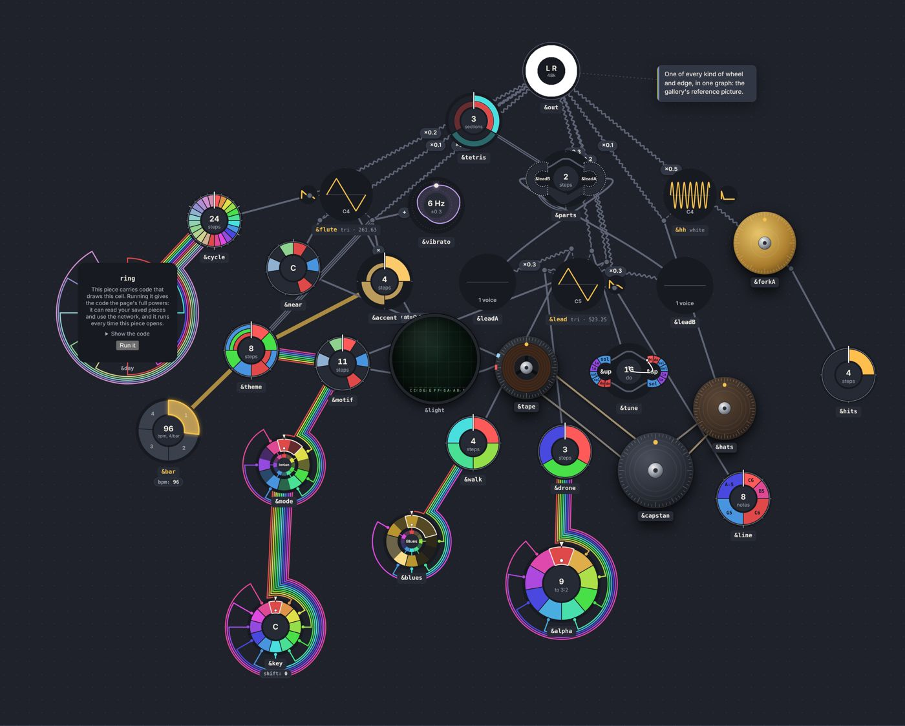
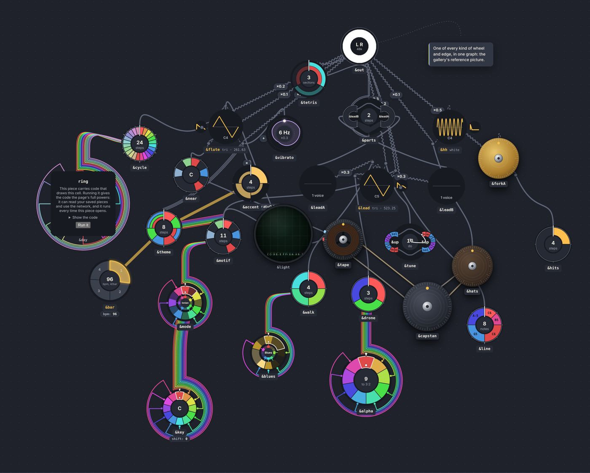
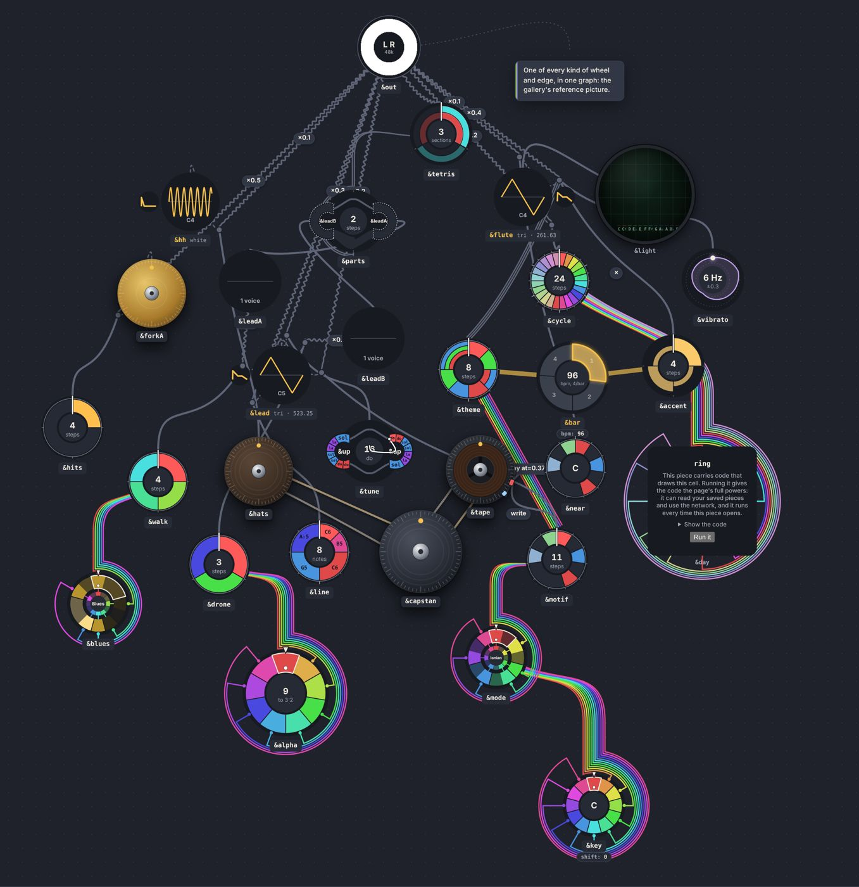

# Outputs at 12 o'clock (a feasibility probe)

Date: 2026-10-09 · Status: open (probe; nothing changes unless switched on) · Issue: [#234](https://github.com/yggi/cell-studio/issues/234) (the multiscale epic; #27, [nets.md](nets.md))

The owner's idea: **a node's output sits at its top, 12 o'clock**: a bus leaves its loom there (locked to the wheel's rotation, as the marker is), a single strand leaves the node's output socket there. The expectation: buses then feed in from the bottom and spread sideways. Two sidequests: wires between the same two nodes run side by side, not on top of each other (a bus of buses); a junction needs a body, so it has a proper output (a step towards a gate or play node that makes `*` explicit; not built here).

## What the layout does today

`tools/probe/outputs-top.test.ts` (`PROBE=out.txt npx vitest run tools/probe/outputs-top.test.ts`, ~5 min; skipped in `npm test`) lays out every example as the app does (500 ticks, the meters' nets laid; three seeds) and measures each drawn wire **along the flow** (`from` → `to`, not the layout's `source`/`target`): the direction it leaves its source, against straight up.

- **The rows already flow up.** Of 884 wires, 56 % leave within 45° of 12 o'clock, 42 % sideways, **2 % down**. 91 % come into their reader from below. Mean turn a wire leaving at 12 would make before heading for its reader: 0.79 rad (45°).
- By port: sound (`mix` 283, `voice` 247) leaves up already (36–38° from up, ~0 % down); tables (`over` 115, 57°) and refs (`braid` 137, 61°, 5 % down) lean sideways; a tape's `play` 13 % down; `couple` (2) mostly down.
- **71 pairs of wires share both ends** over the library (meter traces included): each pair is drawn on top of each other today (the five sound wires out of `&lead`'s junctions in the golden graph).

## Built, switched off

- **Sockets** (`src/ui/outputs.ts`, `?outputs=top`; the gallery: `OUTPUTS=top node tools/gallery.mjs golden`): `PulseEdge` starts every wire at the top of its source's wheel (a hop at the top of the reader it comes on from; a tape's read head stays its own socket) and leaves straight up before bending to its reader; `loomParts` takes an `exit` direction, so a loom's bundle turns off its ring at 12 instead of towards its reader.
- **`upPull`** (`options.ts`, `physics.ts: stepUp`, default 0): each reader below or beside what it reads is pushed up, and what it reads down, until it sits half a row above.
- With `?outputs=top` the app's layout also takes `upPull 0.5, spread 0.25` (`PROBE_LAYOUT`).

## Measured (library, three seeds)

| | up / side / down | from below | crossings | cost | area Mpx² |
|---|---|---|---|---|---|
| today | 56 / 42 / 2 % | 91 % | 25.3 | 40.8 | 86.4 |
| `rankPull` ×6 | 47 / 52 / 1 % | 92 % | 27.0 | 40.1 | 84.4 |
| `spread` ½ | 56 / 42 / 2 % | 91 % | **21.3** | 33.7 | 86.5 |
| `upPull` 0.2, `spread` ½ | 61 / 39 / 0 % | 95 % | 25.3 | 33.1 | 88.7 |
| **`upPull` 0.5, `spread` ½** | **64 / 35 / 0 %** | **97 %** | 22.3 | **32.9** | 90.4 |
| `upPull` 0.2, `spread` 0 | 60 / 39 / 0 % | 96 % | 27.3 | 36.6 | 88.4 |

- A stronger pull to the rows makes it worse (more sideways): the rows put a reader level with its neighbours, not above what it reads.
- `upPull` costs about one crossing over the whole library for no wire leaving down and 97 % arriving from below; area +5 %.
- **A free win on the side: `spread` halved alone takes crossings 25.3 → 21.3** (cost 40.8 → 33.7). The spread force pushes a node's wires apart round it, which is the opposite of a socket; with sockets it should spread only the inputs (round the lower half). Its own issue: [#235](https://github.com/yggi/cell-studio/issues/235).
- The ~35–40 % sideways that stays is the owner's prediction: a source read by several readers a row up fans out horizontally. With a socket that is a bundle rising and splitting, not a wire leaving sideways.

## Seen (golden graph)

| today | sockets | sockets + `upPull` |
|---|---|---|
|  |  |  |

- Looms locked at 12 read well wherever the reader is above: `&key` → `&mode` → `&motif`, `&blues` → `&walk`, `&alpha` → `&drone` rise straight out of the marker and bend once. With `upPull` the whole piece is a tree hanging from `&out`.
- Without `upPull` the few readers beside or below make hooks (`&day` → `&cycle`, `&vibrato` into `&flute`'s junction). `about=` links got a socket too (fixed after the pictures: not an output).
- Junctions are the weak point: a dot on its voice's rim, placed facing what comes **in**, so its output starts on the wrong side. Its wire out still climbs round the voice.

## The sidequests

- **A bus of buses.** With a socket every wire out of a node starts at one point, so a node's outputs are one cable by construction: the question becomes the order of lanes across it (by band: sync, CV, audio, then by reader, left to right as the readers sit, so none cross) and where it splits. The net tree (`netTree`) already does this for one net; per source over all its nets is the same walk. Wires with the same two ends (the 71 pairs) get a lane each, side by side, as `strandPath`'s offset already draws a bus's strands.
- **A junction with a body.** Today `folded()` (`junctions.ts`) takes junctions out of the forces and `placeJunctions` sets them on the voice's rim. A body means the reverse: the junction is a small node in the forces (inputs from below, its voice's `is` from the side, its output socket on top into the mix), which is exactly the node a gate or play node would be. The step that makes that easier, not harder: make the fold optional (an option, as `upPull` is), so a junction can be laid as a node and measured, before any syntax for it.

## Next (proposed, for the owner)

1. Decide: sockets for every output, or only for buses and sound? (`about=` none; a tape's heads are their own sockets already.)
2. `spread` ½ on its own (a measured win independent of this): [#235](https://github.com/yggi/cell-studio/issues/235).
3. Probe 2: junctions as nodes (the fold optional), measured the same way, and the lanes of a node's cable.
4. If both hold: sockets on by default, `upPull` in, `spread` only on inputs; the baseline re-recorded; the edge sheet and golden graph re-shot.
