# The rhythm scalogram (a probe)

Date: 2026-10-10 · Status: open (an open-minded probe; nothing in the app) · Issue: [#286](https://github.com/yggi/cell-studio/issues/286) · The idea: [multiscale.md](multiscale.md), leads 7 and 9

The question: a continuous wavelet transform of the piece's **notes** (not its audio) shows the levels you can hear, as a picture over time [Todd 1994; Smith & Honing 2008]. Set against the cells' spans on the tower (`towerSpans`) and the piece's sections (`sections`), does it show the levels the code writes, the ones it doesn't, and the form? And what should an onset be worth? This first pass looks rather than decides.

## Method

- `tools/probe/scalogram.test.ts` (the `probe` skill; skipped in `npm test`):
  - **One length of each piece**, as the transport has it (`mainLength(pieceTime(…))`, `src/engine/duration.ts`): the whole piece if it ends, one cycle if it loops (a longest layer when the cycle passes half an hour), 5 to 12 its day (86 400 s).
  - **Short pieces are left out**: those under 16 s (`SHORTEST=`), where a third of the length is a bar or two. That is 42 of the 75 examples.
  - **The notes** come from `eventsBetween(plan(…))`, in the code's seconds, with the `free()` controls at their written values.
  - **Four signals**, each note put down as a small Gaussian at its exact time (not rounded to a sample: at a long piece's few samples a second, rounding aliases):
    - **impulses**: each note an impulse of its gain.
    - **envelope**: each note held for its length.
    - **voices**: impulses per voice, the powers summed.
    - **change**: an impulse only where a voice moves to a new pitch (weighed by the interval) or enters after a rest.
  - **Sampling**: 50 a second, fewer for a long piece (at most 2¹⁸ samples: a day at 3 a second).
  - **The transform**: a complex Morlet (ω₀ = 6, 12 periods an octave), from 1/16 s (a long piece: 8 samples) to a third of the length, computed with FFTs. That takes about 1 s for a short piece and about 70 s for a day.
  - **Output**: the peaks of each signal's mean over time against the cells' steps and turns, and JSON for the pictures, with the piece's `sections` repeated over a cycle.
  - **Options**: `LENGTH=` and `RATE=` override the length and the sample rate (to compare a long piece's few samples a second with 50).
- `tools/probe/scalogram-sheets.mjs` draws:
  - one sheet per piece, with the four signals, each signal's mean, the cells' spans named, the sections as white lines, and the notes;
  - or the library as a contact sheet, one signal per sheet.

  Fast is at the top, as on the tower. `NORM=row` sets each period against its own mean over time, so a level shows where it is louder than usual. The veil is the window's edges (twice the wavelet's reach).

```
PROBE=out.txt SHEETS=json/ [ONLY=pop,fiveto12] [TAG=arrangement] [COLUMNS=240] npx vitest run tools/probe/scalogram.test.ts
NORM=row node tools/probe/scalogram-sheets.mjs json/ pics/                 # a sheet a piece
NORM=row node tools/probe/scalogram-sheets.mjs json/ pics/ contact change  # the library, one signal
```

(In a cloud session where Playwright's pinned shell isn't installed: `CHROME_PATH=/opt/pw-browsers/chromium-1194/chrome-linux/chrome`.)

## Pictures

The 33 pieces of 16 s or more, one length each, the **change** signal. Blue ticks at the left are the cells' steps, grey ticks their turns; white lines are the sections:

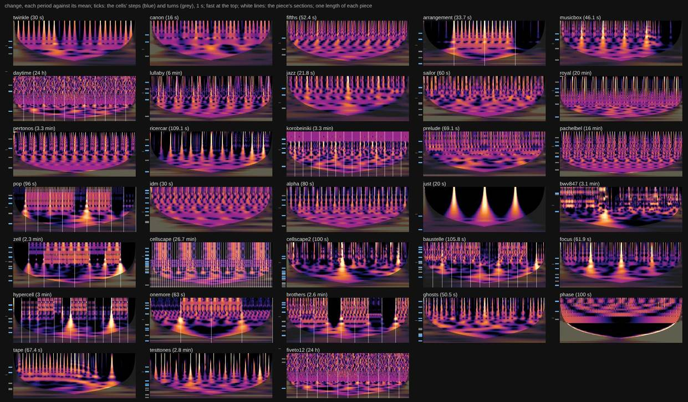

The arrangements: Hypercell, Cellscape, Korobeiniki, Pop. Then 5 to 12's day, BWV 847 and Phase:

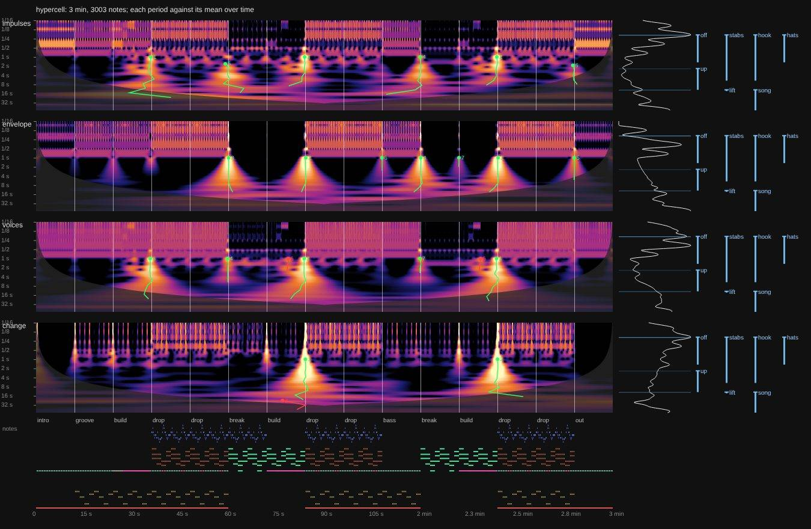
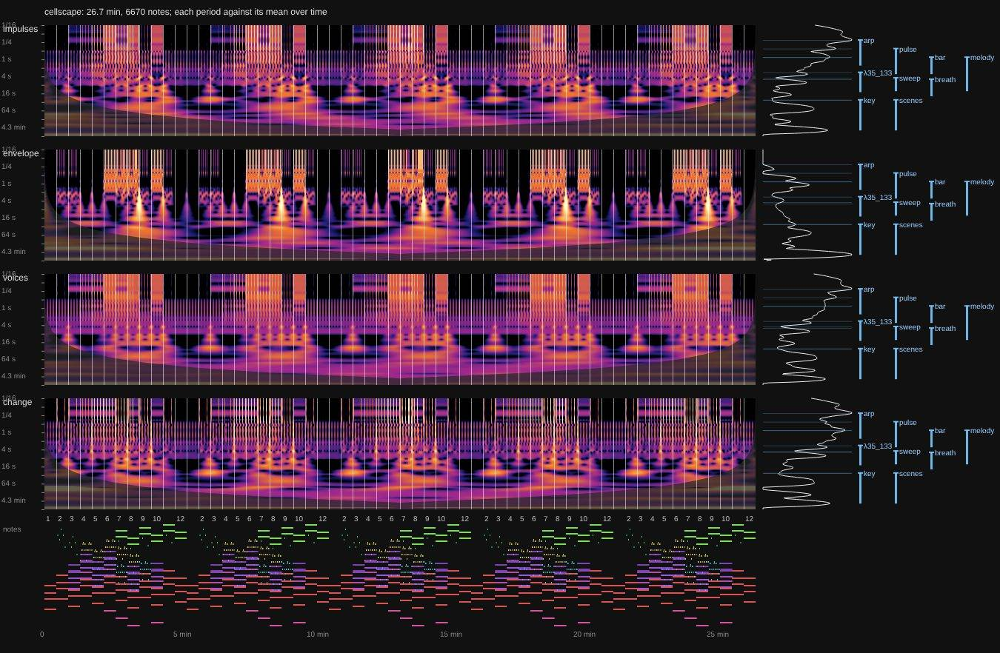
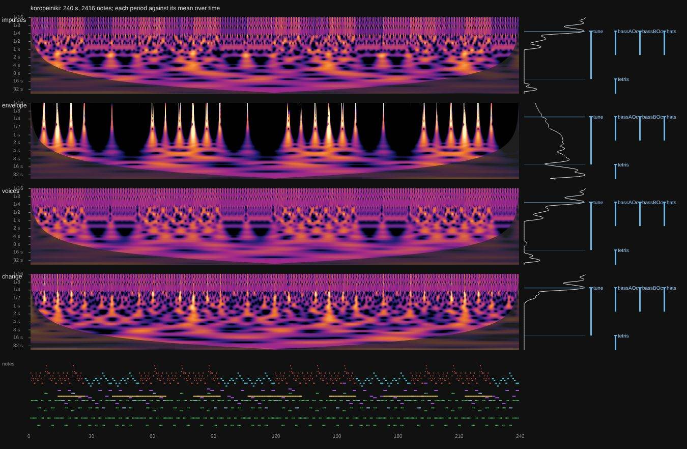
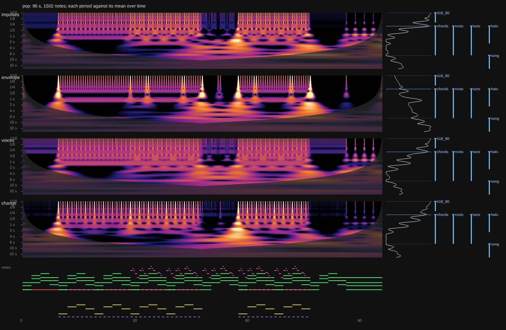
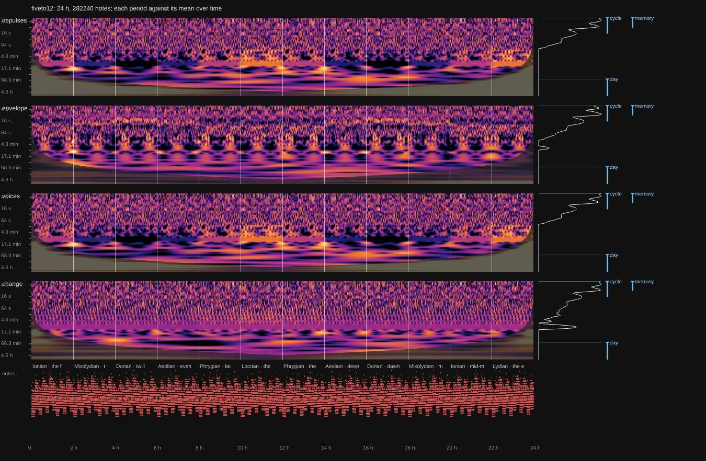
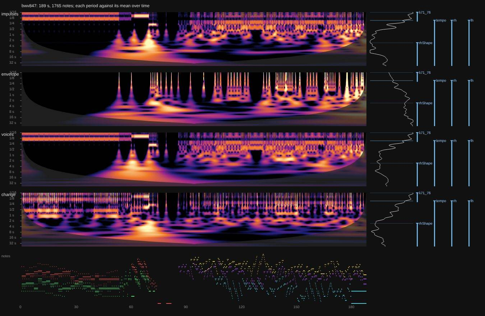
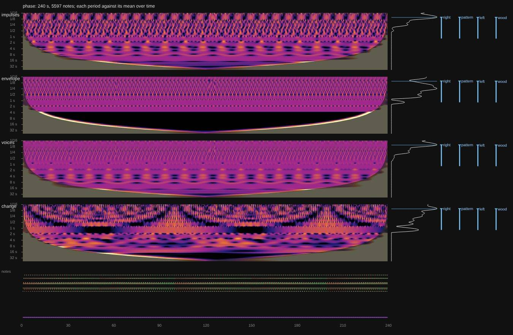

## What it shows (by eye, then the numbers)

1. **Meter as bands, form as cones.**
   - A steady loop is horizontal bands at its levels, the same all the way across.
   - A change of section is a cone: power at every period converging on the moment it happens, the slower the period the wider the cone. This is the wavelet transform's picture of a singularity (its modulus maxima) [Mallat & Hwang 1992].
   - So the form doesn't need a ridge of its own to be seen; its boundaries are the cones' apexes.
2. **In the arrangements, the cones sit on the sections.**
   - Hypercell's intro, groove, build, drop, break and out are the clearest. Each boundary has a cone, and the size of the cone depends on the kind of boundary and the signal:
     - in **change**, the biggest cones are at the drops after a build;
     - in **envelope**, they are at the breaks, where the notes stop.
   - Cellscape's five rounds of twelve scenes repeat as five arches, the cones inside each round on its scenes.
   - Korobeiniki's B sections are a different texture between 2 and 8 s.
   - Pop's cones are at its sections, where the drums drop out and stop.
   - The arrangements are the richest source: their sections give the cones something to be checked against.
3. **5 to 12, a day.**
   - Its twelve two-hour blocks (a mode each) show as cones and bright patches at periods of about 17 minutes, near the block lines.
   - A dotted band at a few minutes runs through the whole day, most clearly in **change**. It is the ten-minute keys, which no cell writes (the law computes them). The 2-minute row of **change** repeats every 10–10.5 minutes, and folded over ten minutes it is loudest at the key change. In the same way, the 15-minute row of **impulses**, folded over two hours, is loudest at the block change.
   - Below that, its bar and the bell's groupings (0.71 s steps; about 1.7, 3.5 and 7.1 s) are steady.
   - `daytime` looks the same.
4. **What one cycle can't show.** *Phase*'s drift between its two pianos is its whole cycle (100 s): one cycle shows one swell of the 1.3 s level, not a level of its own. Seeing the drift as a level takes several cycles. The loop is the slowest level, and a window of one loop can't hold it.
5. **Each signal sees something different.**
   - **envelope** is blind to legato (a line of held notes is a constant), but makes breaks the loudest thing.
   - **voices** finds levels lost where voices interfere.
   - **change** has the fewest false fast levels and shows melody, keys and phasing; a drone gives nothing.
6. **The numbers.** These are the peaks of each signal's mean over time, over the 33 pieces of 16 s or more. A peak is on a cell within 1/6 octave of its step or turn; a harmonic is a peak at ½ or ⅓ of a peak that is on a cell.

   | signal | peaks | on a cell | a harmonic | at ≥ 4 s |
   | -------- | ----- | --------- | ---------- | -------- |
   | impulses | 133   | 68        | 39         | 10       |
   | envelope | 161   | 43        | 18         | 59       |
   | voices   | 150   | 80        | 38         | 22       |
   | change   | 160   | 79        | 40         | 17       |

   The mean over time is the wrong summary for the form: averaged, a cone is spread thin. The form needs the cones found in time, not peaks in the mean.
7. **An alias that wasn't.** In the day, peaks at 3.5 and 7.5 s first looked like aliasing (3 samples a second against a 0.71 s pulse). The same ten minutes at 50 a second have bumps there too, below the peak threshold, so they are the bell's groupings. The Gaussians stay, because rounding to so few samples would alias.

## One chart, three signals

Each signal hears a kind of boundary (below), so the three that differ most share one chart, a colour each, added:
- **red**: envelope (sound against silence: breaks);
- **green**: change (new pitches, entries);
- **blue**: voices (density, pulse; it largely covers impulses).

Two together mix (yellow: red and green; cyan: green and blue; magenta: red and blue), and all three make white. A colour's brightness is how far its signal stands above its period's mean, from the mean to 10 dB above. Each signal's cones are rings in its colour, filled when they land on a section (`node tools/probe/scalogram-sheets.mjs json/ pics/ combined`, or `contact combined`).

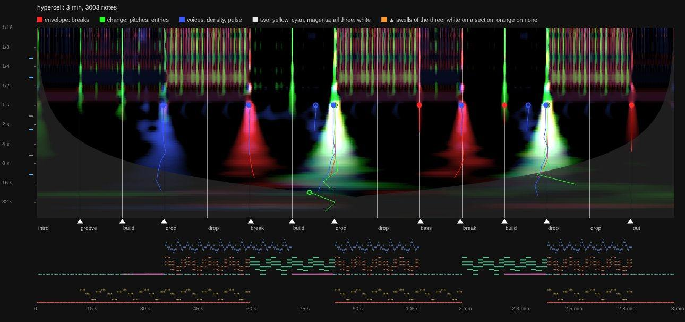
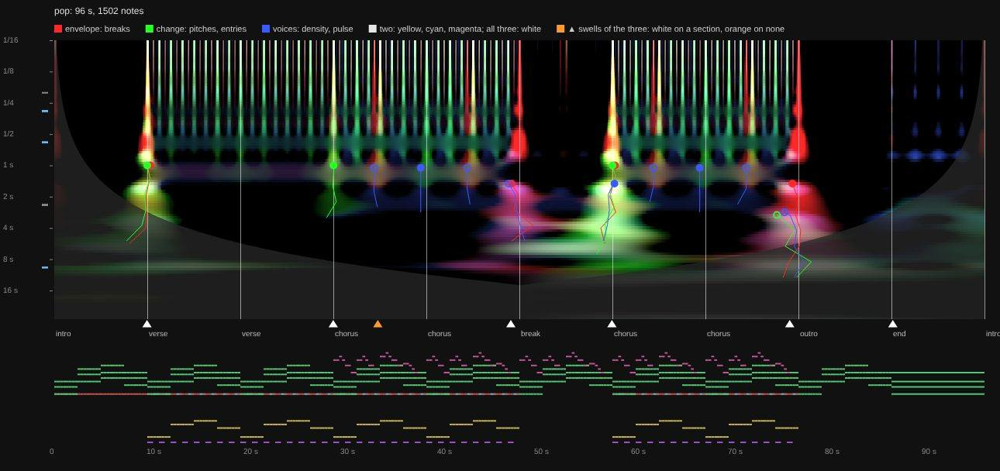
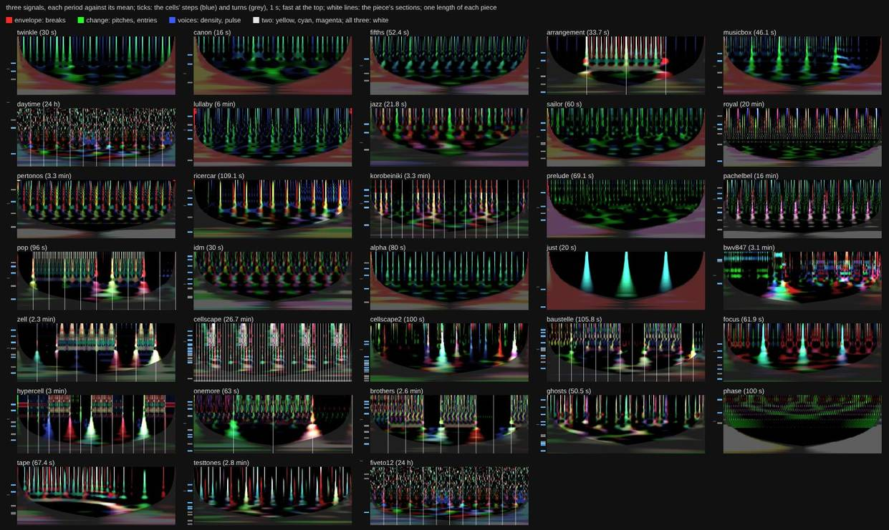

In Hypercell each kind of section has its colour:
- the first drop (the beat coming in) is blue;
- the breaks are red;
- the drops after a build are white (all three at once);
- groove and build are thin green.

In Pop the verse's entry and the choruses are yellow-white, and the break and the outro are red and magenta.

## The cones against the written boundaries

The question: is a written boundary heard as a cone, and is a cone a written boundary? Which signal hears which kind?

**Method** (`cones` and `score` in `tools/probe/scalogram.ts`):
- **Maxima**: each period's row against its own mean; a maximum is louder than the mean and the loudest within a quarter period either side.
- **Chains**: from the slowest period down, each maximum is chained to the nearest maximum one period faster within a quarter period, down to 1 s (or a long piece's fastest period). A chain of at least an octave is a cone; its apex is where it ends; its score is its loudness in dB summed along it.
- **The boundaries**: `sections` (the selector's steps, repeated over a cycle), split into **new** (a label other than the one before) and **repeats** (drop → drop); for 5 to 12, its keys too, every ten minutes apart from its blocks.
- **Scoring**:
  - Only cones that reach up to a tenth of the boundaries' median gap count; the best as many as there are boundaries are scored.
  - **P**: the share of those cones that land within a tenth of the gap (at least 1 s) of a boundary.
  - **R**: the share of boundaries that get one.
  - **Chance**: the share of the window that close to a boundary, which is what P would be with cones dropped at random.
- The thresholds were swept on the arrangements (`CONE_LOUD`, `CONE_OCTAVES`). Strict (1.5 × the mean, 2 octaves) gives P 56–73 % and R 12–20 %; loose (1 ×, 1 octave, kept) gives P 50–67 % and R 34–51 %.

**Measured** (the 11 pieces with sections, 16 s or more; %):

| piece | boundaries | n | chance | impulses P / R | envelope P / R | voices P / R | change P / R |
| --- | --- | --- | --- | --- | --- | --- | --- |
| arrangement | sections | 3 | 18 | 100 / 100 | 100 / 67 | 100 / 67 | 67 / 67 |
| korobeiniki | sections | 14 | 19 | 75 / 64 | 36 / 36 | 100 / 71 | 85 / 79 |
| | new | 6 | 16 | 0 / 0 | 0 / 0 | 50 / 50 | 50 / 50 |
| | repeats | 8 | 21 | 100 / 75 | 38 / 38 | 63 / 63 | 43 / 38 |
| pop | sections | 10 | 19 | 50 / 40 | 100 / 40 | 33 / 30 | 75 / 30 |
| | new | 7 | 26 | 29 / 29 | 100 / 57 | 43 / 43 | 75 / 43 |
| | repeats | 3 | 18 | 0 / 0 | 0 / 0 | 0 / 0 | 0 / 0 |
| zell | sections | 7 | 18 | 71 / 71 | 100 / 71 | 86 / 86 | 100 / 71 |
| cellscape | sections | 59 | 20 | 47 / 47 | 71 / 49 | 58 / 58 | 47 / 47 |
| baustelle | sections | 12 | 23 | 100 / 25 | 75 / 25 | 60 / 25 | 80 / 33 |
| hypercell | sections | 14 | 19 | 100 / 43 | 100 / 50 | 71 / 36 | 67 / 14 |
| | new | 11 | 15 | 100 / 55 | 100 / 64 | 71 / 45 | 67 / 18 |
| | repeats | 3 | 20 | 0 / 0 | 0 / 0 | 0 / 0 | 0 / 0 |
| onemore | sections | 4 | 18 | 100 / 25 | 100 / 25 | 100 / 50 | 100 / 75 |
| brothers | sections | 8 | 18 | 38 / 38 | 67 / 50 | 50 / 50 | 50 / 25 |
| fiveto12 | blocks | 11 | 18 | 75 / 27 | 75 / 27 | 75 / 27 | 100 / 18 |
| | keys | 132 | 18 | 4 / 1 | 16 / 7 | 4 / 1 | 54 / 17 |
| daytime | blocks | 11 | 18 | 75 / 27 | 75 / 27 | 75 / 27 | 100 / 18 |
| | keys | 132 | 18 | 0 / 0 | 16 / 7 | 4 / 1 | 54 / 17 |
| **mean** (sections, blocks, keys) | | | **19** | **64 / 39** | **72 / 37** | **63 / 41** | **75 / 39** |

(Where no new/repeats rows are shown, all of a piece's sections are new.)

**What it says:**
1. **A cone is a written boundary.** The cones found land on a section 63–75 % of the time, against 19 % by chance, in every signal.
2. **A written boundary is a cone less often.** About 40 % are found. Part of that is the finder: it misses faint cones that the pictures show. Part of it is the music:
   - **Repeats can be silent.** Pop's and Hypercell's repeats (verse → verse, drop → drop) have no cone in any signal: written, not heard.
   - Korobeiniki is the other way round. Its A → A repeats are found (impulses 75 %), its changes to B are not. An A is a 13 s phrase, so its restart is a boundary you hear; the change to B keeps the texture.
3. **Each signal hears a kind of boundary.** **envelope** hears the breaks, where notes stop (Hypercell and Pop, every cone on a section). **change** hears the drops and entries, and it is the only one that hears 5 to 12's keys (54 % against 18 %).
4. **The day's blocks are heard, but not as cones.** At the 2-hour blocks the scalogram has patches at periods of about 17 minutes rather than cones down to the bar. The finder gets 3 or 4 of the 11, all on a block. Folded over two hours (point 3 above), the blocks show as a whole.

## Three finders: cones, novelty, swells

A cone has to reach down to the beat. Two other measures don't (in `tools/probe/scalogram.ts`, scored the same way):
- **novelty** [Foote 2000]: at each moment, how different the spectrum is just after from just before, over half the boundaries' median gap either side. It finds lasting changes of texture.
- **swells**: the scalogram averaged over the periods from an eighth to half the gap, and its peaks in time. It finds a moment when those periods are loud: a cone cut short, a break, a fill.

Each is run on one signal, or on the three of the chart together (**three**). Means over the 11 pieces with sections, their sections and 5 to 12's keys (P / R, %; chance 19):

| finder | impulses | envelope | voices | change | three |
| --- | --- | --- | --- | --- | --- |
| cones | 64 / 39 | 72 / 37 | 63 / 41 | 75 / 39 | |
| novelty | 43 / 42 | 33 / 32 | 42 / 39 | 40 / 38 | 37 / 35 |
| **swells** | 67 / 61 | 56 / 50 | 70 / 64 | 64 / 60 | **72 / 62** |

- **Swells find the most**, about 60 % of the sections at 56–72 % precision, the three together the most precise. The written form is mostly heard as a swell at its own scale, not as a lasting change (novelty).
- **5 to 12's blocks are found by swells**: 82 % in impulses and voices, against 27 % by cones. Its keys stay hard: 25 % at best (change), against 18 % by chance.
- **Repeats stay silent**: Pop's and Hypercell's are found by no finder in any signal.

The combined chart marks the swells of the three under the panel: a triangle at each of the best twice as many as there are sections, larger for the best as many, white on a section, orange on none.

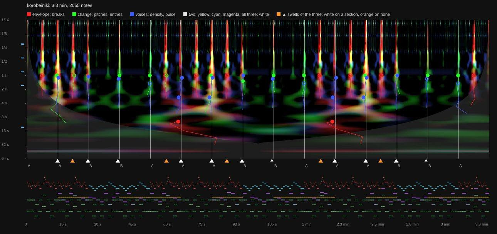
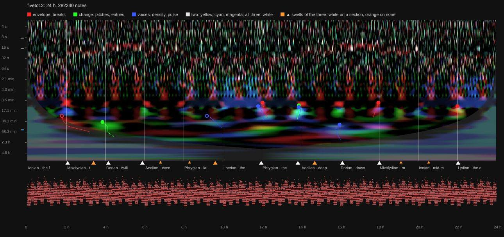

## The boundaries nobody wrote

Of the best swells of the three together (twice as many as boundaries), those that land on no section, over the 11 pieces:
- **28 of 144** land on no section; the written sections account for the rest.
- **A cell's turn doesn't explain them.** 7 fall on a multiple of a cell's turn of phrase length (a quarter of the gap or more), where chance would give 11. The bar's turn would explain any moment, so it isn't counted.
- **Korobeiniki**: 5 unwritten swells, each in the middle of an A section, with a red patch (a break) there. That looks like the halves of the tune's 8 bars, a phrase written inside the tune's notes rather than as a cell (not checked against the notes).
- **Baustelle**: 6, several at multiples of `&edge` (a cell's turn); `chance` plays in it.
- **5 to 12 and daytime**: 7 each inside their blocks, not on a key; unexplained.

## What is next (nothing decided)

- **Korobeiniki's halves, checked**: the tune's notes at the unwritten swells. If it is a phrase, a written cell for it would make the boundary written.
- **The keys of 5 to 12**: heard on average (folded), seldom one by one. A key change under the same rhythm may be too small a change of the notes' timing for any onset signal: a pitch-class signal (a key's notes against the last key's) would ask the question directly.
- **Ridges in time**, not peaks in the mean: a level that holds for part of the piece (Pop's drums, BWV 847's prelude against its fugue).
- **Loops longer than one cycle**, where the loop itself is the question (Phase): two or three cycles.
- **What an onset is worth** stays open. The pictures suggest not choosing one: impulses or voices for the meter, change for melody, keys and phasing, the cones of any of them for the form.

## References

Todd, N. P. McA. (1994), *The auditory "primal sketch": a multiscale model of rhythmic grouping*, J. New Music Research 23. Smith, L. M. & Honing, H. (2008), *Time-frequency representation of musical rhythm by continuous wavelets*, J. Mathematics and Music 2(2). Torrence, C. & Compo, G. P. (1998), *A practical guide to wavelet analysis*, BAMS 79 (the Morlet, the cone of influence). Liu, Liang & Weisberg (2007), *Rectification of the bias in the wavelet power spectrum*, J. Atmos. Oceanic Tech. 24. Mallat, S. & Hwang, W. L. (1992), *Singularity detection and processing with wavelets*, IEEE Trans. Inf. Theory 38 (cones of maxima). Foote, J. (2000), *Automatic audio segmentation using a measure of audio novelty*, IEEE ICME.
