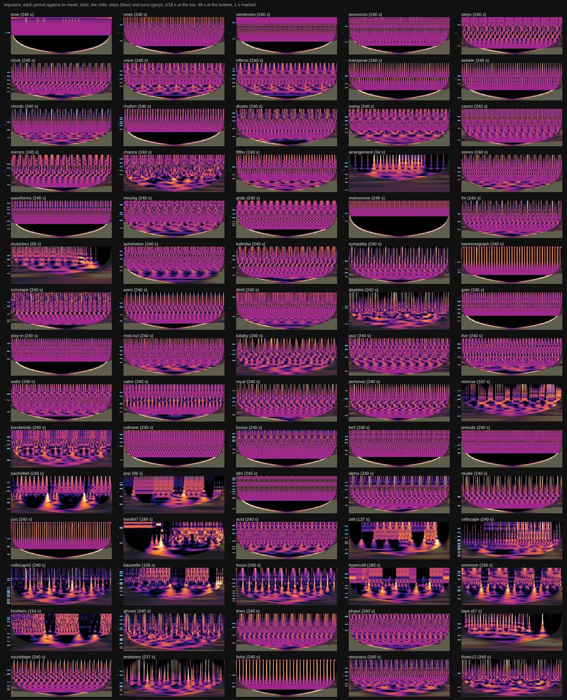
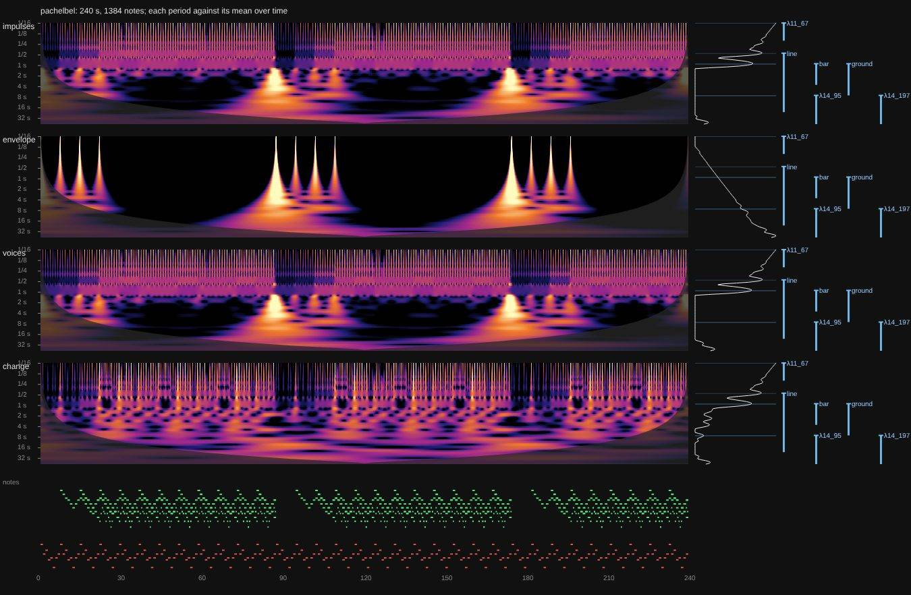

# The rhythm scalogram (a probe)

Date: 2026-10-10 · Status: open (an open-minded probe; nothing in the app) · Issue: [#286](https://github.com/yggi/cell-studio/issues/286) · The idea: [multiscale.md](multiscale.md), leads 7 and 9

The question: a continuous wavelet transform of the piece's **notes** (not its audio) shows the levels you can hear, as a picture over time [Todd 1994; Smith & Honing 2008]. Set against the cells' spans on the tower (`towerSpans`), does it show the levels the code writes, the ones it doesn't, and the form? And what should an onset be worth? This first pass looks rather than decides.

## Method

- `tools/probe/scalogram.test.ts` (the `probe` skill; skipped in `npm test`):
  - Takes the piece's notes (`eventsBetween(plan(…))`, in the code's seconds, the `free()` controls at their written values): 240 s, or the piece's length when it ends.
  - Turns them into a signal sampled at 50 Hz, in four ways:
    - **impulses**: each note an impulse of its gain.
    - **envelope**: each note held for its length.
    - **voices**: impulses per voice, the powers summed.
    - **change**: an impulse only where a voice moves to a new pitch (weighed by the interval) or enters after a rest.
  - Runs a complex Morlet transform (ω₀ = 6, 12 periods an octave, 1/16 s to 48 s), computed with FFTs, about 1 s a piece.
  - Writes the peaks of each signal's mean over time against the cells' steps and turns, and the JSON for the pictures.
- `tools/probe/scalogram-sheets.mjs` draws:
  - one sheet per piece, with the four signals, each signal's mean, the cells' spans named, and the notes;
  - or the whole library as a contact sheet, one signal per sheet.

  Fast is at the top, as on the tower. `NORM=row` sets each period against its own mean over time, so a level shows where it is louder than usual. The veil is the window's edges (twice the wavelet's reach).

```
PROBE=out.txt SHEETS=json/ [ONLY=pop,bwv847] [COLUMNS=240] npx vitest run tools/probe/scalogram.test.ts
NORM=row node tools/probe/scalogram-sheets.mjs json/ pics/                 # a sheet a piece
NORM=row node tools/probe/scalogram-sheets.mjs json/ pics/ contact change  # the library, one signal
```

(In a cloud session where Playwright's pinned shell isn't installed: `CHROME_PATH=/opt/pw-browsers/chromium-1194/chrome-linux/chrome`.)

## Pictures

The library, each note an impulse. Blue ticks at the left are the cells' steps, grey ticks their turns:



Pop (96 s; its song ends), BWV 847, Korobeiniki, Pachelbel, Phase, each with all four signals:





## What it shows (by eye, then the numbers)

1. **Meter as bands, form as cones.**
   - A loop is horizontal bands at its levels, the same all the way across.
   - A change of section is a cone: power at every period converging on the moment it happens, the slower the period the wider the cone. This is the wavelet transform's picture of a singularity (its modulus maxima).
   - So the form doesn't need its own ridge to be seen; its boundaries are the cones' apexes.
   - Pieces that show cones: Pop, BWV 847, Pachelbel, Korobeiniki, Ricercar, Zell, Hypercell, Brothers, Baustelle, the Cellscapes, Focus, Onemore, Arrangement, Musicbox, Tape, Testtones. The rest are steady loops.

   The library splits into those two families at a glance.
2. **Cones land on the cells' turns.**
   - Pachelbel's two big cones are at 87 s and 174 s, its slowest cell's turn (87.3 s).
   - Pop's are where its drums drop out (about 47–57 s) and stop (77 s): presumably `&song`'s taps, not yet checked against them.
   - BWV 847's are at changes in the prelude's last bars, the gap, and the fugue's entry at 85 s.
3. **Something nobody wrote.** *Phase* (two pianos, one pattern, slipping apart) has slow arches in the **change** signal, a pattern over the whole window. That is the drift between the two pianos' clocks, a level that is not any cell's step or turn.
4. **Each signal sees something different.**
   - **envelope** is blind to legato: a line of held notes is a constant, so tone, semitones, twovoices and transpose go black. But it makes sections the loudest thing (the gaps between them are its biggest change).
   - **voices** finds a level that the summed impulses lose, where voices interfere: Drums' groove (8.4 s) shows only there.
   - **change** has the fewest false fast levels and shows phasing and melody contours. A drone or a single repeated note gives nothing.
5. **The numbers.** These are the peaks of each signal's mean over time, over the 75 examples. A peak is on a cell within 1/6 octave of its step or turn; a harmonic is a peak at ½ or ⅓ of a peak that is on a cell.

   | signal | peaks | on a cell | a harmonic | at ≥ 4 s |
   |---|---|---|---|---|
   | impulses | 256 | 127 | 86 | 6 |
   | envelope | 500 | 126 | 80 | 215 |
   | voices | 250 | 135 | 76 | 5 |
   | change | 263 | 130 | 63 | 1 |

   The mean over time is the wrong summary for the form: averaged, a cone is spread thin, so none of the onset signals has peaks at slow periods. Envelope's many slow peaks are its gaps. The form needs the cones found in time, not peaks in the mean.
6. **The first pass's surprises.**
   - BWV 847's strongest level in the first pass (0.13 s, a 64 s window) is not on a cell. With the whole piece, a 0.21 s peak appears and sits on its cells (0.20 s).
   - `tape`'s bands bend over the piece. Probably its varispeed; not checked.

## What is next (nothing decided)

- **Find the cones**: maxima chained across periods down to their apex, a time and a strength for each. Set them against the selectors' taps and the cells' turns, as a table over the library: is a cone a written boundary, and is a written boundary a cone?
- **Ridges in time**, not peaks in the mean: a level that holds for part of the piece (Pop's drums, BWV 847's prelude against its fugue).
- **What an onset is worth** stays open. The pictures suggest not choosing one: impulses or voices for the meter, change for melody and phasing, the cones of any of them for the form.
- **Pictures to look at next**: a piece with `chance` (two seeds side by side), a piece at two tempos, and the same piece with one voice muted.

## References

Todd, N. P. McA. (1994), *The auditory "primal sketch": a multiscale model of rhythmic grouping*, J. New Music Research 23. Smith, L. M. & Honing, H. (2008), *Time-frequency representation of musical rhythm by continuous wavelets*, J. Mathematics and Music 2(2). Torrence, C. & Compo, G. P. (1998), *A practical guide to wavelet analysis*, BAMS 79 (the Morlet, the cone of influence). Liu, Liang & Weisberg (2007), *Rectification of the bias in the wavelet power spectrum*, J. Atmos. Oceanic Tech. 24. Mallat, S. & Hwang, W. L. (1992), *Singularity detection and processing with wavelets*, IEEE Trans. Inf. Theory 38 (cones of maxima).
