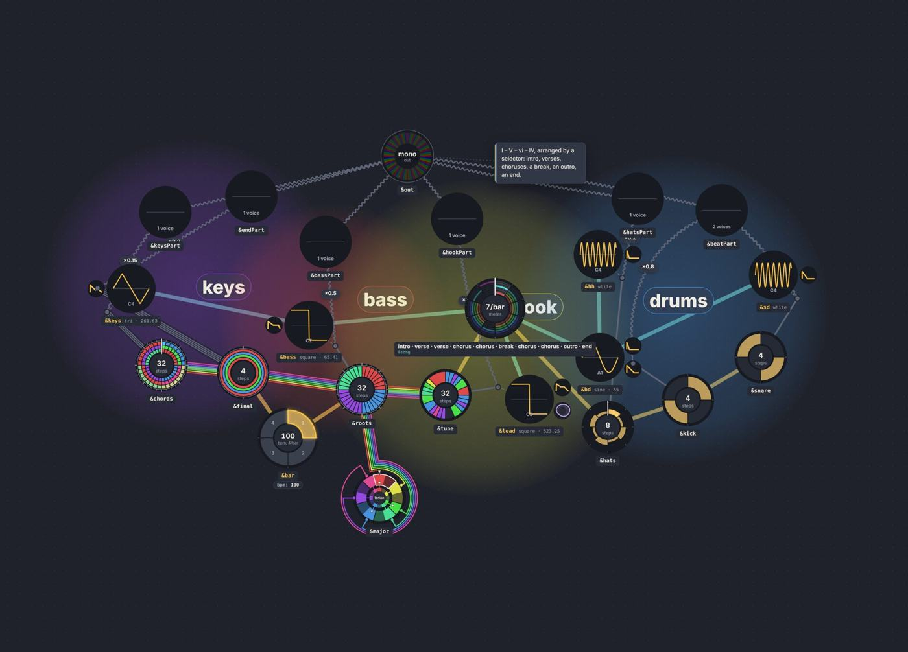
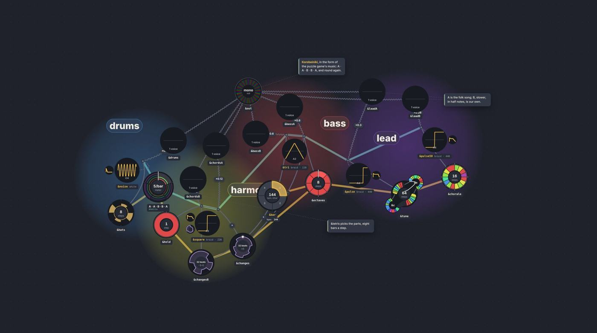
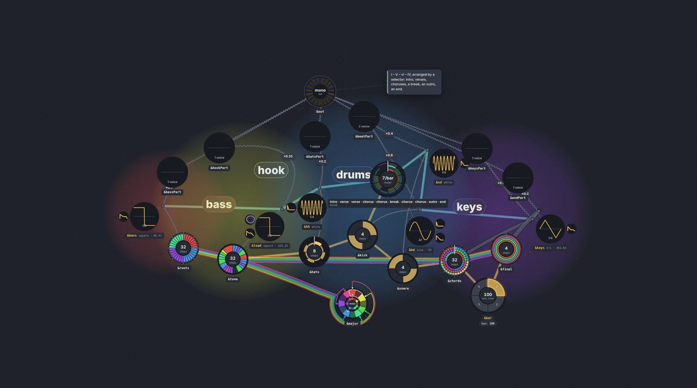
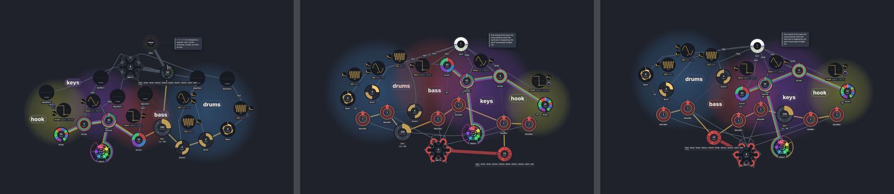
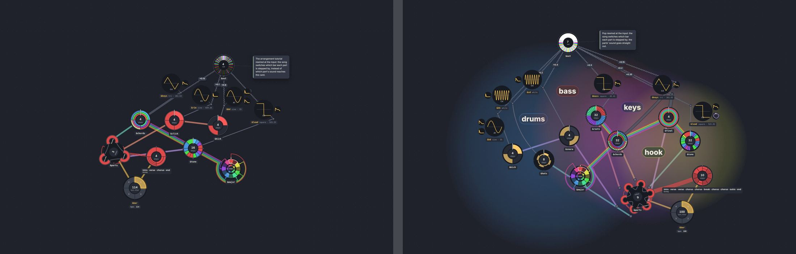

# Selectors as sequencers, junctions as gates (a probe)

Date: 2026-10-09 · Status: closed (a probe; its code, `gates.ts`, `junctionBodies` and the `?gates=` / `?junctions=` switches, was never merged: [#240](https://github.com/yggi/cell-studio/pull/240), closed 2026-10-10) · Issue: [#234](https://github.com/yggi/cell-studio/issues/234) (the multiscale epic), #29 (selectors) · Builds on [tower-rows.md](tower-rows.md)

**What came of it:** the arrangement went to the input instead ([decision 016](https://github.com/yggi/cells/blob/main/docs/decisions/016-arranging-at-the-input.md): a table of taps, the selector switching taps of a meter's bus, so a part's sound no longer passes through it and the selector sits at the bottom by itself, [tower-rows.md](tower-rows.md): after taps); and the junction got a body as the gate node ([cells: notes/gate-node.md](https://github.com/yggi/cells/blob/main/docs/notes/gate-node.md); #264, #270). The measurements and pictures below are kept as the record of the probe.

## The shape (the owner)

*Getting the arrangement selectors and the audio nodes untangled will help most; that is the shape of the junction node: the arrangement selector's trigger at the bottom, the voice's gate at the top. A sequencer in time, complementing the `&key` table's concurrent multiplexer.*

Read as a modular rack:

- **The selector is a sequencer in time.** What it puts out is *which parts are on, now*: a bus of gate lines, one per part, at the rate of its sections. By the tower (and by "a node sits where its output lives") it sits at the bottom.
- **The junction is the voice's gate, a VCA, at the top.** A product `[&tune * &lead * .3]` is where a melody, a voice and a level meet; a gate is one more factor there. The part's sound goes straight out to the sound card, gated at its junctions; it never passes through the selector.
- **Two signals, not one**: the **trigger** (a rising edge) restarts the part's own time, which is today's "a part picked starts from its top" (`docs/language/time.md`); the **gate** (a level) opens the junction. Both leave the selector; the trigger goes to the part's clocks (bottom), the gate to its junctions (top).
- **The duality with `&key`**: a table is a *concurrent* multiplexer: one index, or a chord of them (`[0,2,4]`), picks entries at the same moment. A selector does the same lookup *across time*: `over=&parts` and `over=&key` are already one operator. The difference is what comes out: a pitch from a table of pitches; from a table of parts, today their sound, in this shape a set of gates. A selector's chord (`[0,1]`) is a chord of gates.

## What it needs that the language doesn't say yet

The honest form needs the gate *written*: today no token on a part's line names the selector, so drawing a gate wire would break "every name written is one wire" ([nets.md](https://github.com/yggi/cells/blob/main/docs/notes/nets.md) decision 1). A spelling is the owner's (#29, ⚖: it could change saved pieces). Sketches, for discussion only:

```
&song step=&bar*16 laps=1 0 [0,2] [0,1,2] 0        # a sequence of part numbers: no over=, no table of parts
&keysPart [&chords * &keys * &song:0 * .15]         # the gate: "part 0 is on" as a factor at the junction
&out map=sample [&keysPart, &tunePart, &drumPart]   # the parts' sound straight out
```

or the gate on the part (`&keysPart gate=&song:0 […]`), or the table of parts kept and read the other way round. Whatever the spelling: the gate is a factor at the junction (a product already multiplies by levels), and the trigger is #29's `restart=` ("one rule, two triggers").

## Built, switched off

- `src/layout/gates.ts: gated(model)`: the model redrawn in this shape: each part's sound wired straight to where its selector's went, a gate from the selector to each of the part's junctions, the table of parts gone, and the selector made a **meter of the form** (its gates its net, laid as a tree through the junctions, as a meter's steps are). A drawing of the model, not the model: no token writes the gates.
- `LayoutOptions.junctionBodies` (0 by default) and `junctionArc`: each junction a node of its own, on a rod above its voice (round 2, below). The row rule (`flowRanks`) puts a voice under its junction and its melody under the voice when junctions are nodes; nothing changes while they aren't.
- `?opts=key:value,…` (the gallery's `OPTS=`): layout options in the app, so a variant a probe measures can be seen.
- The app and the gallery: `?gates=on`, `?junctions=bodies` (`GATES=on JUNCTIONS=bodies node tools/gallery.mjs golden 3 pop`).
- The rows probe (`tools/probe/tower-rows.test.ts`) has the gated and junction variants (rows 10 to 15).

## Measured (the 10 pieces arranged by a selector, three seeds)

| | crossings | cost | wires up / down | selectors' height |
|---|---|---|---|---|
| today | **13.7** | **18.8** | 53 / 0 % | 0.90 |
| tower zones (`emit`), the signal path within | 28.3 | 42.5 | 56 / 2 % | 0.91 |
| gated, today's rows | 34.3 | 72.5 | 54 / 1 % | 0.48 |
| gated, tower zones | 49.0 | 92.9 | 59 / 2 % | 0.50 |
| junctions as nodes, today's rows | 116.0 | 102.2 | 39 / 3 % | 0.90 |
| junctions as nodes, gated | 135.7 | 139.8 | 41 / 2 % | 0.54 |

- **Gated, the inversion is gone** (no sound runs down, the parts' sound goes straight up, `&out` reads them), **but the layout gets worse** (13.7 → 34.3): with each junction folded into its voice, a gate can only land on the voice, and the selector's net crosses every melody on its way there. Drawn as separate wires instead of a net it is about the same (on *Pop* and *Korobeiniki* 5.7 against 5.0).
- **Junctions as nodes, as built here, are far worse** (116), and not yet a fair test: nothing in the forces holds a junction near its voice (they float as dots in mid-graph, their `is` wires long), and the wires that used to end under a voice's disc are now counted as drawn. What it shows already: the selector's gate net threads *through the junction dots*, a bus of gates as the owner pictured.
- So the owner's claim holds in a precise form: **the junction node is the prerequisite**. Until a junction is a place of its own, near its voice, where the melody, the level and the gate all arrive, the gates have nowhere to land.

## Seen



*Pop, gated, junctions folded:* the parts' mixes in the top row sending their sound straight to `&out`; `&song` (a meter of the form) mid-graph, its net running out to the voices across the melodies.


## Realized junctions (round 2)

The owner: *go ahead with the realized junctions; reduce or disable other forces where they disturb, keep what helps.* What changed, all under `junctionBodies` (off by default):

- **A rod**: each junction rides its voice on a short rigid rod (their rims and 8 px apart), in the arc 60° either side of 12 o'clock (`junctionArc`; 90° and 150° measured worse, 43.7 against 35.7); the forces move it, a fifth of what pulls it moves its voice (`stepBodies`). Its collision room is its own dot, without the label pad every cell gets: the pad pushed it off its rod.
- **Rows**: a voice under its junction, and what plays into the junction (the melody, the levels) under the voice (`flowRanks`): melody, voice, junction on top, as the folded junction had it. Without this the melody and the voice shared a row and the graph went flat (ρ 0, 38 % of wires up).
- **Forces**: the spread round a node halved and the clusters off help the gated shape (below); `kinds` and spread off entirely don't. Repulsion, collision, the links, uncrossing and the rows' pull stay.

On the 10 pieces arranged by a selector (three seeds):

| | crossings | cost | wires up / down | ρ |
|---|---|---|---|---|
| today | **13.7** | **18.8** | 53 / 0 % | 0.36 |
| gated, junctions folded (round 1) | 34.3 | 72.5 | 54 / 1 % | 0.58 |
| junctions as nodes, naive (round 1) | 116.0 | 102.2 | 39 / 3 % | 0.13 |
| junctions on rods | 57.3 | 80.2 | 38 / 6 % | −0.01 |
| … and the rows kept (melody, voice, junction) | 41.3 | 53.8 | 47 / 1 % | 0.33 |
| … gated | 44.3 | 60.6 | 50 / 1 % | 0.53 |
| **… gated, spread ½, clusters off** | **35.7** | 59.7 | **57 / 1 %** | 0.52 |

Over the whole library (68 examples, three seeds), without gates: realized junctions cost what the folded ones hid.

| | crossings | cost | area Mpx² | wires up / down |
|---|---|---|---|---|
| today | **25.3** | **40.8** | **86.4** | 58 / 2 % |
| junctions on rods, the rows kept | 83.7 | 109.4 | 106.2 | 44 / 2 % |
| … spread ½, clusters off | 80.7 | 105.8 | 104.5 | 48 / 2 % |

The cost is everywhere, not in the selectors: the 58 pieces without one go 11.7 → 42.3, the 10 with one 13.7 → 41.3. A product drawn folded is two wires (melody into voice, voice into mix) meeting under the voice's disc; realized it is three (melody into junction, voice into junction, junction into mix), and its junction needs room beside its voice: crossings ×3, area +20 %. So realized junctions don't pay on their own yet; they pay where something more arrives at the junction (a gate), and only once those wires are routed (the rail, below).

- **Realized junctions now carry the gated shape as well as the folded ones did** (35.7 against 34.3), with more wires leaving up than today (57 % against 53 %) and the vertical order kept: melodies at the bottom, voices above them with their junctions on top, the parts' mixes over those, `&out` on top.
- **The remaining cost is the gate net**: one tree from the selector to every junction of every part, across the width of the graph, crossing the melodies that rise from below to their voices. Where the junctions happen to stand in a row, the tree already runs along them as a rail (Pop: bass → hats → keys), which crosses nothing: a wire that ends at a junction from below doesn't cross a rail at the junction's height.



*Korobeiniki, gated, junctions on rods (spread ½, clusters off):* `&out` on top, the parts' mixes under it, the voices with their junction dots above them (`&tri` has two), melodies and meters at the bottom; `&tetris` (a meter of the form) at the left, its gate net (teal) reaching across to the lead's junctions on the right.



*Pop, the same:* the three tiers, and the gate net running along the junctions as a rail in the middle.

## Round 3: arranging at the input

The owner: *rewire arrangement selection on the other end: not at the output of a mixer, with an inactive section running and stepped but not rendered (which is what leads to the tacets and other couplings), but at the input: switching a section's connection to the meter bus on and off. The meter is not special; unify the buses.*

```
&parts step=&bar &keysBar &tuneBar &drumBar
&song over=&parts step=&bar*16 laps=1 label="intro · verse · chorus · end" 0 [0,2] [0,1,2] 0
&kick step=&drumBar 0 ~ 0 ~
```

A part is a **tap of the meter bus**; the selector switches which taps are live; whatever a tap steps plays, whatever it doesn't stands still. The parts' sound goes straight out, through no selector. Today this compiles (with #29's warning that a table of cells isn't entries) and draws with every wire written as a token: `&bar → &drumBar → &kick`, `&drumBar → &parts → &song`, `&kick * &bd → &out`. It doesn't sound gated yet; for the layout it is the real graph. The probe pieces are in `tools/probe/pieces/` (`arrangement-input.cells`, `pop-input.cells`; the examples are untouched); the rows probe reads them with `CELLS=`.

| three seeds | crossings | cost | wires up / down |
|---|---|---|---|
| Pop today | 0.0 | 0.0 | — |
| Pop gated at its junctions (the best of round 2, per piece) | ≈ 3–5 | — | — |
| **Pop arranged at the input**, today's rows | **0.7** | 1.9 | 47 / 4 % |
| Pop arranged at the input, tower zones | **0.7** | 2.6 | 51 / 5 % |
| the arrangement tutorial: today / at the input | 0.3 / 0.0 | | |

- **At the input it is nearly free** where every way of gating at the output cost 5 to 35 crossings: the selector gates clocks, not sound, so nothing runs down into it, and no gate wire has to reach the top of the graph.
- **The tower comes out by itself** (picture below): the form (`&song`, `&parts`) at the bottom, a row of section taps over `&bar`, the melodies over them, the voices and their products on top by `&out`. Trigger at the bottom, sound at the top, as the owner drew it.
- **The meter is not special already**: each section tap is drawn as a meter of its own (its own colour, its own net), which is right and also a hint for the drawing: the taps are switches *on one bus* (`&bar`'s), and should be drawn as such, not as separate meters. "Meter not special" in the forces (not placed last, no push between time and sound) measured over the library (three seeds): crossings 25.3 → 31.7, most of it in the selector pieces (13.7 → 19.0; the other 58 11.7 → 12.7). So in the forces the meter's own placement (laid out last, where its net costs least) still earns its keep; what unifies is the bus, not the placement: a meter's net is a bus like any other, and its sections are switches on it.



*Pop today; arranged at the input; arranged at the input with the tower's zones (`?rows=zones`).*

## Round 4: the parts wheel, its taps as sub-wheels

The owner's drawing:

```
&bar-wheel --- (bar bus) ---> &parts-wheel
&parts-wheel: &keysBar &tuneBar &drumBar as sub-wheels, each with a positioned output tap
meter edges from &tuneBar's tap to &tune, &keysBar's to &chords, &drumBar's as a real multi-segment net to &kick and &click
the meter's net split at &parts into sub-nets, switched on and off by &song
```

Built (`src/layout/taps.ts`, `?taps=on`, the gallery's `TAPS=on`, the rows probe's `taps` rows; off by default):

- **The model** (`tapped`): a table whose entries are clocks is one wheel; the meter's edges into its taps become one, into the table (the bar bus); the taps' splices into it go (they are its sub-wheels, its bulbs, decision 014); each tap is a meter, so what it steps is its net (traces, multi-segment), not edges.
- **The layout**: each tap rides its table at its bulb (`setRiders`), as a junction rides its voice, exempt from "meters placed last", a share of its net's pull moving the table; and the table **turns** so its taps face what they step (`tableTurn`: the circular mean of how far each tap's net would turn it, a little each tick), as a tape's heads face their cells. The wheel draws its turn (`CellNode`, `turn`).
- **The drawing**: a tap is a socket on its bulb (a junction's dot), the bulbs are the table's own.

| the tutorial and Pop at the input, three seeds | crossings | cost | wires up / down |
|---|---|---|---|
| taps drawn as wheels of their own | 0.7 | 1.9 | 32 / 8 % |
| taps on their table | 7.3 | 27.0 | 50 / 0 % |
| **taps on their table, turned** | **4.0** | **14.4** | **51 / 0 %** |
| taps on their table, turned, tower zones | 6.0 | 18.2 | 73 / 0 % |

- **It is the owner's picture** (below): the bar bus into the parts wheel, a sub-net out of each tap in its own colour (`&drumBar` through `&click` to `&kick`, `&keysBar` to `&chords`, `&tuneBar` to `&tune`), `&song` reading the parts wheel as a bus, the switch. In Pop the parts wheel sits at the bottom between `&bar` and `&song`, its six sub-nets fanning up to their sections: the tower again.
- **No wire leaves downwards** any more; the cost is the sub-nets fanning out of one wheel across the graph (crossings 0.7 → 4.0 on the two pieces). Turning the table halves it.
- **Rough edges**: a socket sits at 0.7 of its table's room, near its bulb but not on it (the bulb's own place is the drawing's: `track.ts`); the turn rotates the whole wheel, its marker at 12 o'clock too. Only measured on these two pieces.



## A gate node: the owner's sketch, reviewed (for #10)

The sketch: a junction written as a cell, taking voices as its braid, with `trigger=`, `value=`, `velocity=`, `gain=` and `map=gate`:

```
&leadOut trigger=&tune value=&tune map=gate gain=0.5 velocity=&(1.0 0.5 0.8 0.5) &lead
&kickOut trigger=&drumBar map=gate &kick
&kick trigger=&drumBar map=gate &(0 ~ 0 ~)
```

**What it gets right.**
- It names what the product hides: today `[&tune * &lead * .5]` folds a trigger (when), a value (which pitch), a level and a voice into one `*`. As ports they get bands (#150): `trigger=` sync, `value=` and `velocity=` CV, the braid audio. The nets note already said melody → voice is a two-wire bus (gate and pitch); this writes the two wires.
- It makes the junction a named cell, so a node with a body, where a gate can land: round 2's prerequisite, in the language.
- The product stays as its anonymous form, as `&( … )` is for a named cell (nets decision 2): `[&tune * &lead * .5]` ≡ `&( trigger=&tune map=gate gain=.5 &lead )`. One canonical form, the product its shorthand (#151).
- With arranging at the input it needs no section gate at all: a part that isn't stepped doesn't trigger. The gate node is a *note* gate; the sections live on the meter bus. Two mechanisms, two scales.

**Where the three lines disagree with each other.** The braid means three different things: a voice (`&lead`), a pattern (`&kick`, which in the sketch above is `0 ~ 0 ~`, not a voice), an inline pattern (`&(0 ~ 0 ~)`). A cell's braid should mean one thing. Proposed: **the braid is what sounds** (voices; several are a kit, picked by `value=`), `trigger=` says when, `value=` which (a pitch for a voice, an index into a kit), and `value=` defaults to the trigger's own values, which is the common case:

```
&leadOut trigger=&tune map=gate gain=.5 velocity=&(1 .5 .8 .5) &lead   # value= is &tune's
&kickOut trigger=&kick map=gate &bd                                     # the pattern triggers, the voice sounds
&drums  trigger=&beat map=gate &bd &sd &hh                              # a kit: &beat's values pick
```

The lambda form, a pattern inline, then reads `trigger=&(step=&drumBar 0 ~ 0 ~)`: the anonymous cell where the pattern goes.

**Questions it raises.**
1. **`trigger=` against `step=`.** `step=` advances a cell; `trigger=` fires a note on each onset of another (its rests fire nothing). Is `trigger=&drumBar` (a clock, every tick fires) the same port as `trigger=&kick` (a pattern, its onsets fire)? Proposed yes: a clock is a pattern with an onset every step.
2. **Resume or restart.** A part whose tap is switched off stands still; switched on again, it goes on from where it stood (a gate). Today's selector restarts a part from its top (a trigger). Both are needed: verse 2 should start at the top of the verse. So the selector sends both, a gate (the tap) and a trigger (a reset of the part's clock on its rising edge): #29's `restart=` ("one rule, two triggers") is that reset.
3. **What a section owns.** Only what is stepped from its tap (downstream in the step chain) is switched; a vibrato on `loop=6`, a drone on its own clock, a tape's motor go on. That is a rule a beginner can see in the graph (the tap's net), and BWV 847's movements become two taps of `&tempo` (`&form step=&tempo 0@624 1@511` over them), its `&tacet`s gone.
4. **`map=gate`.** `map=` says how a cell's values become output (`amp`, `lin`, `sample`, `adsr`): `gate` (its braid sounds when triggered) fits. Whether `trigger=` alone should imply it is a spelling choice.
5. **Velocity and gain** are both levels at the junction: `gain=` constant, `velocity=` per note. They multiply, as factors in a product do today (decision 006).

## Next

1. **Sockets on their bulbs**: the rider at its bulb's own place (`track.ts: layTrack`, as `netEnds` finds a net-ref's), and the table's marker kept at 12 o'clock while its bulbs turn.
2. **The switch drawn**: a sub-net lit while `&song` has its tap on, dark while off (the live state knows which parts a selector picks now).
3. **The owner's answers** are [decision 016](https://github.com/yggi/cells/blob/main/docs/decisions/016-arranging-at-the-input.md); the gate node, under the pressure of kits, MIDI out and gating anything, is [cells: notes/gate-node.md](https://github.com/yggi/cells/blob/main/docs/notes/gate-node.md).
4. **A spelling** for the tap (a part as a switched tap of the meter bus), the trigger (restart) and the gate node (#29, #10, ⚖ owner); then the engine, and Pop and BWV 847 rewritten as the tests.
