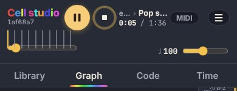
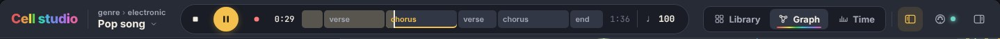
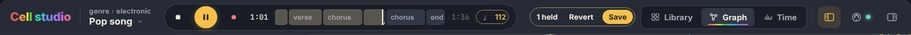
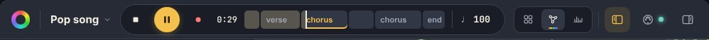
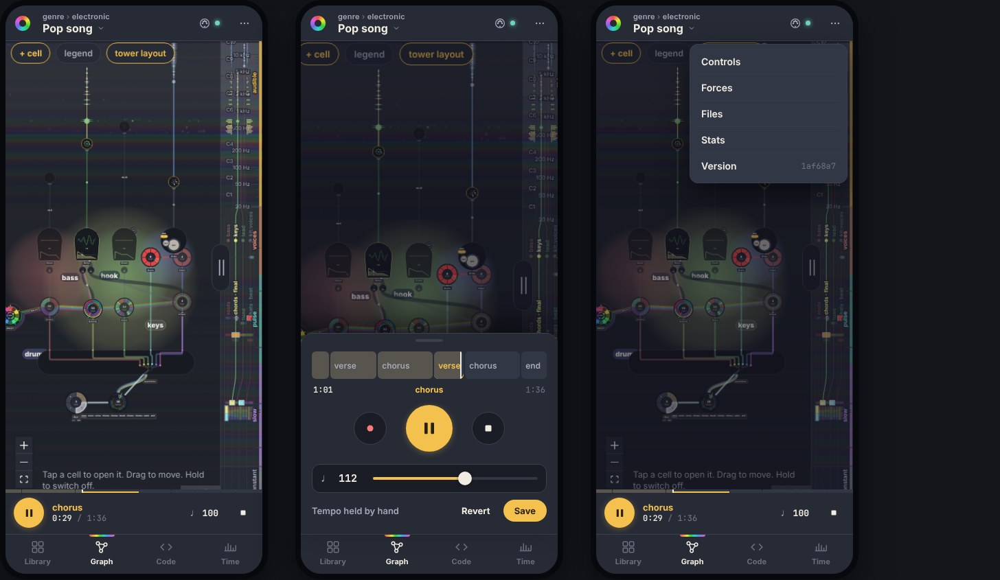

# The titlebar and transport: a redesign (mock-up)

2026-10-20 · open (mock-up, awaiting the owner's choice) · no issue yet

The header (`src/App.svelte`) and the transport (`src/ui/Transport.svelte`) as they are, pictured with the gallery's `play` subject (Pop, 6 s in, at 1440, 1000 and 390 px wide), and a proposal for desktop and phone. The mock-up is static HTML over those screenshots, in the app's theme tokens (`src/app.css`); nothing in `src/` has changed yet.

## Today

- **Desktop: one flat row of a dozen controls**, nothing grouped and everything about the same weight: wordmark, version, play, stop, the path, the clock, MIDI, ☰, the track, the tempo, the view tabs, Code.
- The title, its path and the clock are stacked in 12–13 px beside the buttons. MIDI and ☰ (the inspector) sit between the clock and the track, though they have nothing to do with time.
- The section names float above a thin native slider, then a dead gap before the tempo. Revert · Save hold an invisible slot.
- **At 1000 px the track collapses to its thumb** and the tempo slider runs under the view tabs. This is a real bug, not taste: `.lower` is `flex: 1` beside a `flex: none` row.
- There are two gold circles (play, and stop's breathing ring), and Code is styled as a second primary button. Code is a pane toggle but sits beside the stage tabs.
- **Phone:** the path truncates to "e. › Pop s…", the track gets half the width (no section name fits), and play is at the top, out of the thumb's reach. That's 150 px of chrome before the graph's own toolbar.

## Proposal: desktop

A 56 px bar in three grid zones (`auto · 1fr · auto`), one job each:

- **Left, what's open:** the wordmark, then the piece: its name at 15 px, with its path as an 11 px caption above it. The whole block opens the quick pick as a popover (its three steps as columns). The version moves into the ⋯/inspector (and the wordmark's tooltip).
- **Centre, the deck:** one capsule for everything about time: stop · play · record, the clock, **the sections as segments** with their names inside (the played part filled, the current one underlined in gold; a click on a name jumps to it, anywhere else seeks), the length, and the tempo as a number (drag it, or click for a slider). It takes all the free width, so it can't collapse.
- **Right, where you look:** the stage switch (Library · Graph · Time) as a segmented control, then layout toggles for the two panes, placed like the panes open: code ◧, MIDI with its lamp, the inspector ◨ (was ☰). Revert · Save appear here as one chip ("1 held · Revert · Save") when a value is held, and the tempo in the deck turns gold.
- **One gold thing: play.** Stop is plain: enabled or dimmed.
- **Narrow (≈900–1200 px):** the wordmark becomes the rainbow glyph, the path and the length move to tooltips, and the tabs show icons only. The segments keep their names where they fit (the rule `room()` already has).

## Proposal: phone

- **Top, what:** the glyph, the piece (name in full, path above it), MIDI, and ⋯ for the inspector's pages (Controls, Forces, Files, Stats, Version).
- **Bottom, under the thumb, play and where:** a 62 px mini player above the tab bar: play, the current section and the clock, the tempo, stop. The sections run along its top edge as a 5 px strip. Tap it or swipe up for **the full deck** as a sheet: 40 px segments with names, record · play · stop (68 px play), a full-width tempo slider, and Revert · Save.
- **The tabs move to the bottom**, with icons. When the keys dock is open, it sits between the stage and the mini player.
- The chrome totals 52 + 62 + 58 px, about the same as today's 150 px, but the controls you use while playing are within reach and the track can show names.

## Open

- Whether Library stays a tab, or becomes the piece block's job (it is "open another piece").
- The graph's own toolbar (+ cell, legend, tower layout, notes) is out of scope here. It is the next band of chrome on a phone.
- Building it touches `App.svelte` (the header grid, bottom tabs on a phone), `Transport.svelte` (the deck, the segments, the tempo popover, the mini player and sheet), `QuickPick.svelte` (a popover) and `Version.svelte` (moving it). It is a user-visible change, so it needs a CHANGELOG line, and the smoke test covers the transport.
