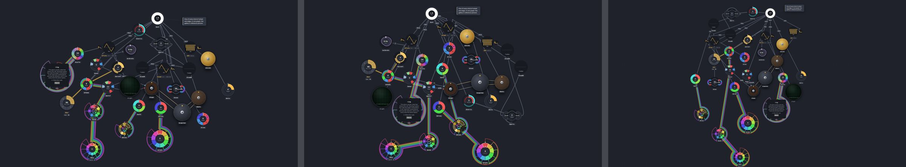
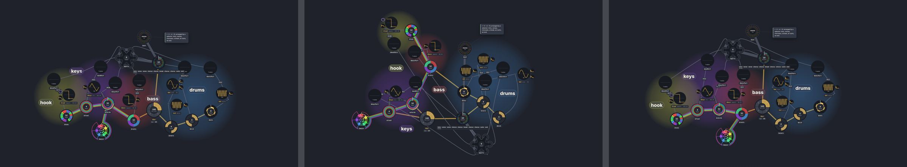
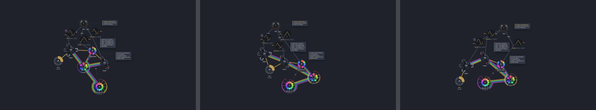
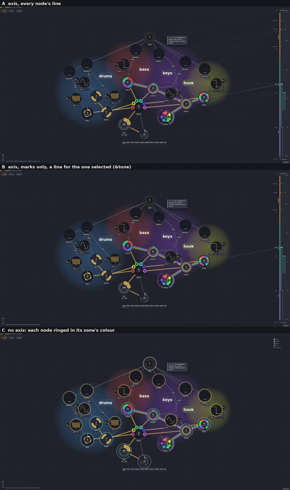

# Rows by the frequency tower (a layout probe)

Date: 2026-10-09 · Status: open (probe; nothing changes unless switched on) · Issue: [#234](https://github.com/yggi/cell-studio/issues/234) (the multiscale epic; its first lead) · The idea: the multiscale note ([#237](https://github.com/yggi/cell-studio/pull/237))

The question: lay the graph out in rows by the **frequency tower** (each node at the height of its time constant, on one log axis: the constant at the bottom, then the slow, the pulse, the audible, the sound card outside on top) instead of by the signal path. What does it cost, where do the selectors land, and does Bach fit it better?

## Built, switched off

- `src/layout/tower.ts`: `towerOf` (each node's height in decades: a clocked cell by its step, its turn or between; a voice by its pitch, an instrument without one by its filter or 1 kHz; a junction at its voice's; a part at its reader's; a mix just above what it carries) and two ways to make rows of it: `towerRanks` (a row per decade or half decade) and `zoneRanks` (the tower's zones, constant / slow under 0.5 Hz / pulse / audible from 20 Hz / outside, with the signal path's rows inside each). `tower.test.ts` checks them on a small song.
- `LayoutOptions.ranks` (unset by default): rows given, for the layered start and the pull back to it (`start.ts`); a node it doesn't name keeps its rank in the flow.
- The app and the gallery: `?rows=tower` or `?rows=zones` (`ROWS=zones node tools/gallery.mjs golden 3 pop`).
- `tools/probe/tower-rows.test.ts` (the `probe` skill's pattern; skipped in `npm test`): `PROBE=out.txt npx vitest run tools/probe/tower-rows.test.ts`, with `ONLY=`, `PIECES=a,b`, `VARIANTS=0,1`.

## Measured (68 examples, three seeds)

| rows | crossings | cost | wires up / down | ρ (height ~ tower) | selectors' height |
|---|---|---|---|---|---|
| **today** (the signal path) | **25.3** | **40.8** | 58 / 2 % | 0.58 | 0.90 |
| tower by step, a row a decade | 68.3 | 105.6 | 54 / 11 % | 0.76 | 0.10 |
| tower by step, two rows a decade | 75.7 | 116.7 | 55 / 12 % | 0.78 | 0.10 |
| tower by turn | 74.7 | 111.5 | 52 / 12 % | 0.77 | 0.09 |
| tower by the step and turn's mean, two rows a decade | 72.7 | 107.8 | 55 / 13 % | 0.81 | 0.07 |
| tower by step, rows held (`rankPull` 0.3) | 94.0 | 139.2 | 46 / 10 % | 0.79 | 0.07 |
| tower, **each node where its output lives** (`emit`) | 56.3 | 76.9 | 56 / 5 % | 0.77 | 0.77 |
| **zones by the tower (`emit`), the signal path within** | 46.0 | 76.2 | **65 / 4 %** | 0.72 | 0.91 |
| zones by the tower (step), the signal path within | 78.3 | 125.3 | 59 / 11 % | 0.72 | 0.15 |

ρ is Spearman's between height and the tower once laid out (1: height is the tower). "Selectors' height": 0 the bottom of their piece, 1 the top. Rows four to six were measured before instruments without a pitch were given the audible zone; that changed the first tower row by 0.4 crossings.

- **The tower costs crossings in today's language**: by step, 25 → 68. Height follows the tower far better (ρ 0.58 → 0.76).
- **The selectors carry most of it**: the 10 pieces arranged by a selector go 13.7 → 51.0 crossings, the other 58 pieces 11.7 → 17.3. The five pieces it hurts most all have selectors (Cellscape 3.7 → 14.3, Korobeiniki 0.3 → 7.0, Hypercell, Baustelle, Pop); the ones it helps most have none (the Ricercar 1 → 0, Automaton, Five, Voice, Moving).
- **Why**, by the wires that run down (per seed, tower by step): 47 are a part's sound running down into its table of parts, about 10 more sound into a tape, a resonator or a selector, 28 other splices, 9 into mixes. A selector's clock puts it at the bottom while its sound still has to pass through it: the inversion of the multiscale note, drawn.
- **A node sits where its output lives** (`emit`): placing what carries sound (mixes, tapes, tables of parts, a selector *as written today*) by the sound it carries rather than its clock takes the downward wires from 11 % to 5 % and the crossings 68 → 56 at the same fidelity. It is the rule that lets a selector go down once it sends *gates* instead of sound: its output would then be slow, and so would its place.
- **Zones, then the signal path** is the best tower-shaped layout: 46 crossings, 65 % of wires leaving up (today 58 %), 4 % down. The rest of its cost is mostly rows that a decade's width makes crowded: everything between 1 and 8 Hz (melodies, levels, meters) in one zone, against a layout whose forces and row trials were tuned on the flow's rows.

### Bach

The owner's hypothesis: *Bach towerizes well.* On the seven contrapuntal pieces (BWV 847, the C major Prelude, the Ricercar, *Per tonos*, Pachelbel, the canon, *Mirrors*), tower by step against today: crossings 3.7 → 4.0, **cost 9.7 → 4.3**, ρ 0.64 → 0.81. So yes, as far as seven pieces say: their structure already nests by time, and the tower costs them nothing in crossings while their weighted crossings halve. The library as a whole pays where it arranges with selectors.

## Seen

Today · tower by step · zones (`emit`) with the signal path within, each stopped, in the real Graph (`node tools/gallery.mjs golden 3 pop ricercar`, `ROWS=…`):

*The golden graph:* by step, the voices take the top row, the tables the bottom, `&day` sinks to the slow zone where a day belongs, and `&tetris` with `&parts` falls to the bottom right with its sound wires running down into it. By zones it is a tall tree hanging from `&out`.

*Pop:* by step, `&song` and `&parts` at the bottom, every part's sound running down to them and one trunk back up to `&out`. By zones (its selector carries sound, so it stays with the sound) it is today's picture.

*The Ricercar:* the same graph three ways, the King's theme and its tables under the voices each time.

## Found on the way

- **The sound through a selector is labelled CV.** A part's mix into its table of parts, the table into its selector and the selector into the sound card are wires of band `cv` in the model, though they carry sound; so they are drawn as plain lines, not ripples: [#238](https://github.com/yggi/cell-studio/issues/238).

## After taps (2026-10-10)

Re-measured on main after taps on their table ([decision 016](../decisions/016-arranging-at-the-input.md)) and the simpler forces (#263), 69 examples, three seeds. The probe now finds a selector written with taps (`over=` reading a table of taps), and `emit` places a pattern of voices (a kit's groove, `&groove &bd &sd`) with the sound it sends on.

| rows | crossings | wires up / down | ρ settled | selectors' height |
|---|---|---|---|---|
| **today** (the signal path) | **53.3** | 58 / 2 % | 0.62 | **0.04** |
| tower by step, a row a decade | 83.0 | 58 / 6 % | 0.78 | 0.10 |
| tower, `emit` | 86.3 | 58 / 4 % | 0.77 | 0.08 |
| zones by the tower (`emit`), the signal path within | 78.3 | 66 / 3 % | 0.71 | 0.06 |

- **Taps took the selector's inversion away.** Today's layout already puts the selectors at the bottom of their pieces (0.04; before taps 0.90), and "a part's sound into its table of parts" running down fell from 47 wires a seed to 5: the form sends up, as the multiscale note asked, without the tower.
- **The tower still costs about 30 crossings** (zones: 25), half again today's. The selector pieces carry 24 of them (41.7 → 65.7), the other 59 pieces 6 (11.7 → 17.3).
- **What the tower still turns upside down** (counted on the rows alone, no layout, `emit`): 81 meters' `step=` wires (a meter clocks a slower cell, `step=&bar*16`; drawn as the meter's net, so they hardly show as wires running down), 6 braids, 4 `over=`. Patterns of voices were 29 more; placed with their sound they are none, and the crossings did not move (87.3 → 86.3, inside the ±8 of a seed). **What the tower costs now is its rows, not wires that run the wrong way.**

## The tower drawn (2026-10-10)

The owner's choice after the re-measure: **the tower as a drawn axis**, today's layout kept. Mocked first as three variants of `src/ui/TowerAxis.svelte` on the real Graph. Each node is a span from its turn to its step (`towerSpans`, `layout/tower.ts`), a voice at its pitch in its colour, a mix just above what it carries.

- **A**: the axis at the right edge, zones marked, every node's line to its mark: the whole picture at once, and a web of lines over the graph.
- **B**: the axis with the marks only, a line for the cell that is selected: quiet; the axis reads as a ruler of the piece's time scales.
- **C**: no axis, each node ringed in its zone's colour: no lines at all, but four colours to learn and no scale.

**Chosen: B** (2026-10-10), built as the graph's *tower* button ([graph.md](../ui/graph.md)); A and C were dropped. The gallery opens it with `TOWER=1` (`TOWER_CELL=tune`: its line, as if selected).

Seen on the way: a table with no clock of its own sits at the constant, though what reads it moves it: a table of taps (`&parts`, its selector), a kit (Metronome's `&clicks`, read over `&bar`).

After review (#268): the axis sits beside the graph, not over it (the flow's box stops at it, so it hides no cell), and steps to the left edge of a cell's card while one is open, so the selected cell's line is seen when it is clicked, not only through `?towerCell=`.

## The tower balanced (2026-10-10)

The owner's ask: the tower and the graph balance each other; density in the graph moves the tower's zone borders, and
a node's place in its zone pulls it to a height in the graph. Chosen: the axis follows, a weak pull, kept only if the
crossings stay within the noise, and only while the tower is open.

- `layout/towerfit.ts: towerFit`: a monotone fit (isotonic regression, pool adjacent violators) of the graph's
  heights against the tower's; a pooled stretch is flat, nodes at one height on the tower are one point.
- **The axis** is drawn by it (`TowerAxis.svelte`): a height on the tower sits at 70 % its share of the graph's span by
  the fit and 30 % an even log scale, so dense zones are wide and the axis never folds up; panning leaves it still.
- **The pull** (`LayoutOptions.tower`, `towerPull`; `physics.ts: stepTower`): every node with a finite height drawn
  toward the fit's height for it, the fit made again every 20 ticks from where the nodes are.

Measured (`tools/probe/tower-balance.test.ts`, four seeds, library sums; ρ is Spearman's of height against the tower,
the mean over pieces):

| pull | crossings | cost | area Mpx² | ρ |
|---|---|---|---|---|
| 0 | 53.3 | 117.7 | 87.8 | 0.623 |
| **0.02** | **53.0** | **114.5** | 88.3 | **0.647** |
| 0.05 | 56.5 | 123.0 | 89.2 | 0.669 |
| 0.1 | 58.8 | 128.6 | 89.6 | 0.680 |

0.02 leans the graph toward the tower at no cost in crossings (`TOWER_PULL`); stronger pulls lean more and cross more.

## Next

1. The language's side (the multiscale note's "the form sends up"): with a selector that sends gates, rerun `emit`: the selector should go down by itself and its crossings with it. A rewritten *Pop* or Korobeiniki is the test.
2. Rows within the pulse zone: a melody, its levels and its meter in one wide row is where the tower loses; half-decade zones there, or the signal path's rows within the pulse zone only.
3. If a tower-shaped layout comes close to today's crossings, the tower drawn beside it (the multiscale note's lead 2).
