# The tower's sky: sockets as spires, the strip's sum in its sources' colours, one tiered strip

Date: 2026-10-14 · Status: open (a prototype in the tower layout; the owner's choices of 2026-10-14 built, below) · Issue: [#234](https://github.com/yggi/cell-studio/issues/234) (the multiscale epic) · Follows [tower-strip.md](tower-strip.md)

## The ask, read back

1. **The audible sky.** In the tower layout, the audible stratum is a muted spectral rainbow behind the graph. Each socket's level meter becomes an **antenna spire** that sends its spectrum into the open sky, brightening it, tinted in its **section's colour**, and locked to the scale of the frequency strip at the right.
2. **The strip's sum.** The spectrum in the strip is the sum of every out and keeps the sources' colours, so it always reads as the sum of the sources.
3. **Alignment.** A marker in the strip sits at the height of its out-node (on a phone, Cellscape's `glint · sine · droneB · ripple` marker was far under its socket).
4. **The strip's markers**, refined and discussed.
5. **The time view shares the mechanism**: an audible stratum (waterfall, notes; voices and outs in the graph) and an inaudible one (scalogram; the structure's nodes), and a tiered frequency scale as a smart strip at the side.

## 3. Alignment: fixed, in #408

The marker sat at its source's top, not at its socket; the fix, its test and its before/after are in [tower-strip.md](tower-strip.md#markers-level-with-their-sockets-2026-10-14).

## 1. The sky (prototype, `TowerSky.svelte`)

- **The sky** is the audible part of the tower's scale (20 Hz … 20 kHz) across the whole graph, behind it: a band a semitone in its note's colour by its octave (the notes' gradient, theme.ts `noteHsl`: full saturation in the fourth octave, darker below, brighter above), muted (9 %), the same rainbow as the strip, on the graph's own scale (it pans and zooms with it). Under 20 Hz it fades out: there the structure stands.
- **A spire** stands at each socket: a mast from its lowest sounding band to its highest, its levels as bars out from the mast *at their own heights* (the left channel to the left, the right to the right). So the meter is scale-locked: a C5's mast starts at 523 Hz and its partials step up it. A socket lifted to the audible's floor (a bass, a groove's drums) has its mast reaching down under it to its real fundamental.
- **The light**: each band a glow out from the spire, as far and as bright as it is loud (up to 1100 px at zoom 1), added (`lighter`), so the sky brightens where several reach, and softened over a few semitones. Stopped, the partials at rest, faint; playing, the live spectrum at 30 fps.
- **The out's colour** is its source's note now (its base stopped), by octave, the colour its socket's meter and its wire wear: one colour an out, everywhere (`outRgb`, `ui/heard.ts`); drums and noise white. (A tint per out, round the colour wheel, was a stop-gap, dropped: below, *The outs by their notes*.)
- `heard()` (`ui/heard.ts`): what a socket hears, a groove's or kit's drums together. The socket's meter, the spire and the strip all read it (the strip used to see nothing of a kit).

Three ways to light it (`?sky=tint|rainbow`, `?sky=off`; the gallery's `SKY=`), Pop at 45 s, real audio (taken before the octave gradient and the colours per out) (`QUERY='layout=tower&strips&sky=rainbow' node tools/gallery.mjs play 45 "Pop song: four chords, arranged"`):

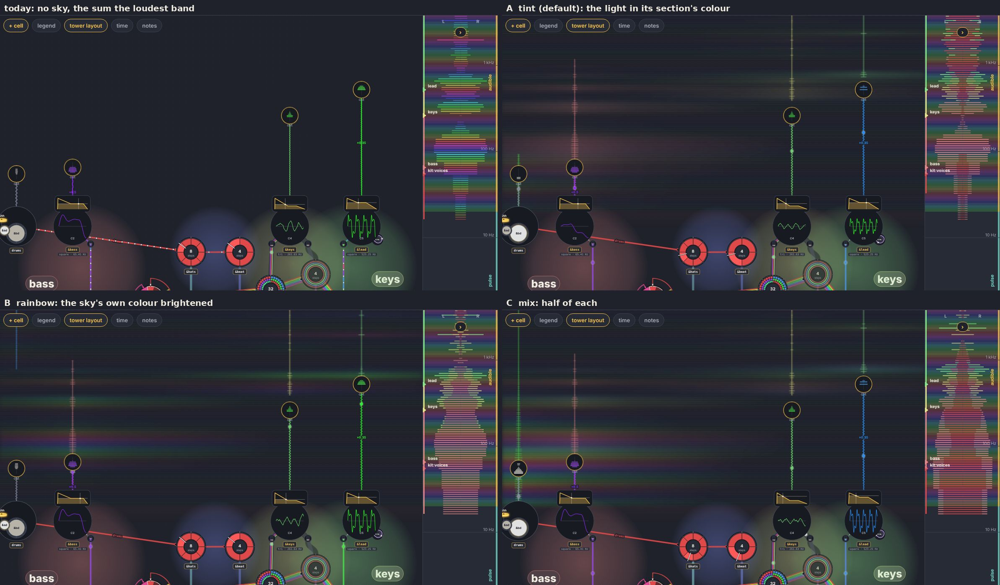

- **A, tint**: the light in its section's colour. Which part lights which height reads at a glance: the bass's red low, the keys' green over it, the lead's blue. Pitch is read from the scale, not the colour.
- **B, rainbow**: the sky's own colour at that height brightened. The sky stays a true spectrogram (C red at every octave), but neighbouring sources blend and nothing says which spire lit what. Only the masts are tinted.
- **C, mix**: half of each.

Chosen (the owner): **C, the mix**, the default now.

The pieces as built (the mix, the octave gradient, each out in its note), real audio at 45 s (`node tools/gallery.mjs play 45 …`, `QUERY='layout=tower&strips'`):

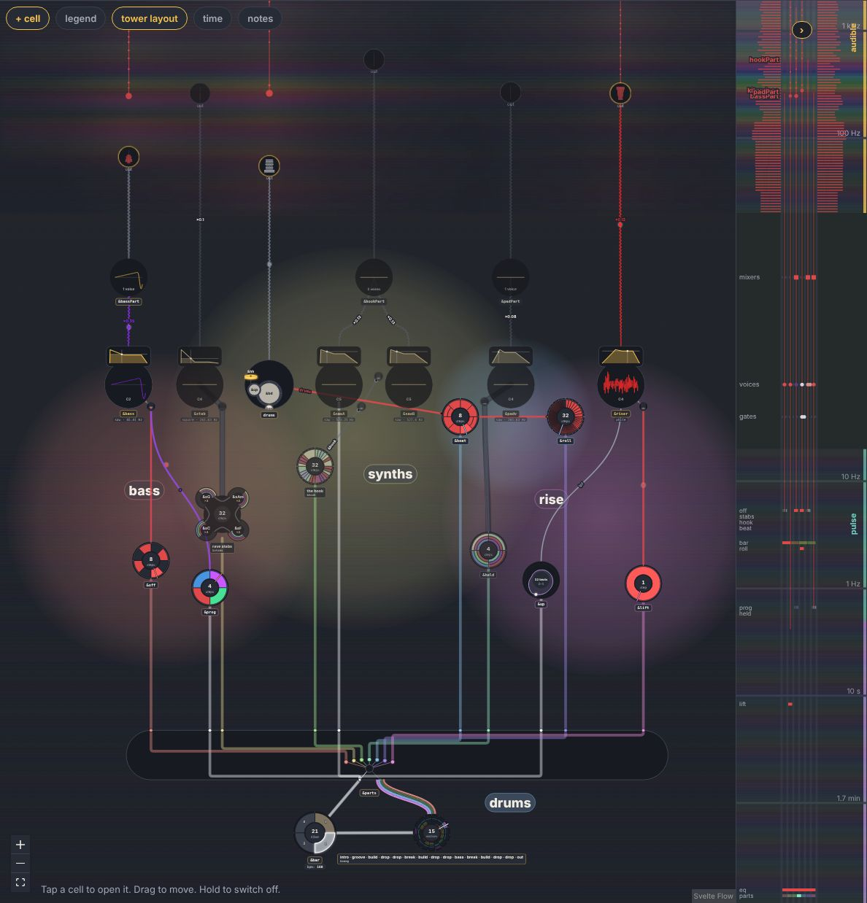

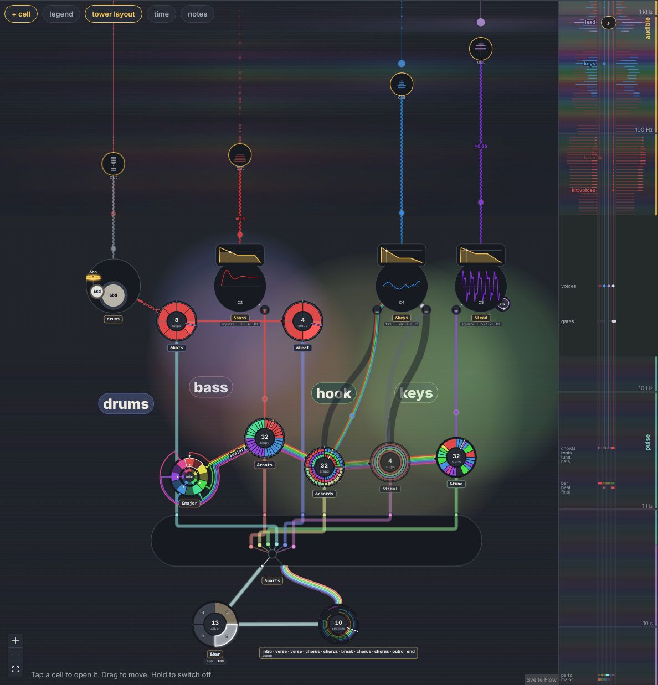

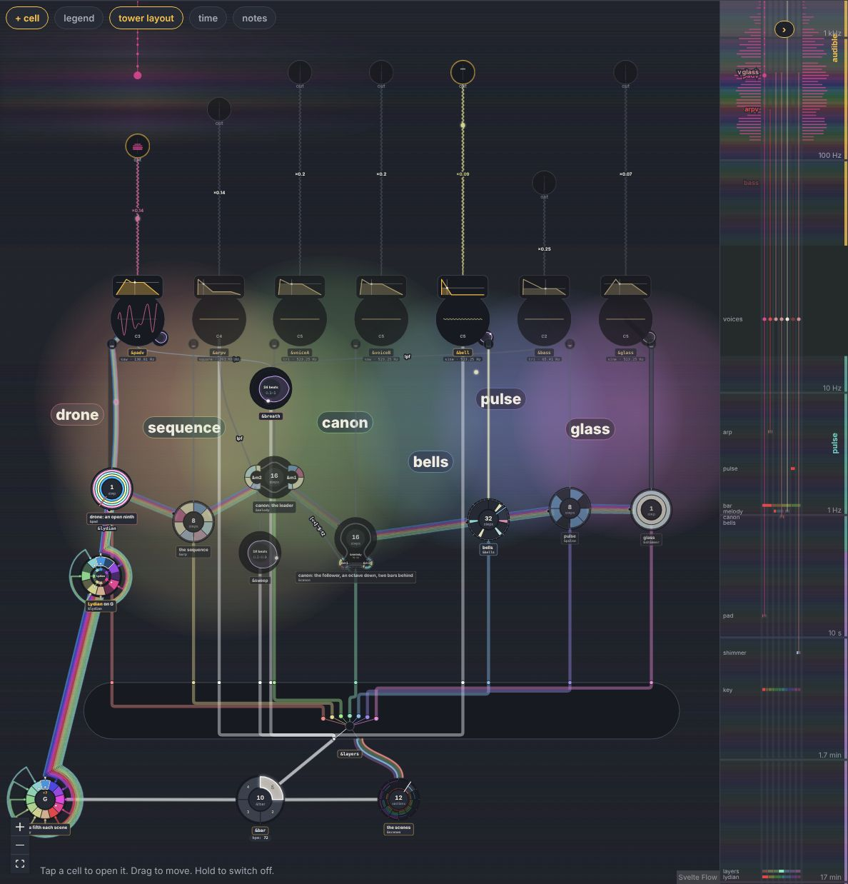

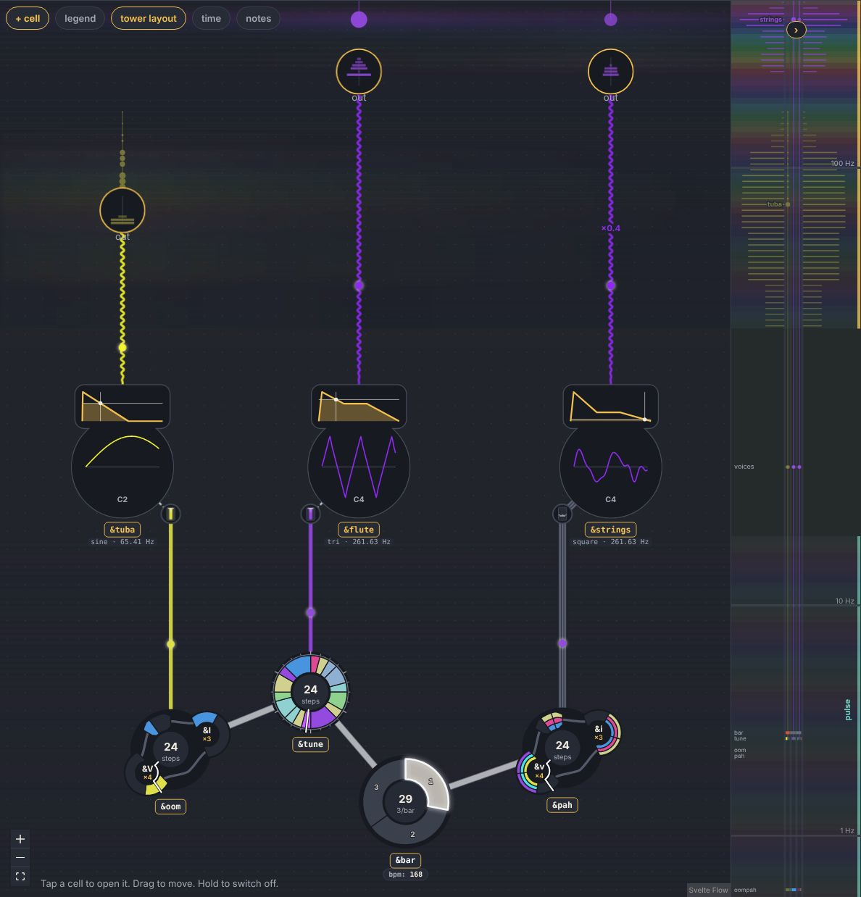

Seen:

- The sky reads as a spectrogram standing on the graph: each part's light at its own heights, Hypercell's bass part low and red, its hook's saws high. Where many spires stand close (Hypercell's six outs over 900 px) the light runs together into one band; reach could scale with the space between spires.
- **The socket's meter and its spire say the same thing twice.** The spire is the scale-locked meter; the round meter could become just its foot (the wire's end and *out*), keeping its room in the layout. Not done: the owner's call.
- The socket, its wire, its spire and its share of the strip now wear one colour, the source's note.
- Cost: not profiled yet (the profile skill is next before building it out). One canvas at half resolution, about 60 bands × 2 sides × the spires a frame, and one blur.

## 2. The strip's sum: stacked in its sources' colours

Each band's bar is as long as its loudest source (as before) and is split into the sources' shares (each source's level over their sum), each in its colour, the sources in the graph's order from the centre out. `?sum=max` (the gallery's `SUM=max`) brings back today's single bar in the band's colour (the first tile above). In Hypercell's strip the bass part's red holds the bottom and the other parts' tints stack over it.

The shares are of levels on the meter's dB scale, not of power: a display, not a mix. A true sum (power added per band, then a level) would make the bar longer where sources overlap; worth trying once the tints are chosen.

## Red or white: a 0 that means nothing is white

The owner's rule ([decision 036](../decisions/036-one-value-is-white.md)): any value but 0 is always coloured, so the only question is 0, red (C) or white, and it is white *if another value would not mean anything different for this wheel*. Measured, not guessed (`tools/probe/colours.test.ts`): each of the library's 102 cells whose steps are all 0 played with 7 in their place, over each piece's hearing (ten minutes at most), every note compared.

| | cells | what they are |
|---|---|---|
| **white**: no note changes | 67 | 57 section clocks (a tap a selector steps on: `&bassBar 0`), 6 read only as a clock, 4 grooves over a kit of one drum (Korobeiniki's `&hats`, Jazz's and Coltrane's `&ride`, the arrangement's `&kick`) |
| **red**: notes change | 35 | 30 played on a voice as its pitch (a kick on a sine, Hypercell's offbeat bass `&off`, ticks, strokes), 3 spliced into a melody (the waltz's `&I`), 2 grooves over a kit of several drums |

The rule that reproduces it, structurally (`blank`, `layout/cellview.ts`; the probe checks it agrees, and it does on all 102): every step 0; a clock of its own; nothing leaves it but a clock's tick, a tap into its table, or a one-drum groove's sound; no table read but a kit of one drum. A first try (*one value only*, any value) was wrong both ways: it turned Hypercell's `&off` white (its 0 is the bass's note) and Pop's `&hats` (a 2) too.

Korobeiniki before and after (`&hats` and its wire white; `&octaves`, a pitch, red):

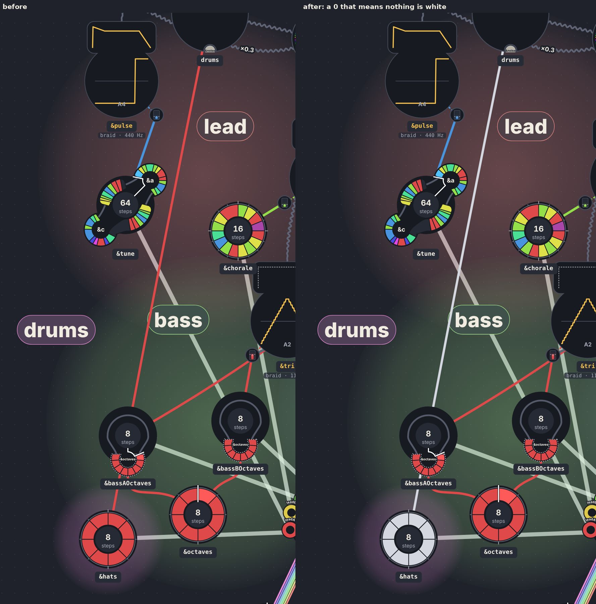

## The outs by their notes

If each out wears its source's note (the owner: sources drive the value), how often do two share a colour? `tools/probe/colours.test.ts`, 63 pieces with two outs or more (220 outs):

| | two outs on one colour |
|---|---|
| at rest, by pitch class (each out's base) | 104 outs share one with another |
| at rest, by pitch class and octave (the notes' gradient) | 41 |
| playing, each out's lowest note, by pitch class | 53 % of the time two outs or more sound |
| playing, each out's lowest note, by pitch class and octave | **16 %** |

So the octave gradient does most of the work: by pitch class alone half the time two outs look alike (harmony: a bass and a pad on one root), by pitch class and octave one time in six, and then they are playing one note, the same colour truthfully. Built: the note by octave, no tint on top. A tint per out would tell those apart, but it is a colour that says nothing about the sound. Where it matters, the strip's stack still keeps them apart by place: the sources in the graph's order, from the centre out.

## 4. The markers

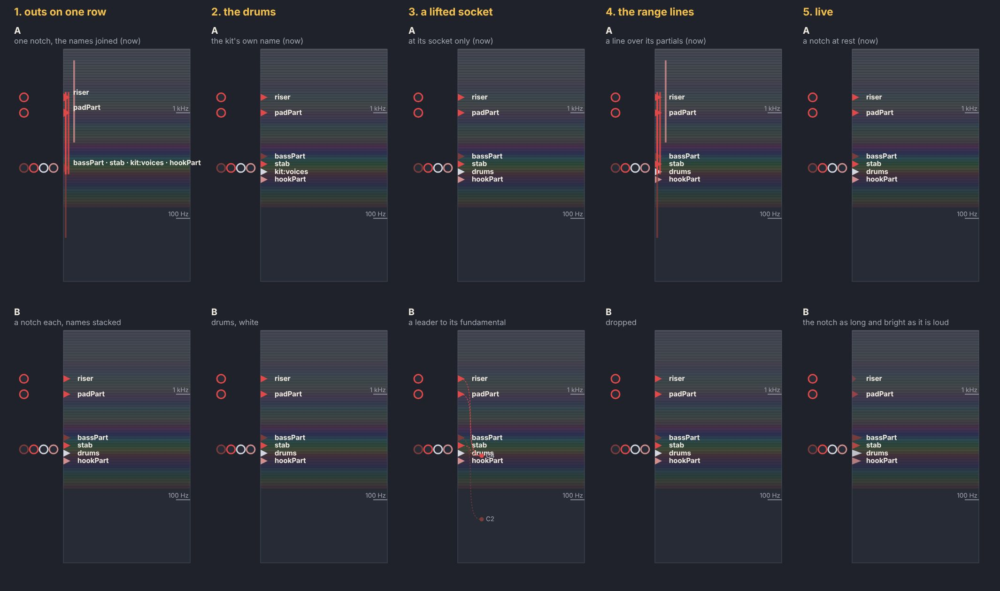

The options, each question A (now) and B (`tools/mockups/tower-markers.py`, Hypercell's outs: four sockets on the audible's floor, the bass part's fundamental two octaves under it). Its parts are nearly all on C, so by note they are nearly all red: the probe's point, seen.

Now: a notch at the strip's inner edge, level with the sockets, pointing in, in the first source's colour; a thin line a source over its range (the bands within about 30 dB of its loudest), side by side; opened, the names. Open questions, with my recommendation:

1. **Several sockets at one height** (Hypercell: four on one row, `bassPart · stab · kit:voices · hookP…` cut off). They share a notch today. Recommended: a notch each, side by side in the graph's order and in their own colours, the names stacked one a line when opened.
2. **The drums' name**: the kit's internal name `kit:voices` shows. It should be *drums*, the kit's name in the graph.
3. **A lifted socket** (sits at the audible's floor, sounds lower): its marker is at its socket, its sound below it. Recommended: a short leader down from the notch to its fundamental on the scale, so marker and sound both show.
4. **The range lines** sit under the left half's bars and get lost there. Recommended: drop them; the spire shows the range in the graph, and the stacked sum shows it in the strip.
5. **Live**: the notch could pulse with its source's level, the strip's markers acting as the outs' meters when the graph is scrolled away from them.

### Chosen (the owner) and built

1. **B**, a marker each.
2. **A**, the kit's own name.
3. **Every socket at its fundamental**, with a **neutral zone** (below).
4. **One glyph for an out, the spire**: a big dot at its fundamental, a hairline up over its range, a dot on each partial as big as it is strong (`ui/spire.ts`: `spireOf` finds the partials, the peaks of what it hears; `drawSpire` draws them). The same glyph stands in the sky over the socket (at the graph's zoom) and marks it on the strip (small, side by side with the others of its row, the names stacked by them when the strip is opened). It replaces the bars, the range lines and the notch.
5. **B**: live, the big dot swells and brightens with the out's level.

Seen: where several outs share one row (Hypercell's stab, pad and riser on C4, a row of their own over the bass part's and the drums' at C2), the stacked names crowd each other in the opened strip.

## The neutral zone: every socket at its fundamental

The owner's correction to the layout's rule: between the structure (under 20 Hz) and the audible (from 20 Hz) a **neutral zone**, off the scale, where the voices and the mixers stand (the gates' row under them, then the voices', then the mixers'), so they don't push into the structure. The audible goes down to 20 Hz on its own scale over it, and **every socket sits at its sound's own frequency**: nothing is lifted to a floor.

- `towerY(d, zone)` (`layout/towerlayout.ts`): under 20 Hz the scale as it was; from 20 Hz up, lifted by the zone. Each part of the scale stays even. `towerLayers` lays the zone's rows and returns its height (`zone`, decades), and the strip and the sky draw on the same scale (`GraphLayout.zone`). The strip leaves the zone blank (*voices · mixers*, opened).
- The zone's rows: the gates' half a layer over 20 Hz, the voices half a layer or a layer over them (room for a player under its kit), the mixers a decade over the voices, the audible a layer over the mixers.
- Before, a socket stood at its sound's frequency or at the audible's floor, a layer over the mixers, when that was higher: 39 of the library's 237 sockets were lifted, and the voices' row hung between the structure's top and the lowest socket.

| tower layout (77 pieces × 3 seeds) | crossings | cost | area Mpx² | pieces with an overlap |
|---|---|---|---|---|
| sockets lifted to the floor (before) | 45.7 | 112.2 | 108.8 | 2.7 |
| **the neutral zone, every socket at its fundamental** | **42.3** | **103.1** | 136.4 | 2.7 |

(`node tools/probe/parallel.mjs out.txt`, `VARIANTS=1,2`.) It crosses less (Korobeiniki 5.7 → 2.3, Resonanz 11 → 10, Baustelle 5.0 → 4.7; Hypercell 3.7 → 4.0), and the graph is taller by a quarter: the audible is on its real scale over the zone, and the structure no longer reaches up to the voices.

## The structure on the strip (2026-10-14)

The owner's next: the markers go on into the structure. Each wheel has a value now and a spectrum of the values it can take; each stepped cell is marked at its rate on the tower, on a sub-sonic rainbow; the tables nothing steps sit at the bottom, showing their static spectrum.

- **A wheel's spectrum of values** (`valueSpectrum`, `valueAt` in `layout/cellview.ts`): each value it takes and the share of its lap it holds it, rests aside, low to high; and which it holds now.
- **On the strip** (`TowerStrips.svelte`): under the neutral zone each stepped cell is a row at its step rate (`towerOf … 'step'`), the cells of one rate stacked: its spectrum as chips, each as wide as its value is held, in the value's colour (a pitch's, a level's, white for a 0 that means nothing), the one it holds now lit while playing. The tables nothing steps (`&major`, `&parts`, `&lydian`) are rows at the strip's bottom. Opened, each row is named.
- **The sub-sonic rainbow**: under 20 Hz the semitone bands go on (a rate's octaves take a pitch's colours, by the notes' octave gradient, so darker), on the strip and, fainter, behind the structure in the graph.

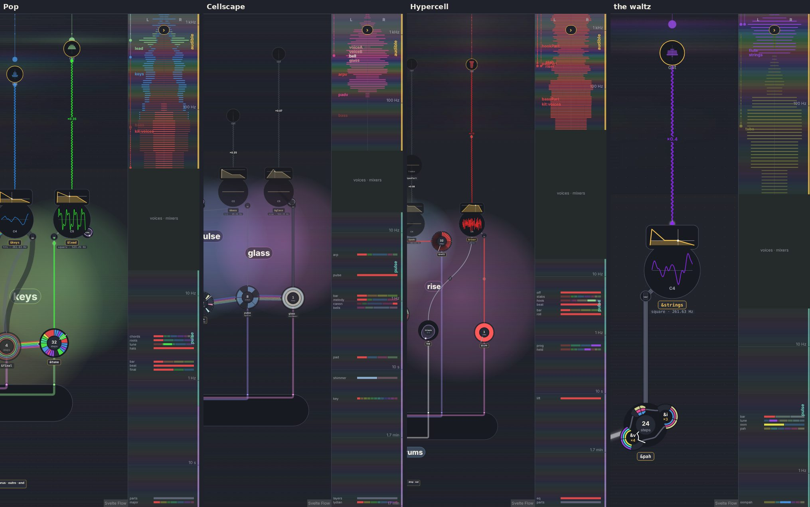

Seen: Pop's melodies on one row at 4 Hz (`&chords`, `&roots`, `&tune`, `&hats`), `&bar`, `&beat` and `&final` lower, `&parts` and `&major` at the bottom; Cellscape's parts spread down the pulse and the slow, its `&key` twelve keys; Hypercell's `&off` and `&lift` red (pitches). A table of taps (`&parts`) shows its values as plain references, grey: they could wear their sections' tints.

## Sections' colours on the wheels and the selector's table; closing the zone (2026-10-14)

The owner: a selector shows its sections' colours; a wheel's accents are tinted in its section's colour; the neutral zone should not be a gap in the strip.

- **The selector's table on the strip**: a table of taps' values are its sections, each chip in its tap's tint (`valueSpectrum` keys a reference by its entry; `tapTintRgb`).
- **A wheel's accents in its section's tint** (both layouts): a node's section is its tag's, or the nearest tap upstream of it (`nodeSections`, `ui/sections.ts`), and its tint (`tapTint`) is handed to its wheel as `--section` (`CellNode`). Its ticks, its hand (the cursor) and its name's border wear it: the border half-strength at rest, full while it sounds (in place of the gold). Looked at for the other candidates on the zoom sheet (`ZOOM=chords,tune,hats,roots node tools/gallery.mjs zoom 3 pop`): the steps keep their values' colours (the tint is the section's, not the value's); the hub's text stays ink, for legibility.

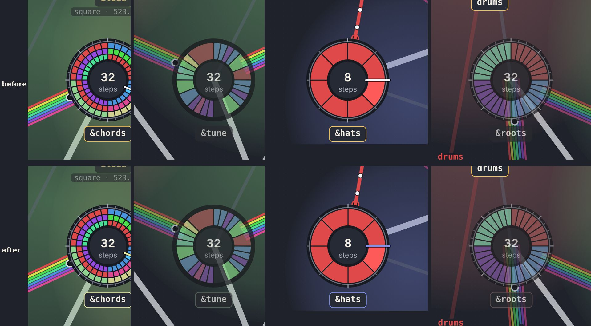

### The neutral zone on the strip: options

The strip is locked to the graph's scale, so the zone is a band of its height on the strip too. Instead of leaving it blank, it can show what stands in it (`tools/mockups/tower-zone.py`, Hypercell's numbers: the zone 2.2 decades):

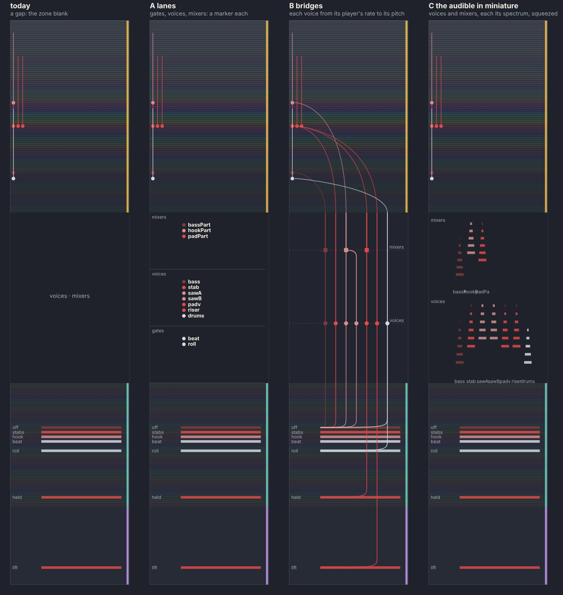

- **A, lanes**: three lanes, the gates, the voices, the mixers, a marker each member, in its colour. Simple; says who is there, but not what connects to what.
- **B, bridges**: each voice a line from its player's row (its rate, under the zone) up across the zone to its out's fundamental (over it); a dot where it crosses the voices' row, a square where a mixer joins its voices. The zone becomes what it is: where a rhythm at a rate turns into a tone at a pitch. It joins the structure's rows to the audible's spires, so the strip reads as one scale again.
- **C, the audible in miniature**: each lane the whole of 20 Hz … 20 kHz squeezed into its height, a column a member: a voice's spectrum before it is mixed, a mixer's after. It shows timbre, but repeats the spires at an unreadable scale.

Recommended: **B**, with the lanes' names of A on its rows. Seen: Hypercell's parts are nearly all on C, so most of its bridges are red. Their places (the order across, the joins) tell them apart, not their colours.

## The strip a minimap (2026-10-14)

Chosen (the owner): **B with A's names**, the bridges straight: the outs in lanes, so the strip becomes a miniature of the tower graph. And (a correction to a first try that drew a spectrum a lane): **the spectrum stays combined**; the lanes are narrow, in a central column; the spectrum out from its sides, the left channel left, the right right.

- **Lanes** (`layout/minimap.ts`): a lane an out, in its sections' order (`nodeSections`), then the graph's left to right; every node in the lanes of the outs it feeds (everything upstream of its socket; a groove upstream of the kit it plays, though it reads it with `over=`). A cell several outs share (`&bar`) spans their lanes.
- **The column** (`TowerStrips.svelte`), bottom to top in each lane: the structure's cells at their rates, each its values as chips across its lanes, the one it holds now lit (the tables nothing steps at the bottom; a selector's table its sections in their tints); the neutral zone's rows, named (*gates*, *voices*, *mixers*), a gate a white dot, a voice a dot in its note, a mixer a square across the voices it mixes; the out's spire at its fundamental. **A bridge** runs straight up each lane, from its player (the highest cell in that lane alone) to its pitch.
- **The spectrum**, all the outs together, as before: each band's bar as long as its loudest out, split into the outs' shares in their colours, in the lanes' order from the column out. Opened, each out is named at its fundamental, left of the column.

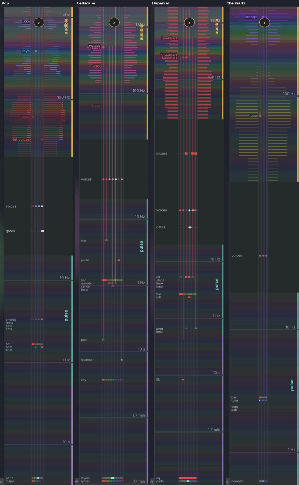

Seen: Pop's four lanes (bass, keys, lead, the drums' kit), the drums' gates on their row under the voices; Hypercell's mixers over its voices; the waltz's three outs, one bridge each from `&tune`, `&oom` and `&pah`. Names at one height in other lanes are stacked; where many cells share a rate (Hypercell's at 5.3 Hz) the names make a short list beside the column.

## 5. One tiered strip for the graph and the time view (proposed)

Three things draw the tower's scale today, each its own way:

| | where | scale | tiers | content | markers |
|---|---|---|---|---|---|
| `TowerStrips` | the tower layout, at the right | the graph's even log scale (360 px a decade), panned with it | a rail of zone colours, a tick a decade | the rainbow, the sum spectrum | the outs (notches, names) |
| `TowerAxis` | today's layout, at the right | balanced with the graph (`towerFit`) | zones named | — | every node's span, a line to the selected |
| the time view (`timeview.ts`, `timedraw.ts`) | its own frame, log from the window to 40 kHz | even log | zones banded, named at the right | waterfall, notes, scalogram | the ridges heard (`arp step`, `beat`), the meter's lines |

They share the zones (`TOWER_ZONES`) and `towerOf`, nothing else. Proposed: one component, a tiered **smart strip**, given a scale function (decades → y: the graph's, the time view's frame, or the balanced one), with the same tiers and the same marks in each:

- **card** (over 20 kHz): the waveform (the time view's), the card's samples.
- **audible** (20 Hz … 20 kHz), ticks as octaves (C1 … C9) and decades in Hz; content: the muted rainbow and the sum, stacked in the sources' tints; markers: the outs (the graph's sockets; the time view's voices, the ones its legend lists now).
- **pulse** (0.5 … 20 Hz) and **slow** (under 0.5 Hz), ticks as times (1 s, 10 s, 1 min); content: the scalogram's ridges (its row means), the inaudible counterpart of the sum: how much is going on at each time scale; markers: the meter's levels named (beat, bar, section) and the structure's cells at their rates (`arp step`).
- **constant**: a cap at the bottom, the tables nothing steps.
- *Smart*: a tier with nothing in it folds to a thin band and gives its height to the others (the time view's empty card; a piece with no slow form); folded (64 px), content and notches; opened (180 px), names and ticks.

Mock-up, Cellscape's numbers (`tools/mockups/tower-scale.py`): the graph with its sky and spires, the strip beside it, and the same strip at the time view's side:

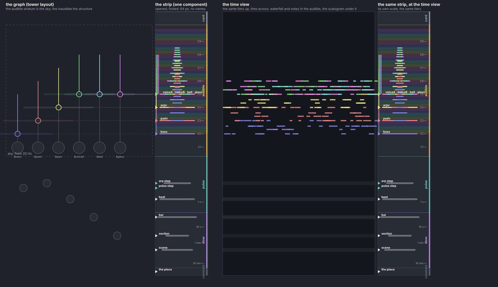

Then the strata line up across both views: the sky in the graph is the time view's waterfall and notes (sound, by pitch), the graph's structure under it is the scalogram (time scales, by period), and the strip at the side is the same scale for both. Built as `layout/towerscale.ts` (tiers, ticks, folding: pure) and `TowerScale.svelte` (drawing), replacing the scale parts of `TowerStrips`, `TowerAxis` and `timedraw.ts`. Worth it only once the sky and the markers are chosen; a PR of its own.

## Next

1. The socket's round meter and its spire now say the same thing: the socket could become the spire's big dot.
2. The time view's voices are a hue each (golden angle), not their notes: align them with the graph's (the colour table, [ui/theme.md](../ui/theme.md#colour-rules)).
3. Profile the sky while playing (the profile skill) before it goes on by default.
4. The tiered strip (5), its own issue; the minimap is most of it, for the graph.
