# The tower strip: the sound card as the tower, the graph laid by it

Date: 2026-10-11 · Status: open (built as a layout of its own, off by default) · Issue: [#234](https://github.com/yggi/cell-studio/issues/234) (the multiscale epic) · Follows [tower-rows.md](tower-rows.md) and [outputs-top.md](outputs-top.md)

## The ask, read back

Subject: the Viennese waltz (`examples/waltz.cells`).

1. **The tower is always there**, as a strip at the side of the graph, and opens wider on demand (today it is the *tower* button's axis, [graph.md](../ui/graph.md)).
2. **No sound card node** (`&out`, or the sink mix: the waltz's `&mix`). The strip is the sound card.
3. **Each sound output leaves the top of its source and goes into the strip.** The strip's connector shows that source's spectrum (its partials, up high, down low); all of them together are the piece's spectrum. Stereo: left and right apart; mono: symmetric.
4. **A node that sends sound out has a fixed height: its base frequency** (`loop=C4` → 262 Hz on the tower's log axis). **`&bar` and every other stepped cell is fixed at its tower height too** (its step: the waltz's bar and its three melodies at 2.8 Hz). Only x is left to the layout.
5. A **parallel layout** (beside today's, switched by an option, as `?rows=tower` is), since it moves every metric.

## Mock-ups

Drawn from the waltz's real tower heights (`towerSpans`: the bar and its melodies at 2.8 Hz, the tuba at 65 Hz, the flute and the strings at 262 Hz), by hand-placed x, at one moment (beat 1: the flute on B4, the tuba on G2, the strings' chord G B D). `tools/mockups/tower-strip.py` makes them (an HTML page; screenshot it in Chromium).

Today:

The options:

- **A1, one strip, folded** (always there, 44 px): each voice's wire leaves its top (its socket sits exactly at its base frequency), runs level into the strip, and the strip shows every source's partials in its colour, mirrored about the centre line.
- **A2, the same strip opened**: the axis (decades, zones), the sources named at their base, the stepped cells as a mark at their row.
- **B, two strips, the graph between the speakers**: L at the left edge, R at the right; every wire splits at its voice's top, a strand each way. Reads stereo at a glance, but every sound wire crosses the whole graph twice.

Stereo in A (if the strings had `pan=-.6`):

## Seen in the mock-ups

- **Rows are the tower.** The waltz falls into three rows: the pulse (bar, tune, oom, pah), C2 (tuba), C4 (flute, strings). Height in the graph now means time; the dotted guides are the rows.
- **Voices at one pitch share a row**: the strings' wire runs through the flute's socket. Drawn here as one bus of two strands from there on; in general the voice nearest the strip should sit on the strip's side, or the wires take lanes.
- **A voice's actual notes live above its base**: the flute is fixed at C4 but plays B4; its partials enter the strip above where its wire does. The connector (the coloured bracket on the strip's edge) spans the source's range.
- **The pulse row is crowded**: four wheels at one height, the meter's net a straight trace along it. Pieces with many melodies at one rate will make wide rows (the tower-rows probe's main cost).
- **Wires to the strip cross the graph** at their pitch's height: a low voice far from the strip passes under the higher ones. The layout's x should pull sound sources toward the strip, lowest first.

## Chosen (the owner, 2026-10-11)

1. **B**: two strips, the left channel at the graph's left edge, the right at its right.
2. **An even scale** on the strip (a rainbow: a band a semitone, in its note's colour), the same as the graph's.
3. **A voice's top** sits at its base frequency (its wire runs level).
4. A mix that isn't the card keeps its node and sends its own wire into the strips.
5. Cells with no height: wherever the layout puts them, **minimal forces**, heights fixed; a separate graph layout, `tower`.

## Built

- `layout/towerlayout.ts`: `towerHeights` (each node's y held: a voice's top at `towerY(log10 f0)`, a stepped cell's centre at its step, `TOWER_PX` = 360 px a decade), `withoutCard` (the graph drawn without the sound card's node and its edges), `towerOuts` / `towerIns` (what went into the card, and where its wire leaves).
- `LayoutOptions.heights` (`physics.ts: hold`): each named node ends every tick at its height (d3's `fy`), dragged too; `TOWER_LAYOUT` the forces (first few: no rows, columns, spread, kinds, tags; now today's without the meters placed last, below).
- `GraphLayout.mode` (`'flow' | 'tower'`, `setMode` lays the piece out afresh); the toolbar's *tower layout*, `?layout=tower` (`?strips`: opened); the gallery: `LAYOUT=tower STRIPS=1 node tools/gallery.mjs golden 3 waltz`.
- `TowerStrips.svelte` (the strips: a canvas each, the rainbow, the zones, the spectra per band, the connectors), `TowerWires.svelte` (the wires, behind the cells, in the graph's coordinates).
- `towerlayout.test.ts`: the waltz's heights, no card, a two-channel card split left and right, heights held through the forces and a drag.

### Seen (the real Graph, the gallery's made-up sound)

The waltz, stopped with the strips open, and live with them folded:

*Pop* and the *Ricercar*, stopped:

- The rows fall out of the tower by themselves: the beat (the bar and what it steps), the voices at their pitch, the form and the constant tables (free) lower down. Pop's drums nest by rate (the bar, the kick and snare, the hats); the Ricercar's tables sink under the voices.
- **Wires run level over what is in their way**: the tuba's crosses under the flute and the strings, Pop's mixes' wires over its voices' caps. A force that keeps a held cell off another's wire row (sideways), or wires taking lanes round a cell, is the next step.
- The colours of live wires and the live spectra in these pictures are the gallery's made-up sound (every voice on C4); the app's are the piece's.
- Measured over the library below.

## Measured (75 examples, three seeds)

`tools/probe/tower-layout.test.ts` (`PROBE=out.txt npx vitest run tools/probe/tower-layout.test.ts`, ~2 min): every example laid out as the app does (500 ticks, `layNet`), library sums, mean over seeds. *Over a cell*: a wire into a strip passing over another cell's body (0.7 of its room, at its height); *over an edge*: crossing a drawn edge (straight, centre to centre); each strand counted, so a wire into both strips counts twice.

| layout | crossings | cost | area Mpx² | pieces with an overlap | wires into the strips | over a cell | over an edge | wire length kpx |
|---|---|---|---|---|---|---|---|---|
| today (the signal path) | 46.3 | 134.6 | 73.7 | 0 | — | — | — | — |
| today, no card node | 33.3 | 118.1 | 65.4 | 0 | — | — | — | — |
| **tower** (heights held, few forces) | 130.0 | 397.9 | 124.6 | 0 | 480 | 152.7 | 406.0 | 366 |
| tower, today's forces | 80.0 | 255.0 | 104.3 | 29.3 | 480 | 154.3 | 402.0 | 341 |

57 % of nodes are held at a height (742 of 1305); the rest (constant tables, cells no clock reaches, tags) are free.

- **The card's node alone costs 13 crossings in today's layout** (46.3 → 33.3, −28 %, far outside the seeds' ±8): every voice's wire converging on one node. Taking it out is a win whatever the layout.
- **The tower layout costs crossings**: against today's layout without the card (the same edges drawn), 33 → 130, about four times, and 1.9× the area. Its pieces most hurt are the selector pieces again (Baustelle 9.7 → 17.7, Korobeiniki 5 → 13, Cellscape 3.7 → 11) and the tape and resonator pieces (Resonanz, Ghosts, Echotape 0 → 5–7); helped or even: Pop 1.7 → 0.7, BWV 847 0.7 → 0.3, the waltz 0 → 0.
- **Its wires into the strips cost more than the crossings**: 406 crossings with edges and 153 passes over cells, about one wire in three over a cell. Baustelle's alone: +22 over cells, +65 over edges. Two strips double it (each wire runs both ways); they are the price of option B.
- **Today's forces with heights held** cross less (80) but overlap in 29 pieces: the forces built for free nodes push in y, where nothing can move, and outweigh the collision sideways. The few forces keep nothing overlapping. A middle set (today's sideways forces, no y pushes) is worth a run.
- So, as [tower-rows.md](tower-rows.md) found for rows by the tower: **height by the tower costs crossings in today's language**, most where it arranges with selectors, tapes and resonators; contrapuntal and song-form pieces fit it. What the tower layout adds of its own is the wires' cost, the first thing to work on.

## Wires and forces (2026-10-12)

The owner's next two: cut the wires' cost, and a middle set of forces. Same probe, 75 examples × 3 seeds (`hops routed`: the hops the wires make round cells, below).

| layout | crossings | cost | area Mpx² | pieces with an overlap | over a cell (of them free) | hops routed | over an edge |
|---|---|---|---|---|---|---|---|
| today, no card node | 33.3 | 118.1 | 65.4 | 0 | — | — | — |
| tower, few forces (as first built) | 130.0 | 397.9 | 124.6 | 0 | 149.3 (0.7) | 136.7 | 406.0 |
| … + a sideways collision and free cells off the wires' rows (tried, dropped) | 132.7 | 433.4 | 144.0 | 0.3 | 151.3 (0.3) | 136.7 | 401.0 |
| … + spread | 135.3 | 437.7 | 122.1 | 0 | 148.3 | 136.3 | 406.0 |
| … + columns | 122.0 | 384.3 | 117.0 | 0 | 150.0 | 138.0 | 407.7 |
| … + row trials | 102.3 | 323.8 | 122.7 | 0 | 151.3 | 137.0 | 408.7 |
| … + meters last, held to their row | 118.0 | 365.1 | 123.0 | 8.7 | 148.7 | 136.0 | 407.7 |
| … + row trials, spread, columns | 108.3 | 352.2 | 116.5 | 0 | 151.0 | 137.0 | 406.3 |
| tower, today's forces (meters last held to their row) | 77.3 | 249.6 | 105.8 | 7.3 | 154.0 | 138.3 | 401.3 |
| **tower, today's forces, no meters last** (`TOWER_LAYOUT`) | **90.7** | **301.9** | **108.3** | **0** | 152.0 | 137.0 | 403.0 |
| … and no kinds apart | 93.3 | 318.1 | 108.2 | 0 | 152.3 | 136.7 | 402.0 |
| … and no tags | 102.3 | 350.9 | 110.7 | 0 | 150.0 | 136.0 | 406.3 |

- **With two strips a wire spans the whole graph** (from the left strip through its source to the right one), so no sideways move takes a cell off another's wire. And the cells under wires are held ones (149 of 150): a free cell is under a wire 0.7 times in the library. So pushing free cells off the rows (`rowClear`) had nothing to do, and a sideways collision for held cells (d3's pushes along the line of centres, and a held cell drops the vertical part) changed no overlap; both were dropped.
- **So the wires go round**: `routeWire` (`towerlayout.ts`) runs a wire level at its height and hops it over a cell in its way, or under it when its row passes through the cell's lower part, cells close together one hop; about 137 hops in the library, and no wire passes over a wheel any more. Its crossings with edges (~400) stay: an edge from below a row to above it crosses a wire that spans the whole width, whatever the layout does. They are the price of option B; one strip would halve them.
- **The forces: today's, without the meters placed last.** The overlaps with today's forces were the meters placed last: put at the best (x, y), then pulled back to their height onto a neighbour. A held meter is now sought along its own row only (`placement.ts`), which takes the overlaps from 29 pieces to 7, still not none; without it, none, and 91 crossings against the first build's 130 (area 125 → 108 Mpx²). Of today's forces, the row trials and the tags do the most; kinds apart a little; spread alone nothing.
- Seen (stopped, the real Graph): the waltz's tuba wire dips under the flute and the strings; *Baustelle*'s wires hop over its mixes, a dense web at the top but none through a wheel; *Pop*.

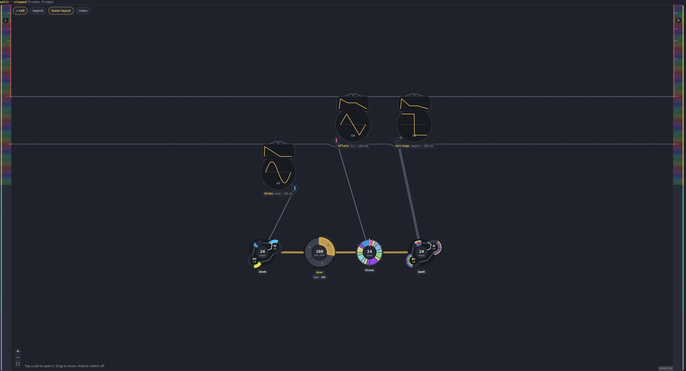

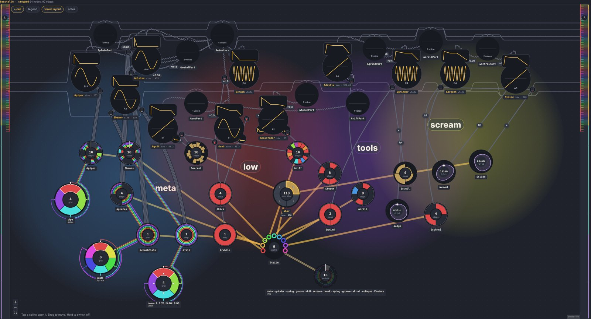

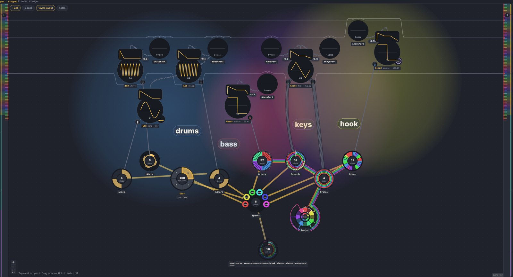

## One strip, nets (2026-10-12)

The owner's next: **the strip to the right** (one strip, its halves the channels: option A after all), **wires into the strip crossing each other don't count**, and **the audio edge and nets** instead of plain wires: each base frequency a net, instruments on one base frequency tapping into it.

Built: `TowerStrips.svelte` one strip at the right (L half, R half, mirrored about the centre; a dot at its inner edge where each net comes in); `towerNets` (the wires gathered by their height, within half a pixel), `netPaths` (a trunk from the source furthest from the strip, routed; a riser from each other source); `TowerWires.svelte` draws them as an edge of sound (`.band-audio`, rippled at rest, `EdgePayload`'s wave while it sounds, the note's colour live).

Same probe, 75 examples × 3 seeds, nets counted once, their crossings with each other not at all:

| layout | crossings | area Mpx² | overlaps | wires (nets) | over a cell → hops | over an edge | wire length kpx |
|---|---|---|---|---|---|---|---|
| today, no card node | 33.3 | 65.4 | 0 | — | — | — | — |
| tower, `TOWER_LAYOUT`, two strips, a wire a source | 90.7 | 108.3 | 0 | 480 | 152 → 137 | 403 | 341 |
| **tower, `TOWER_LAYOUT`, one strip, a net a base frequency** | 90.7 | 108.3 | 0 | **175** | **63 → 63** | **171** | **133** |

- The nets' crossings with edges fall by 58 % (403 → 171), their passes over cells by 58 % (152 → 63, each now a hop), their length by 61 %. Half of it is the one strip (a wire no longer spans the whole width, only from its source to the right), the rest the nets (sources on one pitch share a trunk: 480 wires were 175 heights).
- The layout itself is unchanged (the nets don't pull on it): 91 crossings against today's 33 without the card.

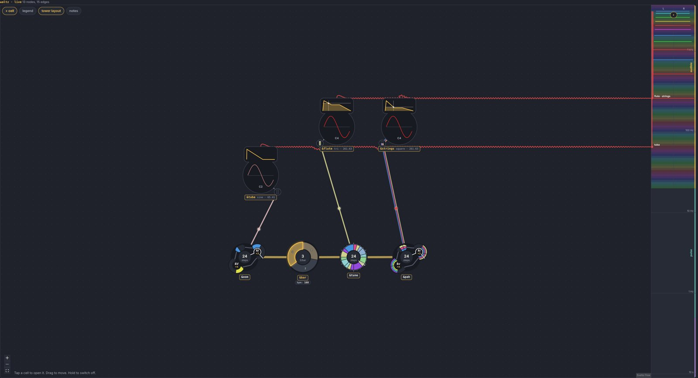

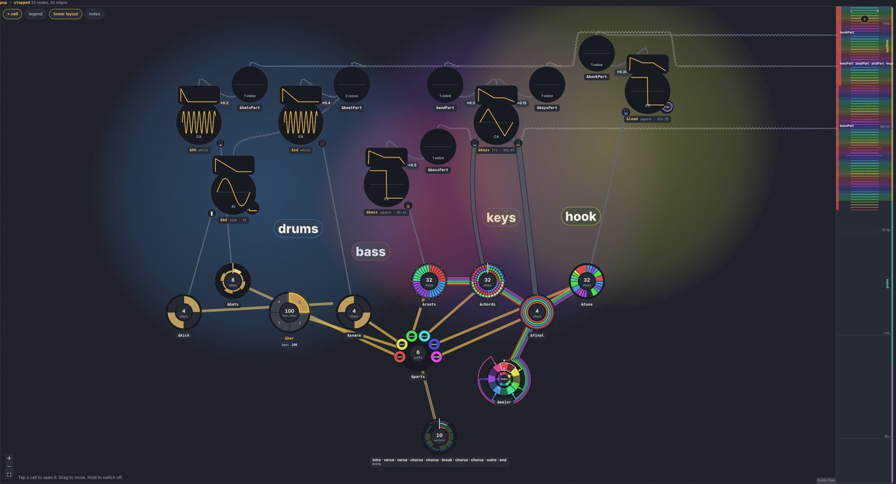

*The waltz* (live, the gallery's made-up sound): the C4 net leaves the flute, the strings join it; the tuba's net dips under their labels. *Pop*: the parts' mixes sit just above C4 and share one net; the bass's part its own.

## The card everywhere: a socket each (2026-10-12)

**Crossings on main (#332), 76 examples × 3 seeds:** today's layout 45.0 (cost 137.1), today's without the card's node **24.0** (80.4: the card's node alone is half of today's crossings, #309), the tower layout 99.7 (337.0) and its nets into the strip a further 165.3 crossings with edges.

The owner's next: **no single out-node; each thing that goes into the card goes into a socket of its own**, by its audio edge; **a socket is a multiband level meter**, symmetric and stacked; **held at its frequency on the strip's scale**.

- `withSockets` (`towerlayout.ts`): the card's node goes; each edge into it keeps its id (what it carries, its live state) and ends at a socket (`socket:<edge>`, a small node in the layout, room 40). `socketHeights`: a socket is held where its source's sound sits on the tower (`towerOf … 'emit'`): a voice at its base frequency, level with its top; a groove at its lowest drum (its drums are pieces of the drums' kit, no node of their own).
- `SocketNode.svelte`: ten octaves stacked, the low at the bottom; each a bar out from the centre line, the left channel to the left, the right to the right (mono: alike); in its source's note's colour (drums: neutral). Stopped, its source's partials (a groove's drums together), faint; playing, its live spectrum. Tapping a socket opens its source.
- The strip stays at the right as the tower's scale and the piece's whole spectrum; the nets into it are gone (`?outs=nets` brings them back, to compare).

| tower layout (76 × 3) | crossings | cost | area Mpx² |
|---|---|---|---|
| nets into the strip | 99.7 (+165.3 nets over edges) | 337.0 | 103.0 |
| **a socket each** | **117.3** (its socket edges included) | 316.5 | 123.7 |

So the sockets cross less than half of what the nets did with the layout's own (117 against 265), at 20 % more area: a socket is a node of its own beside its source.

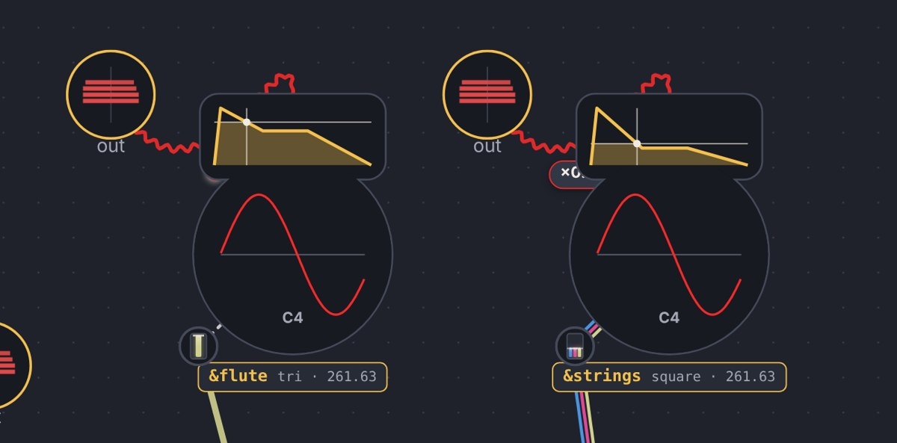

*The waltz* (live, the gallery's made-up sound): the flute's and the strings' sockets beside their tops, the meter's bands on C4.

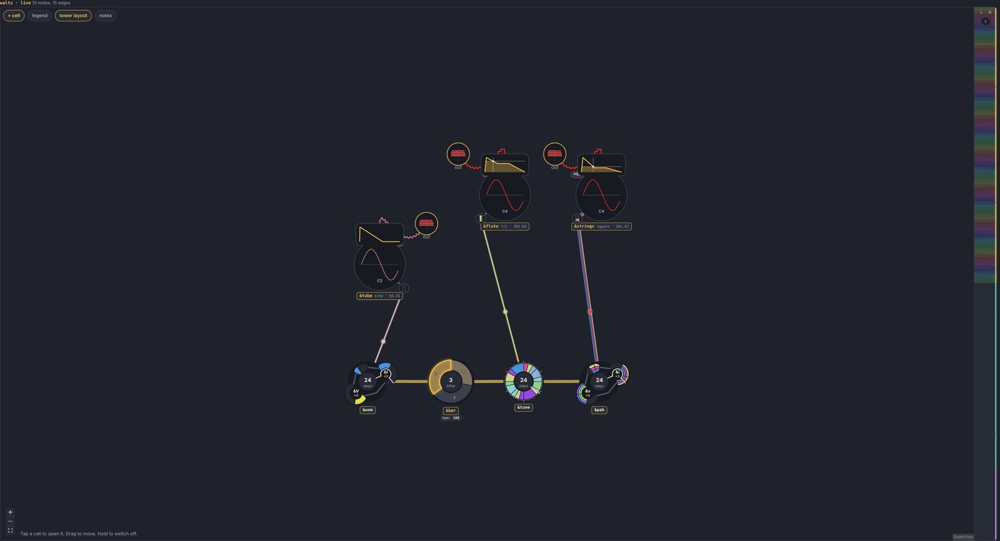

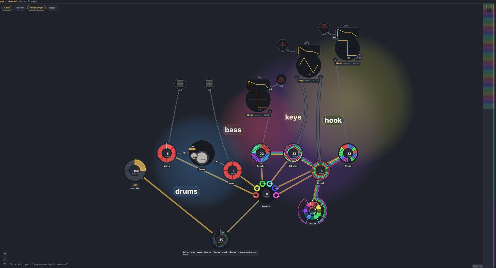

*Pop* (stopped): the hook's, the keys' and the bass's sockets at their pitches; the hats' and the beat's at their kick's, A1.

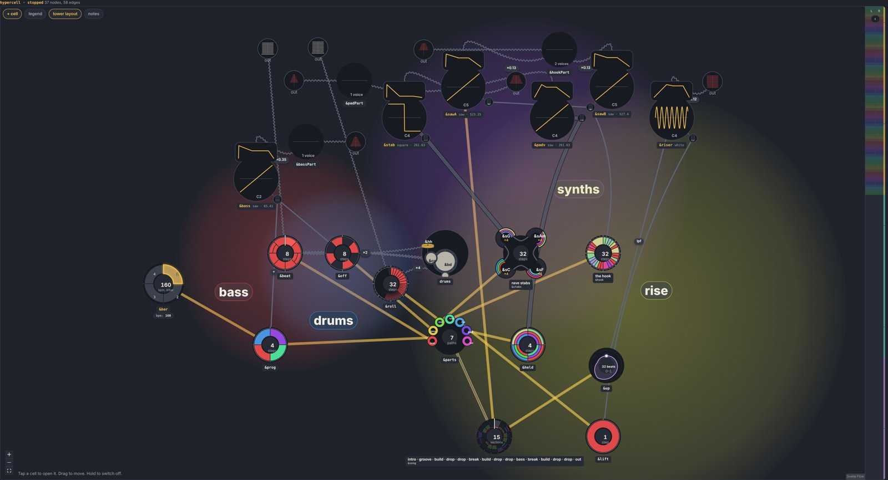

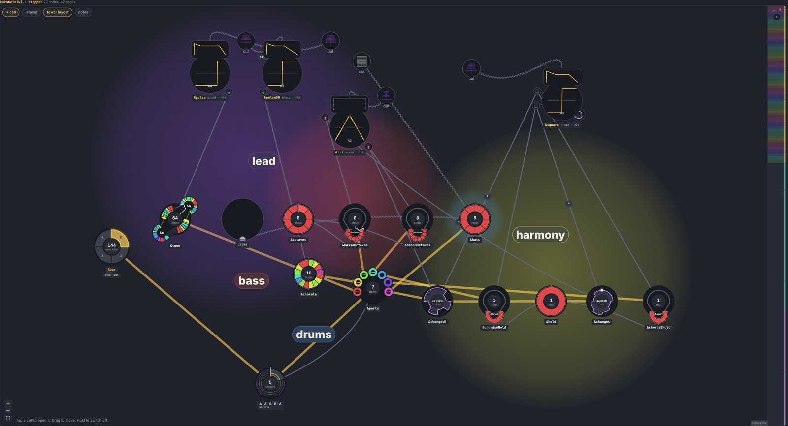

## Layers and a scale force (2026-10-12)

The owner's next: **a gentle scale force** pulling every node to its height instead of holding it there; **layers**: tables nothing steps pulled to the bottom, the structure (each stepped cell at its rate), **the voices between the structure and the audible** (voices, mixes, kits, tapes, resonators: one row), **only the sockets in the audible**.

- `towerLayers` (`towerlayout.ts`): each node's target and layer. The voices' row sits half-way between the structure's top and the lowest socket, a layer's gap (0.6 decade) over the structure at least; the tables a gap under the structure's bottom.
- `LayoutOptions.heightPull` (`physics.ts: hold`): 0 holds each node at its height (a rail, as before); more draws it towards it by a spring of that strength (a target). The tower layout's default: .05 (`TOWER_LAYOUT`); `?pull=.1` (the gallery's `PULL=.1`) to compare.

| tower layout, a socket each (76 × 3) | crossings | cost | area Mpx² | off its height, decades (mean, most) |
|---|---|---|---|---|
| today, no card node | 24.0 | 80.4 | 58.9 | — |
| heights held as before (voices at their pitch) | 117.3 | 316.5 | 123.7 | 0 |
| layers, held | 123.7 | 443.4 | 128.6 | 0 |
| layers, pull .02 | 40.0 | 122.8 | 74.5 | .80, 3.95 |
| **layers, pull .05** | **39.7** | **121.8** | 77.2 | .62, 3.08 |
| layers, pull .1 | 47.3 | 161.7 | 83.4 | .46, 2.53 |
| layers, pull .2 | 52.7 | 192.0 | 91.0 | .31, 1.82 |

- **The scale force takes the tower layout from 3× today's crossings to 1.7×** (124 held → 40 at .05), at a fidelity of .6 of a decade on average: the layers read in order (the sockets over the voices over the structure, on average, a test checks), and a node gives way where its links pull harder (Hypercell's drums' sockets sit by their drums).
- Held rails cost: the layers held cross more than the per-pitch heights held (124 against 117), since one voices' row puts every voice level with every other.
- Resonators and tapes sit in the voices' layer (the owner's call); the pull lets a tape's heads and what they play find their places round it.

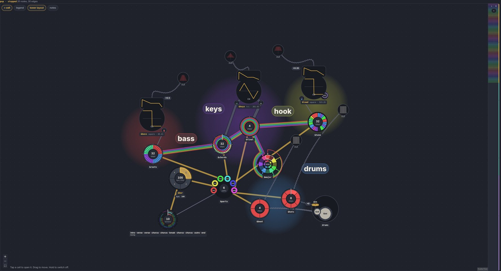

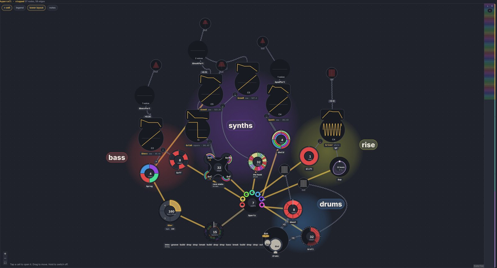

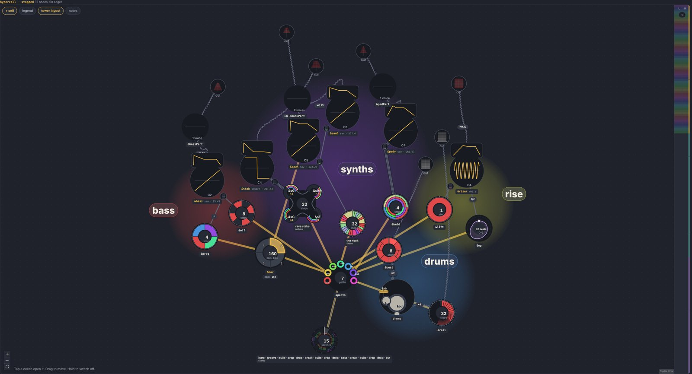

*Pop and Hypercell* (stopped): sockets on top, the voices' row under them, the structure, the form at the bottom; at .1 (the last) the rows are a little tighter, for 8 more crossings over the library.

## A selector's loom (2026-10-12)

Asked: the wires out of a selector's taps as a horizontal loom over it, each strand in its section's colour, run along to its consumer's x and straight up to it; crossings inside the loom don't count.

- `layout/taploom.ts: tapLoom`: a lane a tap over the table (the first 26 px over its top, each next 9 px higher), the strand up from its bulb, along its lane, straight up to its cell's bottom (or down to its top), corners rounded. `ForceLayout.tapLooms()` lays them from where everything is; `TapLooms.svelte` draws them behind the cells, tinted by `partColour` as the bulbs are; the taps' traces aren't drawn. `LayoutOptions.tapLoom`, on in `TOWER_LAYOUT`.
- `quality.ts`: an edge drawn as a `path` is counted as drawn (its ends needn't be nodes: a strand leaves a bulb), and two strands of one `loom` never cross.
- A bus doesn't hop on from a loom's table (`nets.ts: netTree`): its clock went on out of the table's top, straight through the lanes.

Measured (76 pieces × 3 seeds, the layers at pull .05; area and height fidelity the same):

| taps as | crossings | cost |
|---|---|---|
| traces (before) | 39.7 | 121.8 |
| a loom, its strands not counted against other edges (a bug, first reported as 25.0) | 25.0 | 67.2 |
| a loom, counted | 47.7 | 183.8 |
| a loom, counted, no hops from its table | **46.0** | 166.1 |

So, counted honestly, the loom crosses more than the traces did (46.0 against 39.7). Of its strands' crossings, about four in five are lanes (a lane is long: median ~400 px, up to 900), with the edges leaving the cells beside the table; the rest the straight risers. Tried and dropped: the lanes higher, under their cells (49.3) or half way (46.7); a pull drawing each consumer over its tap's bulb (`loomPull` .02 to .2: 44.7 to 57.7, noise or worse).

What it would take: the layout placing a selector's consumers in their sections' order over it (then the lanes are short and the loom fans out), or the loom in a band of its own that the rest of the graph keeps clear.

### In section order, the source out of the loom (2026-10-12)

Asked: place the consumers in section order; the selector's source (the bus it is stepped by, `&bar`) may go out of the loom anywhere, several times, the net choosing it where that crosses less.

- **The source's lane** (on): a loom's lowest lane is its source's. In the bus's tree (`nets.ts: netTree`) a reader over the loom may join from it anywhere along it, costed by the riser (and how far past the loom's ends); its strand runs from the table along the lane (`TapLooms`, the edges' colour), and the bus's own edge rises from the lane straight up (`taps`: `loom`, from the lane under the reader). Crossings: 46.0 → **45.7**.
- **Section order** (`LayoutOptions.loomOrder`, a spring, off): each cell the taps step drifts to its slot over the table, the taps' order a slot each, centred on it (a cell several step: between theirs).

| order | crossings | cost |
|---|---|---|
| off (default) | 45.7 | 170.7 |
| slots, .02 | 49.7 | 186.6 |
| slots, .05 | 47.7 | 180.2 |
| slots, .1 | 52.0 | 198.9 |
| slots, .2 | 62.0 | 231.3 |
| only inversions pushed apart, .02 / .05 / .1 | 56.0 / 50.3 / 51.7 | |

Ordered or not, the strands cross about the same (seed 0: 84 crossings with a strand either way): what they cross are the consumers' own wires (a voice's to its scale, cv; its step, sync), not each other's lanes. And the order fights the tags: the consumers of a selector sit in their tags' clusters (Baustelle's metal, low, tools, scream), which aren't in its taps' order. Next to try: the clusters themselves ordered by the taps (a tag's slot, not a cell's).

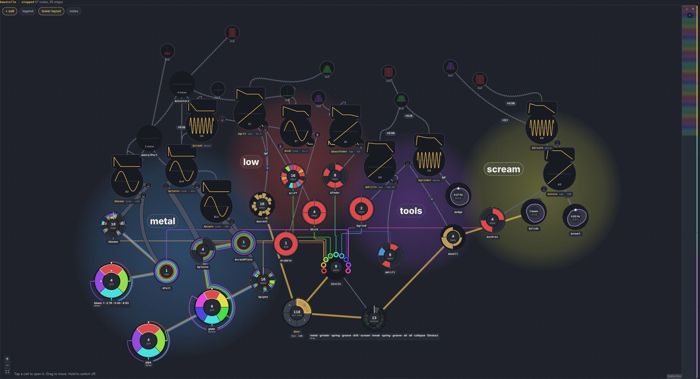

*Baustelle*: `&teile`'s nine taps, each a lane, straight up to the parts they step.

## Sockets straight above their sources; a faster probe (2026-10-12)

Asked: each socket straight above its source, to help with the tangles in the upper part; and whether the miniatures can make the crossings probe faster.

- **`LayoutOptions.socketsAbove`** (on in `TOWER_LAYOUT`; `?above=0` off): each socket's x is its source's every tick (several from one source side by side), its height still drawn to its sound. Its wire is a riser.

| sockets | taps as traces | taps as a loom |
|---|---|---|
| where the forces put them | 39.7 | 45.7 |
| straight above their sources (default) | 44.7 | 51.0 |

The upper part is cleaner, as asked: the outs rise straight from their voices and no longer cross over each other (seed 0: the socket wires' own crossings about 32 → 20). The total goes up because the layout around changes: the loom's strands cross the sync wires about twice as often (32 → 62), spread over many pieces, a crossing or two each (Hypercell +2, Baustelle +1.7, Cellscape +1.3; Arrangement −1.3, Echo tape −0.7). In the pictures, a groove's socket, held at its lowest drum, stands in the middle of the structure, in the loom. Tried and dropped: a soft pull to the source's x (.05 / .2 / .5: 56.3 / 59.7 / 56.3).

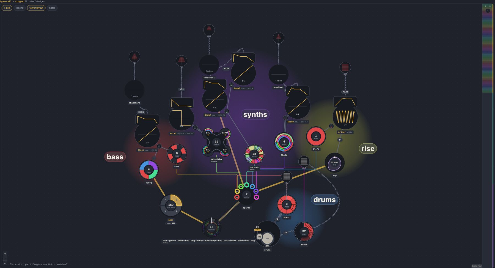

**The probe's time** (`TIMES=1`, one variant, 76 pieces × 3 seeds, about 25 s): the ticks 14 s, `setGraph` 9 s (of it, the rows' order tried for each seed, 3 s, and the start's own ticks), compiling under 1 s. The time is the forces (`stepBends` alone 27 %, collide 12 %).

- **The miniatures can't stand in.** They are today's layout (no heights, no sockets) after 160 ticks, worked out when the app is built. Run at their length (`TICKS=160`) the probe is a third faster and ranks the variants alike, but squeezes their differences (sockets above against the loom: 5.3 → 1.3 crossings) and moves the base (today 24.0 → 21.7): for a quick look, not a number to keep.
- **Their rows' order can't either.** The examples' order (chosen once, as for the miniatures) instead of a trial per seed takes `setGraph` from 8.6 s to 0.3 s, but crosses 59.3 against 45.7: the trial picks the order that suits that seed's layout. The app tries it per graph too, so the probe keeps doing so.
- Kept: each piece compiled once (not per variant and seed), `TICKS=`, `TIMES=1`, and `COMPARE=1` (crossings by piece between the first two variants picked).
- What would make it faster: the pieces across the machine's four cores (a shard per worker, the rows summed after), or a cheaper `stepBends`.

## Every socket in the audible; the probe on every core (2026-10-13)

Asked: all sockets sit in the audible layer; and the probe faster (the four-core split).

- **The audible's floor** (`towerLayers`): a layer's gap (.6 decade) over the voice row. A socket sits at its sound's frequency, or at the floor when that is lower: a groove's lowest drum (A1, 55 Hz), a bass. 39 of the library's 237 sockets are lifted.
- **Held there** (`LayoutOptions.socketsHeld`, on in `TOWER_LAYOUT`): drawn by the gentle pull (.05), a socket still sank toward its source; the drums' outs stood in the structure. Now a socket's height is held each tick; everything else keeps the spring.
- **Found on the way:** the voice row rested on the structure's top, and a braid stepped at an audio rate (Waveforms) put that top in the kHz, a socket lifted to 127 kHz. The voices now rest on the structure below 20 Hz.

| layout | crossings | area Mpx² | off its height, decades |
|---|---|---|---|
| today's, without the card | 24.0 | 58.9 | — |
| before: loom, sockets above, drawn to their frequency | 51.0 | 77.2 | .62 |
| the floor, drawn (not held) | 50.0 | 77.5 | .62 |
| **the floor, held (default)** | **48.0** | 95.4 | .35 |
| the floor, held, taps as traces | 38.0 | 95.6 | .35 |
| the floor, held, sockets where the forces put them | 56.7 | 96.8 | .35 |

The outs form the top row; the graph is taller (the outs at their real heights). Taps as traces now cross 10 fewer than the loom: the loom's place is open again.

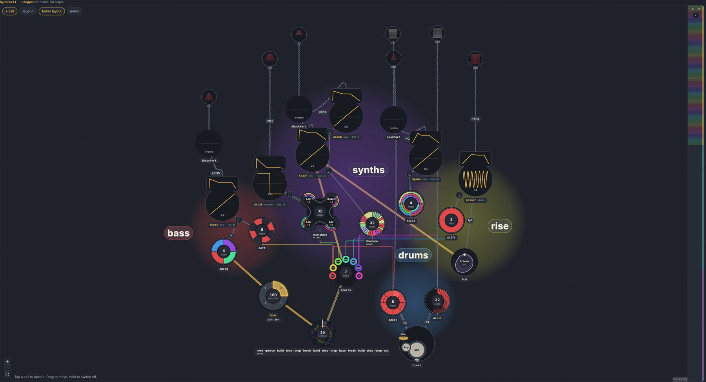

**The probe on every core:** `node tools/probe/parallel.mjs out.txt` (the same variables) runs a shard of the pieces per core (`SHARD=k/n`, each one's layouts as JSON) and merges them into one report (`MERGE=`). The four main rows: 89 s → 40 s, byte for byte the same table. (A shard is a vitest of its own: its start-up and the shards' uneven lengths keep it from a quarter.)

## A kit with the voices (2026-10-13)

Asked: a kit sits with the voices, between the sockets and the structure.

- Every kit was in the voice layer already (`towerLayers`: 25 over the library, 18 of them a piece's drums' kit), but drawn there by the gentle pull it sank: it is wired to every groove that plays it, and the grooves are in the structure. In Hypercell *drums* stood under `&beat` and `&roll`.
- Now `towerLayers` says what is **held** at its height (`held`: the sockets and the kits; `LayoutOptions.held`, in place of `socketsHeld`); the rest keeps the spring.

| layout | crossings | area Mpx² |
|---|---|---|
| sockets held, kits drawn (before) | 48.0 | 95.4 |
| **sockets and kits held (default)** | **51.3** | 95.3 |
| the same, taps as traces | 45.0 | 95.2 |
| nothing held | 50.0 | 77.5 |

It costs 3.3 crossings, piece by piece both ways: better in Brothers (7.3 → 4.7), Bell, Coltrane; worse in Zell (2.0 → 4.7), Jazz, IDM, Bossa. A groove's wires now rise from the structure to its drums on the kit, and its socket's riser passes beside them. Tried and dropped: a groove's socket over its kit instead of over the groove (53.0).

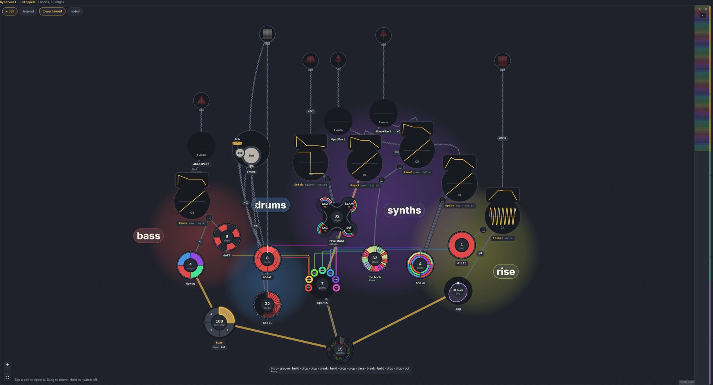

## The drums' wires, simplified (2026-10-13)

Asked: one audio wire from the drums to out, and one wire in per gate (a groove).

- `drawn.ts`: the wires a groove's drum names made (one a name, from its piece on the kit) are one wire, the groove reading the kit as a table is read (`over`); every groove gets it, a drum with its own node too. A groove's sound wires out of the drums (into a mix) are drawn from the kit: one wire, however many grooves. A drum motif spliced into a groove keeps its own wire. The engine's graph is unchanged: every name written is still its wire there (`alias` maps each to the one drawn).
- The tests that read the drawing follow: `graph.test` (a groove in a mix goes in as the drums' kit, as a gate goes in as its voices), `grooves.test`, `flowedges.test`.

| layout | crossings before | after |
|---|---|---|
| today's (the card node) | 45.0 | **36.3** |
| today's, no card node | 24.0 | 21.7 |
| tower, taps as traces | 45.0 | 39.7 |
| tower, loom (default) | 51.3 | 53.3 |

The layout baseline is recorded again (the library's drawn crossings 46.3 → 36.5). In the tower layout the loom loses a little (its strands meet the grooves' wires into the kit); traces gain.

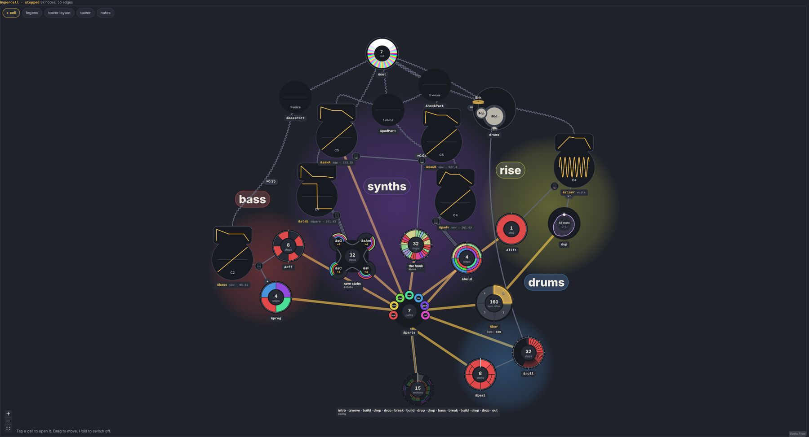
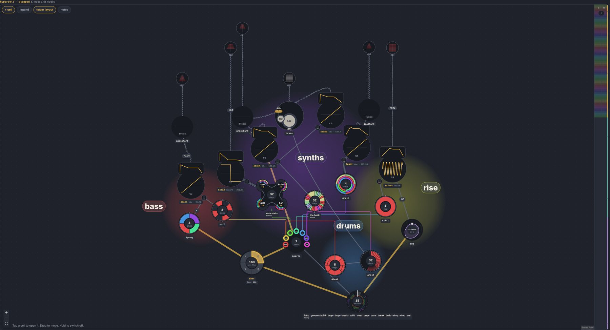

## The grooves with their kit (2026-10-13)

Asked (on a picture of Hypercell): `&beat` and `&roll` sit with the kit, not below the loom.

- A stepped cell that reads a kit (a groove, a pattern over a written kit) is a **player** (`towerLayers`): a row half a layer's gap under the voices, over the structure, held there with the kits and the sockets. Drawn by the spring alone they stayed down: the bar's steps, the selector's taps and their tag's cluster pull them there.

| layout | crossings before | after |
|---|---|---|
| tower, loom (default) | 53.3 | 52.3 |
| tower, taps as traces | 39.7 | 41.7 |

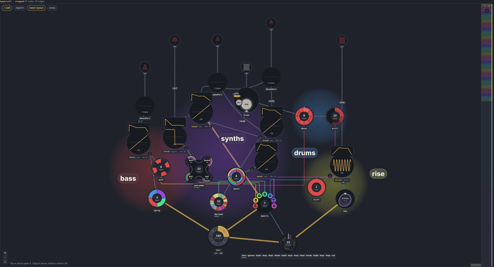

## Strict strata, the loom a level (2026-10-13)

Asked: the layers as strict boundaries, audible · voice · gate · stepped structure · constant structure; no node pulled out of its stratum; a selector's loom an implicit level, what its output steps never below it.

- `towerLayers` gives each node its **stratum** and the stratum's band (`strata`, the graph's y), its edges halfway between the rows. The strata: `audible` (the sockets), `voice` (voices, mixes, kits, tapes, resonators; a braid stepped at an audio rate, a wave, at its own height), `gate` (a gate, a groove: what plays voices or a kit), `stepped`, `constant` (tables nothing steps).
- `physics.ts: strata` (the last force): where a tick would carry a node past its stratum's edge, its velocity stops it there. With the loom on, what a selector's taps step is lifted over its top lane; one held, or at its stratum's top, takes the selector down instead.

| layout | crossings | area Mpx² | out of its stratum | under its loom |
|---|---|---|---|---|
| strata not strict (before) | 52.3 | 97.3 | 292 | 31.7 |
| **strict (default)** | **54.7** | 103.7 | **0** | **0** |
| strict, taps as traces (no loom level) | 51.3 | 103.7 | 0 | — |

(The library's sums, 76 pieces, the mean of three seeds; "out of its stratum" counts nodes, "under its loom" cells a selector steps.)

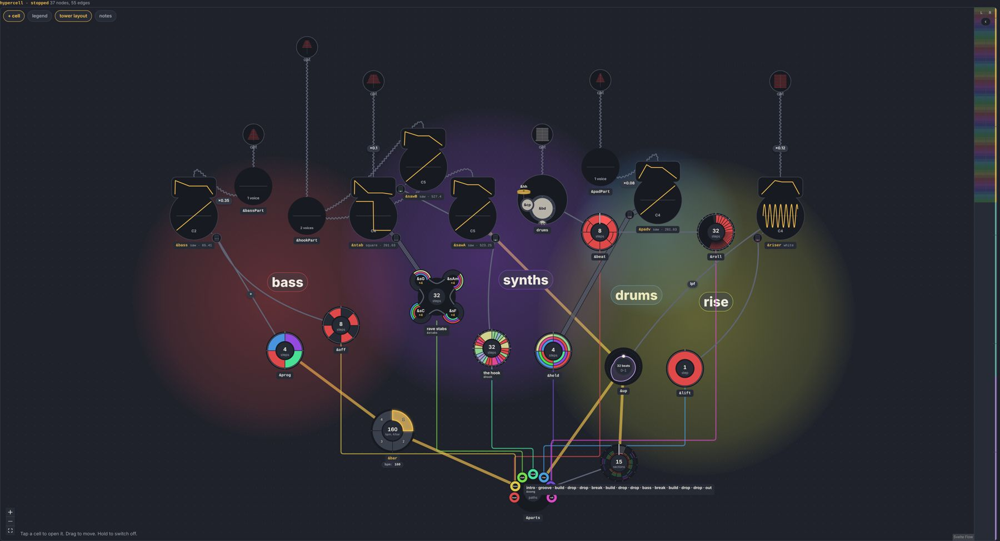
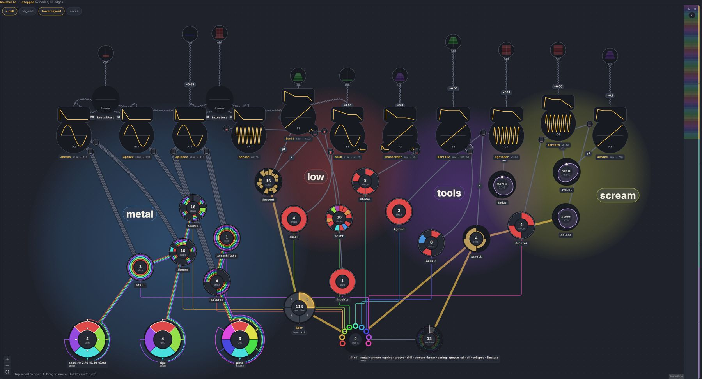

## Mixers, loom rides, a clear loom, flat nets (2026-10-13)

Asked (on pictures of Hypercell and Baustelle), four changes:

1. **A mixer stratum** between the voices and the audible: a mix sits a layer over the voices, held, its x the mean of its sources' (`towerLayers`: `mixer`, `between`; physics: `above`). The audible's floor goes a layer over the mixers.
2. **A net rides the loom that carries it.** A reader of a bus or a meter over a selector's loom, when the selector reads that net too, takes it off the loom's source lane (`loomRide` .2: that much cheaper than a straight join), and a join through such a loom costs ten times over (`nets.ts: netTree`, `throughLoom`). A meter's ride is drawn as a strand, its riser with it; its straight trace is gone (`physics.ts: tapLooms`, the traces filtered in `placed` and `graphLayout`). In Baustelle `&accent` and `&slide` take `&bar` off `&teile`'s loom; `&bar`, `&tag` and `&teile` lie in a row under it.
3. **A loom is an exclusion zone** (`loomClear`): its band, from its top lane to its table's top over its span, is kept clear; a node standing in it goes out the nearer way its stratum allows (up, down, or aside when it is held).
4. **Forces:** contraction .75 → .4 (`contract`); a net's join between two readers, a bus's or a meter's, lies flat (`flatNets` .1); other edges lean upright a little (`upright` .01; .05 was worse).

| layout | crossings | area Mpx² |
|---|---|---|
| all four off | 59.3 | 103.4 |
| **all four (default)** | **53.3** | 106.1 |
| … without the mixer stratum | 58.0 | 106.7 |
| … without the loom kept clear | 51.7 | 106.4 |
| … the loom ride as a straight join | 51.0 | 106.3 |
| … without flat nets | 49.7 | 106.4 |
| … contraction .75 | 53.3 | 102.0 |

Out of their strata and under their looms: none, in every row. The flat nets cost 3.6 crossings for the rows they lay; the clear loom and the ride are within the seeds' noise (±2).

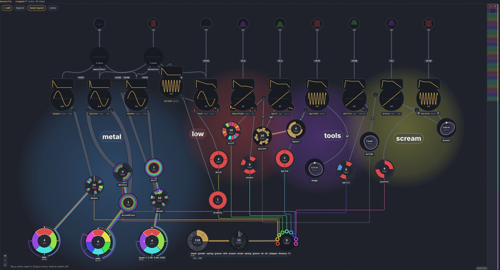
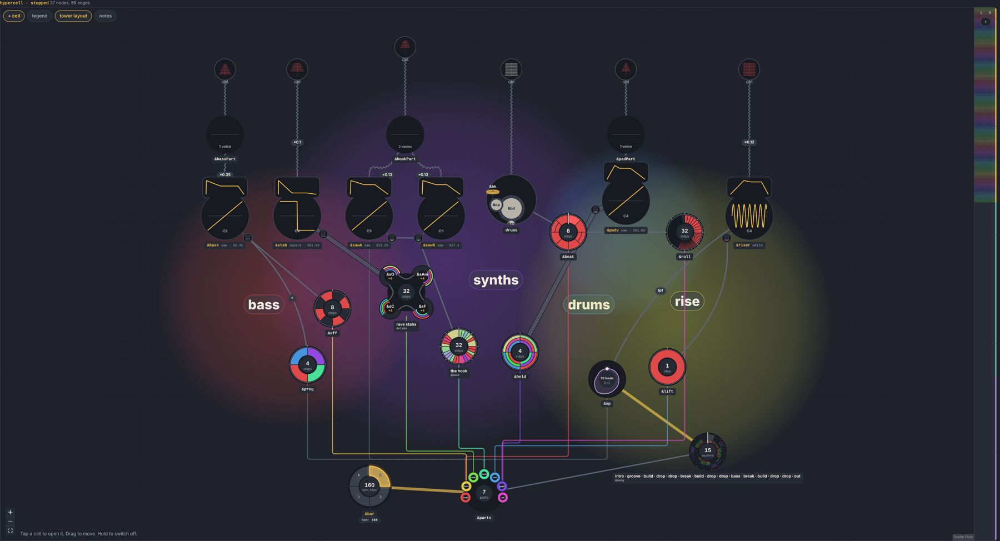

## Next

1. The tower layout still crosses about three times today's (91 against 33, the card left out of both), most in the pieces arranged with selectors, tapes and resonators (#234's language side: a selector that sends gates).
2. A net's crossings with edges: the layout could pull a net's sources toward the strip (the nearer, the shorter its trunk), measured as `over an edge`.
3. Meters placed last on their row without overlapping (room made sideways), then measured again: today's forces with them crossed 77.
4. A mix's own height (centre vs top), and the tower's axis against the strips: one of them, once the layout is chosen.
