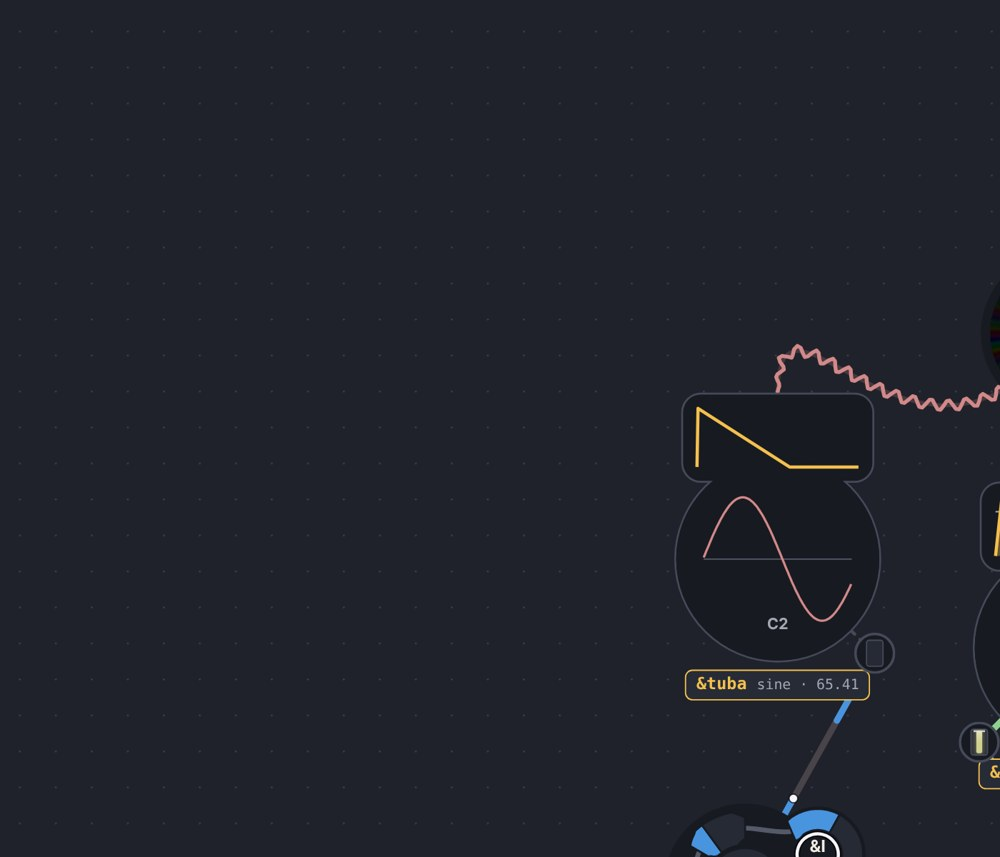
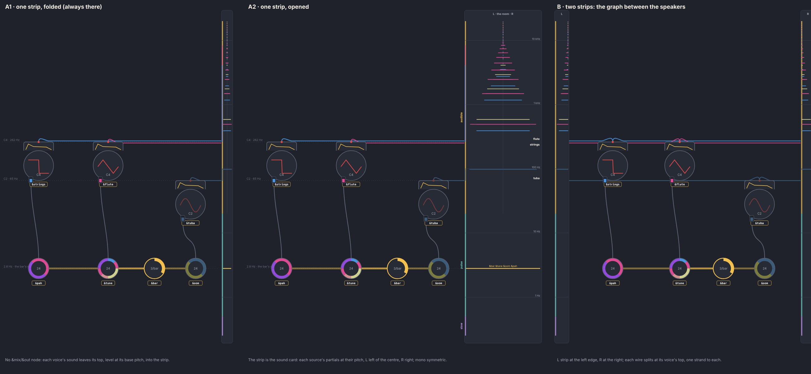
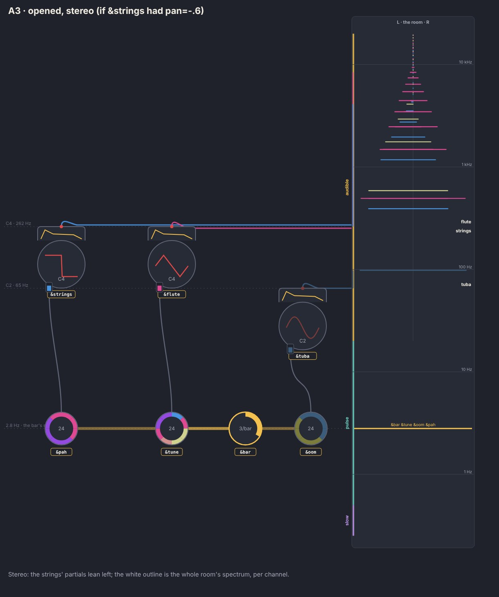
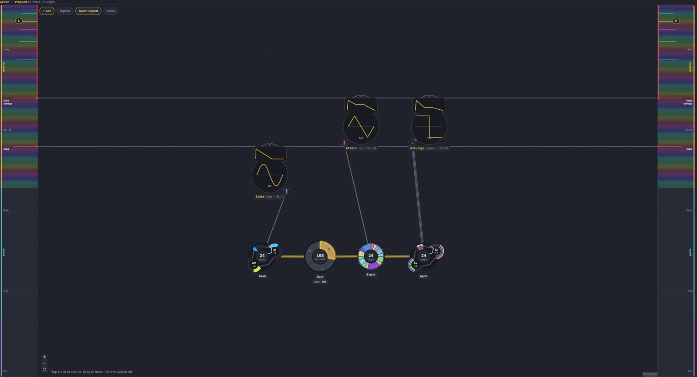
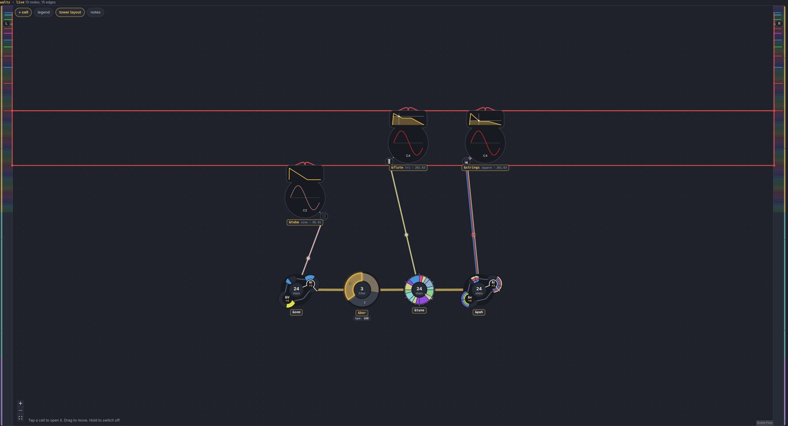
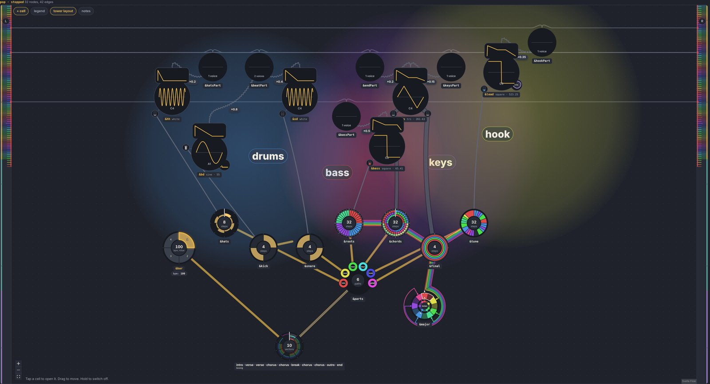
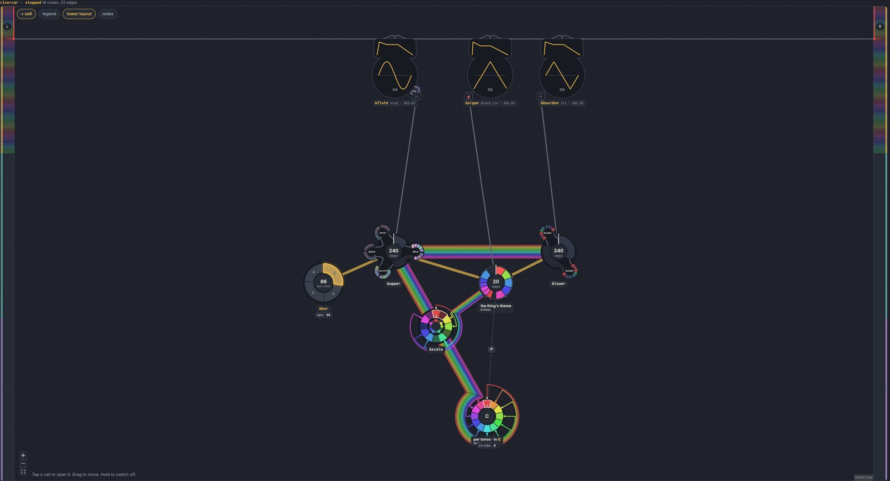

# The tower strip: the sound card as the tower, the graph laid by it

Date: 2026-10-11 · Status: open (built as a layout of its own, off by default) · Issue: [#234](https://github.com/yggi/cell-studio/issues/234) (the multiscale epic) · Follows [tower-rows.md](tower-rows.md) and [outputs-top.md](outputs-top.md)

## The ask, read back

Subject: the Viennese waltz (`examples/waltz.cells`).

1. **The tower is always there**, as a strip at the side of the graph, and opens wider on demand (today it is the *tower* button's axis, [graph.md](../ui/graph.md)).
2. **No sound card node** (`&out`, or the sink mix: the waltz's `&mix`). The strip is the sound card.
3. **Each sound output leaves the top of its source and goes into the strip.** The strip's connector shows that source's spectrum (its partials, up high, down low); all of them together are the piece's spectrum. Stereo: left and right apart; mono: symmetric.
4. **A node that sends sound out has a fixed height: its base frequency** (`loop=C4` → 262 Hz on the tower's log axis). **`&bar` and every other stepped cell is fixed at its tower height too** (its step: the waltz's bar and its three melodies at 2.8 Hz). Only x is left to the layout.
5. A **parallel layout** (beside today's, switched by an option, as `?rows=tower` is), since it moves every metric.

## Mock-ups

Drawn from the waltz's real tower heights (`towerSpans`: the bar and its melodies at 2.8 Hz, the tuba at 65 Hz, the flute and the strings at 262 Hz), by hand-placed x, at one moment (beat 1: the flute on B4, the tuba on G2, the strings' chord G B D). `tools/mockups/tower-strip.py` makes them (an HTML page; screenshot it in Chromium).

Today:

The options:

- **A1, one strip, folded** (always there, 44 px): each voice's wire leaves its top (its socket sits exactly at its base frequency), runs level into the strip, and the strip shows every source's partials in its colour, mirrored about the centre line.
- **A2, the same strip opened**: the axis (decades, zones), the sources named at their base, the stepped cells as a mark at their row.
- **B, two strips, the graph between the speakers**: L at the left edge, R at the right; every wire splits at its voice's top, a strand each way. Reads stereo at a glance, but every sound wire crosses the whole graph twice.

Stereo in A (if the strings had `pan=-.6`):

## Seen in the mock-ups

- **Rows are the tower.** The waltz falls into three rows: the pulse (bar, tune, oom, pah), C2 (tuba), C4 (flute, strings). Height in the graph now means time; the dotted guides are the rows.
- **Voices at one pitch share a row**: the strings' wire runs through the flute's socket. Drawn here as one bus of two strands from there on; in general the voice nearest the strip should sit on the strip's side, or the wires take lanes.
- **A voice's actual notes live above its base**: the flute is fixed at C4 but plays B4; its partials enter the strip above where its wire does. The connector (the coloured bracket on the strip's edge) spans the source's range.
- **The pulse row is crowded**: four wheels at one height, the meter's net a straight trace along it. Pieces with many melodies at one rate will make wide rows (the tower-rows probe's main cost).
- **Wires to the strip cross the graph** at their pitch's height: a low voice far from the strip passes under the higher ones. The layout's x should pull sound sources toward the strip, lowest first.

## Chosen (the owner, 2026-10-11)

1. **B**: two strips, the left channel at the graph's left edge, the right at its right.
2. **An even scale** on the strip (a rainbow: a band a semitone, in its note's colour), the same as the graph's.
3. **A voice's top** sits at its base frequency (its wire runs level).
4. A mix that isn't the card keeps its node and sends its own wire into the strips.
5. Cells with no height: wherever the layout puts them, **minimal forces**, heights fixed; a separate graph layout, `tower`.

## Built

- `layout/towerlayout.ts`: `towerHeights` (each node's y held: a voice's top at `towerY(log10 f0)`, a stepped cell's centre at its step, `TOWER_PX` = 360 px a decade), `withoutCard` (the graph drawn without the sound card's node and its edges), `towerOuts` / `towerIns` (what went into the card, and where its wire leaves).
- `LayoutOptions.heights` (`physics.ts: hold`): each named node ends every tick at its height (d3's `fy`), dragged too; `TOWER_LAYOUT` the few forces left (no rows, columns, spread, kinds, tags; one row order; meters not placed last).
- `GraphLayout.mode` (`'flow' | 'tower'`, `setMode` lays the piece out afresh); the toolbar's *tower layout*, `?layout=tower` (`?strips`: opened); the gallery: `LAYOUT=tower STRIPS=1 node tools/gallery.mjs golden 3 waltz`.
- `TowerStrips.svelte` (the strips: a canvas each, the rainbow, the zones, the spectra per band, the connectors), `TowerWires.svelte` (the wires, behind the cells, in the graph's coordinates).
- `towerlayout.test.ts`: the waltz's heights, no card, a two-channel card split left and right, heights held through the forces and a drag.

### Seen (the real Graph, the gallery's made-up sound)

The waltz, stopped with the strips open, and live with them folded:

*Pop* and the *Ricercar*, stopped:

- The rows fall out of the tower by themselves: the beat (the bar and what it steps), the voices at their pitch, the form and the constant tables (free) lower down. Pop's drums nest by rate (the bar, the kick and snare, the hats); the Ricercar's tables sink under the voices.
- **Wires run level over what is in their way**: the tuba's crosses under the flute and the strings, Pop's mixes' wires over its voices' caps. A force that keeps a held cell off another's wire row (sideways), or wires taking lanes round a cell, is the next step.
- The colours of live wires and the live spectra in these pictures are the gallery's made-up sound (every voice on C4); the app's are the piece's.
- Not measured yet: crossings and the rest of the quality numbers in the tower layout against the signal path's (the probe skill's pattern; the layout's own metrics will move: a crossing with a wire into the strips isn't counted, the card's edges are gone).

## Next

1. Measure the tower layout over the library (crossings, wires over cells), against the signal path's.
2. Wires and held cells: keep cells off the wires' rows, or route wires round them.
3. A mix's own height: today a mix sits a hair above the highest sound it carries (`towerOf`), its centre there, so its wire leaves its top just above; whether a mix should sit where its own output is read (its top) as a voice does.
4. The tower's axis (the signal path's layout's *tower* button) and the strips: one of them, once the layout is chosen.
